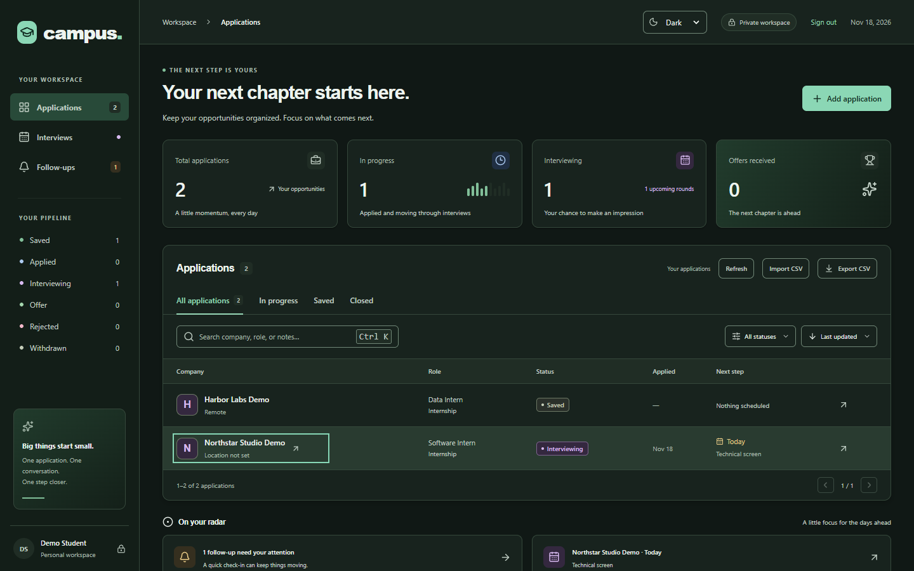

# Campus Internship Tracker

Keep track of where you applied, which interview comes next, and who needs a follow-up. Each account has its own applications, notes, and dates.

[Try it locally](#try-it-locally) · [Follow the demo walkthrough](docs/DEMO.md) · [Explore the code](docs/CODE_GUIDE.md)



## What you can do

- Search your **applications** by company or filter by status to see where you stand.
- Schedule **interviews** and mark each round complete as you go.
- See which **follow-ups** are due and check them off after you reach out.
- Bring in a **spreadsheet** with CSV import. Preview additions and updates before saving, or export your list back to CSV.

## Try it locally

The local demo lets you create your own account and explore sample applications. Hosted staging is for existing accounts and can take a moment to wake up. [Staging sign-in](https://campus-internship-tracker-staging.onrender.com)

For a fresh checkout, install Docker with Docker Compose and open the repository root. If you're reusing a PostgreSQL volume from an older version, follow the [database upgrade guide](docs/DATABASE-SECURITY.md) first.

1. Copy [.env.example](.env.example) to `.env`. Replace the four database password placeholders with four different passwords.
2. Start the tracker, PostgreSQL, and the local email inbox.

   ```sh
   docker compose up --build
   ```

3. Open the [local tracker](http://127.0.0.1:8080), choose **Create an account**, and leave the sample applications selected. You can use an address such as `student@example.test`.
4. Open the verification email in the [local inbox](http://127.0.0.1:8025). Follow the link, confirm with your signup password, and sign in.

To stop the demo, press **Ctrl+C**. Your applications stay in the Docker volume for the next run.

On Windows, you can also run the demo without Docker. The [Windows demo walkthrough](docs/DEMO.md) includes the build commands, a local inbox, and a sample CSV to import.

## Develop the tracker

React and TypeScript power the interface. A Java 17 Spring Boot backend serves the API and stores each account's data in H2 locally or PostgreSQL with Docker. The bundled app serves the interface and API from the same address.

<details>
<summary>Run the frontend and backend during development</summary>

Install Node.js 22.18 or later and JDK 17 or later. To register a new account, start an SMTP capture server on `127.0.0.1:1025` so you can read its verification email.

In one terminal, run the following from the repository root.

```sh
npm ci
npm run dev
```

In a second terminal, open `backend/`. Set `PUBLIC_ORIGIN` to the exact address Vite printed. For example, if Vite printed `http://127.0.0.1:5173`, use the command for your shell.

**Windows PowerShell**

```powershell
$env:PUBLIC_ORIGIN = 'http://127.0.0.1:5173'
.\mvnw.cmd spring-boot:run
```

**macOS or Linux**

```sh
PUBLIC_ORIGIN=http://127.0.0.1:5173 sh ./mvnw spring-boot:run
```

Open the Vite address in your browser. Vite forwards API requests to Spring Boot on port 8080.

</details>

| When you want to… | Read |
| --- | --- |
| Trace a request or see how the data is stored | [Code guide](docs/CODE_GUIDE.md) · [API reference](docs/API.md) |
| Build the bundled app or run the tests | [CI and local commands](docs/CI.md) · [Recorded test results](VALIDATION.md) |
| Configure PostgreSQL or upgrade an existing database | [Database setup and upgrades](docs/DATABASE-SECURITY.md) |
| Configure sign-in or password recovery | [Authentication controls](docs/AUTHENTICATION-SECURITY.md) · [Password recovery runbook](docs/PASSWORD-RESET.md) |
