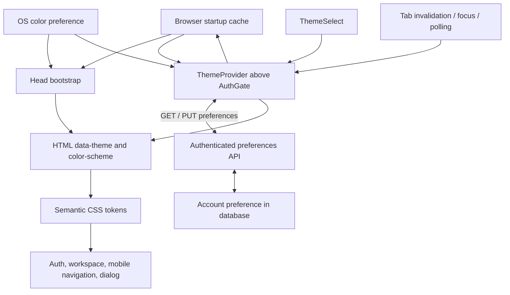

# Dark mode architecture

Status: Proposed design; implementation is outside this request.

## Intent and scope

Add a consistent dark appearance to Campus Internship Tracker while preserving its green identity, readable application statuses, and existing workflows. Cover session loading, login, registration, all workspace views, mobile navigation, application details/editing, confirmations, errors, and feedback.

User requirement: synchronize the preference through the user's account across devices. Offer Light, Dark, and System; default to System. Success means the account preference persists across sessions/devices and changes without losing filters, dialog drafts, focus, or session state. A local cache provides immediate startup appearance; a fresh server value can legitimately change it after authentication.

## Existing architecture

- `src/main.tsx` mounts `AuthGate` inside React StrictMode and imports `src/styles.css`.
- `AuthGate.tsx` owns session loading, authentication, and the signed-in `App`. `App` is keyed by user ID.
- `src/styles.css` mixes layout with many literal colors. Its existing `--green`, `--muted`, `--line`, `--ink`, and `--surface` variables cover only part of the UI. Responsive rules also contain literal colors.
- `Shared.tsx` renders status and company tone classes. `ApplicationDrawer.tsx` uses a native modal dialog.
- `index.html` contains a fixed browser theme-color value. The Spring backend serves application data and authentication; it does not need to resolve browser appearance.
- Current frontend tests use Node's test runner; there is no browser/component test setup in `package.json`.

## Options and decision

| Approach | Benefits | Costs / limitations |
| --- | --- | --- |
| Semantic CSS tokens + root theme provider + browser preference | Covers signed-out screens, instant switching, small dependency-free runtime, no API changes | Does not satisfy cross-device synchronization |
| CSS media query only | Minimal runtime code, automatically follows OS | No independent saved Light/Dark override |
| Semantic CSS tokens + account-backed preference (selected) | Follows a user across devices; supports explicit override and OS default | Requires API/schema changes and rules for anonymous startup, login reconciliation, failures, and account switching |

Choose account persistence with a browser startup cache. The database is authoritative for signed-in users. Signed-out selection remains a separate browser preference and never silently overwrites a user's account setting. System synchronizes the choice to follow the OS, so two devices can correctly resolve to different appearances.

## Components and contracts

| Proposed unit | Responsibility and boundary |
| --- | --- |
| `public/theme-init.js` | Small synchronous head script; validates stored preference, resolves OS appearance, and sets initial root attributes before app rendering. Plain JavaScript with no React dependency. |
| `src/theme/theme.ts` | Types and pure preference validation/resolution; guarded browser cache operations. |
| `src/theme/ThemeProvider.tsx` | Single runtime owner of preference, save state, OS subscription, account reconciliation, refresh subscriptions, and document updates. Exposes `useTheme()` and internal session-binding methods. |
| `src/data/preferencesApi.ts` | Typed GET/PUT account-preference requests through the existing CSRF/session-aware `request` helper. |
| `src/components/ThemeSelect.tsx` | Reusable labeled native select with System, Light, Dark choices. Reads/writes provider state, never storage directly. |
| `src/theme/tokens.css` | Complete light and dark semantic token maps and native `color-scheme` rules. |
| `src/styles.css` | Existing layout and selectors consume semantic tokens. No component-specific JavaScript color branching. |

Public React contract:

```ts
type ThemePreference = 'system' | 'light' | 'dark';
type ResolvedTheme = 'light' | 'dark';
type ThemeContextValue = {
  preference: ThemePreference;
  resolvedTheme: ResolvedTheme;
  syncState: 'local' | 'loading' | 'synced' | 'saving' | 'error';
  syncError: string | null;
  setPreference: (preference: ThemePreference) => void;
  retrySync: () => void;
};
```

Mount `ThemeProvider` inside StrictMode and above `AuthGate`. `AuthGate` binds the authenticated user ID after session lookup/login and clears that binding after confirmed logout or session expiration. Binding starts an account preference fetch; it does not trust cached identity. Do not key any application subtree by theme. Components need `useTheme` only if they expose the control; ordinary UI follows CSS inheritance.



## State and lifecycle rules

1. Accept only `light`, `dark`, or `system`. Keep `campus.theme.anonymous.v1` for signed-out choice and `campus.theme.bootstrap.v1` for the last displayed preference (no identity or credentials). Missing/invalid cache values mean System. Store preference, never resolved OS color.
2. Resolve explicit Light/Dark directly. Resolve System using `matchMedia('(prefers-color-scheme: dark)')`; if unavailable, choose Light.
3. Bootstrap sets `data-theme="light|dark"` and `data-theme-preference="system|light|dark"` on `<html>`. CSS sets the corresponding `color-scheme`; both bootstrap and runtime update the existing theme-color meta element using the same surface values.
4. Initialize from bootstrap cache, then reconcile with the server after authenticated identity is known. Disable account preference editing while the initial GET is unresolved; other workspace actions remain usable. On initial GET failure retain the provisional appearance, show a small retry action, and keep account editing disabled until loaded. The tiny bootstrap/provider resolver duplication must have parity tests.
5. Signed-out selection updates local state and anonymous/bootstrap caches only. Signed-in selection applies optimistically and sends a PUT. Disable the select during the write, display Saving, then mark Synced and update the cache on success. On failure retain the selected appearance for this session, show 'Appearance changed here; account sync failed' with Retry, and do not claim cross-device persistence. Do not automatically replay failed writes. Storage exceptions never block server synchronization.
6. OS change events update the resolved theme only while the preference is System. Explicit modes ignore OS changes. Re-selecting System resolves against the current OS setting immediately.
7. After a successful account write, publish a non-sensitive localStorage invalidation signal. Other authenticated tabs refetch from the server rather than treating cache events as authoritative values. Signed-out tabs follow only the anonymous key; removal/invalid values/clear mean System. Bootstrap-cache changes never override an authenticated account value.
8. Refetch on window focus, visibility becoming visible, and every 60 seconds while visible and authenticated. Coalesce overlapping refreshes. Skip background refresh while a write or unsynced local choice is pending. Thus other devices converge within 60 seconds while visible, or on their next focus/login; real-time push is outside scope. Background refresh failure retains the current appearance and retries on the next normal trigger.
9. Tag asynchronous work with an account-session generation and request sequence. Ignore results from old accounts/sessions and GETs started before a newer local write. Clean up polling, media-query, focus, visibility, and storage listeners. StrictMode remounts must not duplicate them.
10. Confirmed logout/session expiration invalidates pending work, restores the anonymous preference, and replaces the bootstrap cache. Login always reads the target account preference; it never uploads the anonymous choice. New accounts start at System. A fresh browser uses System until account data arrives; cached startup cannot guarantee the remote value before a network response.

## Backend persistence and API

Add `V2__user_theme_preference.sql`; do not alter the applied V1 migration. Add `campus_users.theme_preference VARCHAR(6) NOT NULL DEFAULT 'system'` with a check constraint allowing `system`, `light`, and `dark`. Map it in `CampusUser` with a System initialization for new entities. Validate the migration on both H2 and PostgreSQL.

Add a focused `UserPreferencesController` and `UserPreferencesService` under the account/auth area, reusing `UserRepository`. Use authenticated `CampusPrincipal.id()` for all lookups; accept no user ID in the request. Read the persisted preference on every GET, rather than storing a stale preference in the session principal.

| Endpoint | Contract |
| --- | --- |
| `GET /api/me/preferences` | 200: `{ "themePreference": "system" }`; authenticated and not cached |
| `PUT /api/me/preferences` | Body `{ "themePreference": "dark" }`; validate required exact enum value; 200 returns committed preference |

Existing `/api/**` authentication and CSRF rules cover these routes. Missing session returns 401, invalid/missing CSRF returns 403, invalid preference returns 400. Use existing API error formatting. No changes to login, registration, `/auth/me`, or the `UserView` response are needed: a dedicated fetch keeps preferences fresh independently of session identity. Extend `docs/API.md` during implementation.

Use a transactional update limited to the theme column; do not save a stale whole-account snapshot. Concurrent writes use last database write wins, which is acceptable for appearance. Do not add application-style optimistic locking for this single setting. The PUT response reports that write, and later refreshes converge on the database value. Never let late responses from a previous account affect a new one.

## Startup and delivery

Place `<script src="/theme-init.js"></script>` in the document head before the application module and stylesheet references emitted by the build. It is deliberately a small classic blocking script, not async/defer: theme resolution must precede initial painting. Vite copies the public asset into the built site, which must also be verified in the packaged Java application.

Light tokens are the baseline. A CSS System fallback applies dark tokens under the OS dark media query only when `data-theme` is absent; explicit root attributes always win. If bootstrap fails to load, this fallback gives an appropriate default until the provider reconciles the saved preference. Avoid hiding the entire page to handle startup. Verify the generated HTML ordering and throttled first paint in the production build.

## Styling strategy

Use semantic roles, not raw palette names, as component dependencies:

- Surfaces: `--bg-page`, `--bg-sidebar`, `--bg-surface`, `--bg-subtle`, `--bg-hover`, `--bg-selected`.
- Content/boundaries: `--text-primary`, `--text-secondary`, `--text-muted`, `--border-subtle`, `--border-control`, `--focus-ring`.
- Actions: `--action-bg`, `--action-hover`, `--action-text`, `--link-text`.
- Feedback: dedicated foreground/background/border triples for error, warning, success, and each application status (including Saved).
- Decoration: company tone pairs, chart bars, auth/offer/note gradient stops, shadows, and overlay/backdrop colors.

Suggested dark starting colors are page `#101815`, surface `#18231e`, primary text `#edf4ef`, and secondary text `#b7c7bd`. These are palette candidates, not a claim that every combination is validated. Keep action foreground/background pairs separate from accent text so a lighter green accent does not force white text onto a pale button.

Replace existing literal colors by role, including late responsive overrides, gradients, hover/focus states, placeholders, selection, native form controls, disabled styling, and `dialog::backdrop`. Set dialog foreground/background explicitly because native dialog defaults can otherwise remain light. Assign backdrop tokens on the pseudo-element explicitly if needed; do not rely on pseudo-element inheritance. Preserve status labels and stable company tone assignments while adapting their colors.

Retain the reduced-motion rule. Do not add a whole-page color animation or force browser high-contrast colors off. Target at least 4.5:1 normal text contrast, 3:1 large text, and 3:1 meaningful control boundaries/focus indicators; measure actual rendered pairs before accepting palettes.

## User control

Render `ThemeSelect` in the workspace top bar and in a shared signed-out shell covering loading/login/registration. Use a visible Appearance label (or an associated accessible label in constrained layouts) and readable System, Light, Dark option text. Keep the selection available at mobile widths even where date/privacy labels disappear. Give non-submitting controls appropriate semantics inside forms.

The control changes appearance immediately and, when signed in, saves it to the account without navigation or a reset of application state. System remains the displayed choice when the resolved appearance is Dark. Announce sync failures accessibly beside the control and offer Retry; keep these separate from application-save errors. While initial session identity is unknown, keep the control disabled to avoid applying a signed-out choice to an unresolved account.

## Verification and acceptance

- Unit tests: all preference/OS combinations; missing and corrupt cache; storage exceptions; absent media-query support; bootstrap/provider resolution parity; preference API serialization and errors.
- Lifecycle tests: OS changes in System versus explicit modes, tab invalidation, visible polling/focus refresh, sync failure/retry, initial-fetch failure, stale responses after writes/account switches, and cleanup across StrictMode remounts. Add a focused DOM-capable test setup if needed; existing API tests alone cannot verify these behaviors.
- Browser verification: a cold load with a cached Dark preference on a Light OS has no light flash; repeat in built Vite output and the Java-served bundle. Test a stale cache reconciling with a remote change, fresh-browser login, logout, multiple accounts, two devices, a second tab, and storage-disabled behavior. Verify two devices using System may resolve differently.
- Visual/interaction matrix: Light/Dark at desktop/mobile sizes across auth, loading, empty/populated/error workspace states, every status badge, follow-ups/interviews, open drawer editing, and delete confirmation. Verify focus, contrast, date/select controls, backdrop, and forced-colors/reduced-motion behavior.
- Backend tests: authenticated read/write, user isolation, invalid values, missing session, CSRF enforcement, existing/new-account defaults, persistence after a new login, and concurrent theme writes. Verify H2/PostgreSQL migration behavior.
- Regression: switching appearance preserves an unsaved drawer draft, current filters, pagination, and focus. Run existing `npm test`, `npm run build`, and backend integration tests after implementation.

## Delivery sequence and scope boundary

1. Inventory color roles and migrate existing light styling to tokens, checking for unintended appearance changes.
2. Add the dark token map and audit all states and responsive overrides.
3. Add the migration, preference service/endpoints, and API tests.
4. Add bootstrap, provider, session binding, account synchronization, and both control placements.
5. Verify startup, multi-device convergence, lifecycle, accessibility, and existing workflows in development and packaged delivery.
6. Document account synchronization and the signed-out browser preference; update the planned-feature list only when implementation is complete.

No new production library or application-record change is required. Backend work is limited to one account column and authenticated preference read/write operations. Real-time push, custom themes, and importing anonymous preferences into accounts are outside scope.
