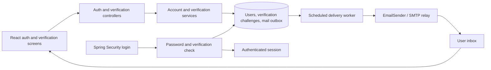

# Email verification architecture

Date: 2026-09-24
Updated: 2026-09-25
Status: implemented; validation results are recorded in `VALIDATION.md`.

## Purpose and scope

Prove ownership of the account email before allowing newly created accounts to access the internship tracker. The user explicitly confirmed that verification is required only for new accounts; existing accounts retain access without verification. Keep React, Spring Boot, server-side sessions, CSRF protection, and the existing H2/PostgreSQL persistence model.

Success means a new, unverified account cannot obtain an authenticated application session; existing accounts can continue signing in without verification; a valid confirmation activates exactly one account; delivery can recover after a process restart; and existing application data remains intact.

Password reset, changing account email, social login, MFA, and university-domain restrictions are outside this change. Verification proves mailbox access, not student status or legal identity.

## Verified starting point

- `AccountService.register` creates a user and optional sample applications transactionally. It normalizes email with trim and lowercase and rejects duplicate accounts.
- `authApi.register` in `src/data/api.ts` immediately calls login after registration. `AuthGate` assumes registration returns a signed-in user.
- `CampusPrincipal.isEnabled()` always returns true. There is no email verification state.
- Spring Security handles form login, sessions, logout, and session-backed CSRF. Public write endpoints still require CSRF.
- There is no mail dependency or delivery worker in `backend/pom.xml`.
- Flyway migrations currently end at V2. Production disables registration by default.
- Documentation discrepancy: `docs/API.md` describes a 10-character password minimum, but `PasswordPolicy` enforces 12 characters and complexity. Preserve the implementation; correct the API documentation when updating the contract.

## Approaches and recommendation

| Approach | Benefit | Cost |
| --- | --- | --- |
| Existing app with database tokens and transactional email outbox — recommended | Preserves authentication; durable delivery intent; no separate queue service | Adds worker leasing, retry state, and encrypted delivery payloads |
| Existing app with synchronous email sending after commit | Smallest initial implementation | Signup can commit before sending fails; recovery depends on user resend; requests wait on mail |
| External identity provider | Moves identity workflows to a dedicated service | Replaces substantial session and account integration; introduces an additional operational dependency |

Use the existing application and database. Run a scheduled mail worker in the Spring Boot process. A transport interface isolates the chosen SMTP relay from the verification domain. Provider procurement is not required to settle this architecture.

## Component boundaries

- `AccountService`: validates registration, creates the pending user and requested sample data, and requests the initial challenge in one transaction.
- `EmailVerificationService`: issues challenges, enforces resend policy, confirms ownership, and invalidates outstanding challenges. It depends on repositories, `PasswordEncoder`, a cryptographic token generator, and an injected `Clock`.
- `EmailVerificationController`: validates allowlisted DTOs and maps domain outcomes into explicit responses. Clients never supply an owner ID or verification timestamp.
- `VerificationTokenRepository`: stores hashes and challenge lifecycle state; supports transactional locking and atomic consumption.
- `EmailOutboxWorker`: claims committed jobs, delivers outside database transactions, retries transient failures, and records outcomes.
- `EmailSender`: sends a templated message through SMTP. Use a local capture SMTP server in development and an in-memory fake in tests; do not print live tokens to application logs.
- Spring Security authentication provider: verifies the password and checks persisted verification or the existing-account exemption before producing a successful authentication result.

## Data model

Add a new versioned Flyway migration; do not edit V1 or V2. Use UUIDs and microsecond UTC timestamps consistent with existing tables.

| Storage | Fields and constraints |
| --- | --- |
| `campus_users` | Add nullable `email_verified_at` and non-null `email_verification_exempt` with default `false`; backfill the exemption to `true` only for accounts present at migration |
| `email_verification_tokens` | `id`, `user_id` FK, immutable normalized `email`, unique `token_hash` (SHA-256 hex), `created_at`, `expires_at`, nullable `consumed_at`, nullable `revoked_at` |
| `email_outbox` | `id`, `verification_token_id` FK, encrypted recipient/template/token payload, encryption key ID and nonce, `status`, `attempts`, `next_attempt_at`, lease owner and expiry, `created_at`, nullable `sent_at`, sanitized failure category |
| `auth_rate_limits` | Unique scope/key/window bucket with atomic attempt counter and expiry; hash identifiers with a server-held keyed hash rather than storing arbitrary submitted emails |

An account is pending only when `email_verified_at IS NULL AND email_verification_exempt = false`. A successful password check permits login when the timestamp is present or the exemption is true. The exemption is server-owned and cannot be set through registration or any public DTO; new accounts always receive `false`. Exemption grants access without asserting mailbox ownership.

Index verification rows by user and expiry; index outbox rows by status/next attempt and lease expiry. Token validity requires a pending account, matching account email, null consumption/revocation timestamps, and `expires_at > now`.

Generate tokens from 32 cryptographically random bytes and encode as unpadded base64url. Verification lookup uses only SHA-256 hashes. The outbox necessarily needs the recoverable token for delivery: encrypt that payload with authenticated encryption and a key held outside the database and repository. Never describe this as a database containing only irreversible hashes. Erase the payload after successful delivery, cancellation, expiry, or terminal failure; retain nonsecret job metadata for seven days.

Proposed token lifetime: 24 hours. Cleanup removes expired challenge material after a seven-day diagnostic retention window. Cleanup never deletes users or application records.

## Registration and confirmation flow

1. Browser obtains the existing CSRF token and submits the current registration fields.
2. In one transaction, the backend creates the unverified user, optional samples, token hash, and encrypted outbox job. Database failure rolls back all four. The response means the request was accepted, not that mail arrived.
3. React clears the password and shows “Check your email.” It does not call login, load applications, or bind an account's appearance preferences.
4. The worker sends a link of the form `https://<configured-origin>/#verify-email=<token>`. Using the root route avoids adding a deployment-specific SPA fallback route. The fragment is never sent in the HTTP request URL.
5. React detects the fragment before normal `AuthGate` rendering, copies the token into memory, and immediately removes the fragment with `history.replaceState`. Refreshing after removal requires reopening the email link. Do not store the token in localStorage or sessionStorage.
6. Show an explicit confirmation form requiring the password chosen at signup. Submit `{token, password}` with a fresh anonymous-session CSRF token. Opening a link or executing page initialization never confirms automatically.
7. The service checks the token and password, locks the account, rechecks token validity, marks the account verified, consumes the selected token, revokes its other tokens, and cancels unsent jobs in one transaction. All issuance/confirmation paths acquire locks in the same order: user before challenge.
8. Return success and show the normal login screen. The user signs in through the existing password/session flow, including the existing CSRF refresh after login.

Requiring the signup password at confirmation binds mailbox ownership to the registration the user initiated. A mailbox owner cannot accidentally activate an account created by someone else with an attacker-chosen password merely by clicking an unsolicited message. Wrong-password attempts do not consume the token. This adds one password entry and deliberately does not turn email verification into password recovery.

If the browser already has a signed-in account, confirmation must not replace that identity or its preferences. Show a success message and an explicit sign-out/sign-in path if the user wants to switch accounts.

## HTTP contract

All paths below are under `/api/auth`. Every POST remains CSRF-protected, uses same-origin cookies, and returns uncached responses.

| Endpoint | Request | Outcome |
| --- | --- | --- |
| `POST /register` | Existing registration DTO | `202 {status: "VERIFICATION_REQUEST_ACCEPTED", message: ...}` for a valid request, including duplicate email; no profile and no authentication |
| `POST /email-verification/resend` | `{email}` | Generic `202` for unknown, verified, exempt, pending, and recipient-throttled addresses; queue only eligible pending accounts |
| `POST /email-verification/confirm` | `{token, password}` | `200 {status: "EMAIL_VERIFIED"}` after commit; generic `400` with `VERIFICATION_INVALID` for expired, consumed, revoked, unknown tokens or incorrect password |
| `POST /login` | Existing form-encoded email/password | Verified or exempt + correct password: existing `200` profile; correct password + pending: `403` with `EMAIL_VERIFICATION_REQUIRED`; otherwise existing generic `401` |
| `GET /me` | Session | Existing authenticated profile; pending users have no application session; existing exempt accounts retain normal access |

Keep existing validation `400`, registration-disabled `403`, and infrastructure `503` distinct from accepted requests. IP/global throttling returns `429` with `Retry-After`; it must not depend on whether the submitted account exists. Retain human-readable `message` and add optional machine-readable `code` to `ApiError` so the UI does not parse prose or confuse verification failures with CSRF failures.

Duplicate signup never overwrites an existing password, display name, samples, or verification state, and does not send mail implicitly. The response offers a sign-in path and a separate resend action. Translate unique-email races to the same accepted response, outside the rolled-back creation transaction. Valid duplicate requests must still perform comparable password-hashing work to reduce obvious timing differences.

A lost confirmation response is recoverable by ordinary login: success may already have committed. Reusing a consumed token causes no additional mutation and returns the generic invalid response. The page should offer sign-in and resend options. Do not automatically replay writes.

## Authentication enforcement

Do not implement the requirement solely in React, a login success handler, or an informational profile flag. Reject pending accounts before the security context is saved or a success response is produced. Existing exempt accounts authenticate normally even with a null verification timestamp. No partially authenticated tracker session is issued.

The verification-required response is available only after a successful password comparison. Unknown users and wrong passwords use the same generic failure and comparable password-check work. Use an authentication-provider check after password validation; do not rely on an early disabled-account check to expose this state. Resolve the exact Spring Security API against the project's managed dependency before implementation.

Only CSRF retrieval, registration, login, resend, confirmation, and existing health endpoints are public as specified. All application and preference APIs remain authenticated and owner-scoped. Mail failure never bypasses verification.

## Resend, concurrency, and abuse controls

Proposed starting limits, configurable and subject to operational tuning:

- Share an initial-send/resend budget of one new message per address per 60 seconds, five per hour, and ten per day. Charge the reservation when the outbox job is created, not per worker attempt.
- Cap registration/resend at 30 requests per IP per hour, with a separate global mail budget of 1,000 jobs per day. Add a short burst cap of five requests per minute per IP.
- Limit login/confirmation failures to ten per minute per IP and ten per fifteen minutes per submitted account/token key. Use temporary throttling rather than permanently disabling accounts.
- Apply rate limits atomically in the database; expire old buckets. Derive client IP only from trusted proxy configuration.

Retain previously issued, unexpired links when resending. Otherwise an unauthenticated attacker could repeatedly invalidate a legitimate user's email. The rate limits bound active challenges. Successful confirmation revokes all other challenges, and user-row locking serializes concurrent confirmations and resends. Exactly one request performs activation.

The resend service returns the same outward result for suppressed and ineligible sends. It must not reveal whether an address exists through response fields or recipient-specific `Retry-After` values.

## Durable mail delivery

Poll every five seconds. Claim eligible jobs in a short transaction with an atomic lease; use a two-minute lease and transport timeouts comfortably below it. Only the lease holder can finalize a job. A crashed worker's lease expires so another worker can resume. Do not hold row locks across SMTP calls.

Before sending, cancel jobs for verified or exempt accounts, revoked/consumed tokens, or expired tokens. A race can still deliver a stale message after verification; the token endpoint remains authoritative and rejects it safely.

Retry transient failures after approximately one minute, five minutes, fifteen minutes, one hour, and four hours, with jitter. Stop after six total attempts or token expiry. Permanent recipient failures become terminal immediately. Mark provider acceptance as `SENT`; do not claim this proves inbox delivery.

Delivery is at least once. A crash after SMTP acceptance and before marking the job sent can cause duplicates; retries send the same token. Use a stable job/message identifier, and use provider idempotency if supported, without assuming SMTP deduplication.

Monitor queued-job age, terminal failures, send latency, verification completion, and throttling. Alert when the oldest eligible job exceeds five minutes or repeated provider failures occur. Logs contain job IDs and sanitized categories, never passwords, tokens, complete links, or unmasked recipient addresses.

## Configuration and deployment

Add validated configuration for trusted public origin, sender address, SMTP settings, token lifetime, outbox encryption keys, and rate limits. Construct links exclusively from the configured origin, never request Host or forwarded headers. Production requires HTTPS and must fail startup if mandatory verification delivery configuration is missing. Disable provider click tracking on verification messages and configure a verified sender domain and its mail authentication records.

Use no third-party analytics on the verification page, `Referrer-Policy: no-referrer`, and no-store responses. Keep existing secure-cookie and CSRF policies. Mail transport secrets and encryption keys belong in deployment secrets, not source control. Local development uses explicit capture-server settings; there is no implicit production verification bypass.

Confirmed existing-account rollout: exempt every account present when the new migration runs. Leave `email_verified_at = null`, set `email_verification_exempt = true` for those rows, and preserve account IDs, passwords, applications, and preferences. Do not invent a verification timestamp or send verification mail to existing accounts. Their next login works normally without a verification prompt.

Stop all old application instances before applying the migration so registration cannot race the exemption backfill. In that migration, add the exemption column with default `false` and backfill existing rows to `true`; retain default `false` for all future inserts. Start the updated application only after migration completes. This database boundary defines existing versus new accounts without a runtime creation-date comparison. New registrations must explicitly remain non-exempt. A normal restart may end in-memory sessions, but this feature requires no additional revocation of existing-account sessions.

Resend is a no-op with a generic accepted response for exempt accounts. Pending new accounts can still request resend while new registration is disabled. Changing an existing account's exemption policy later is outside this scope.

Accounts with an inaccessible mailbox or forgotten password need a separate recovery/support process; this feature does not safely solve those cases. Keeping the chosen password requirement means a mailbox owner also cannot reclaim an attacker-created pending account through resend alone. An email-first signup or dedicated verified recovery flow is the appropriate follow-up if self-service reclamation becomes a requirement.

## Frontend and backend change map

- `src/components/AuthGate.tsx`: separate login/register/check-email/confirmation/success states; require a successful ordinary login before rendering the tracker.
- New focused verification UI component and typed auth DTOs; keep network calls in `src/data` and extend the existing shared transport instead of bypassing it.
- `src/data/api.ts`: change registration's result type, remove its automatic login, add resend/confirm methods and optional error codes. Preserve account-switch guards and login CSRF rotation.
- `auth/AccountService`, `AuthController`, and `AuthDtos`: update the registration response and transactional challenge creation.
- New `auth/verification` domain classes, repositories, and controller; a separate `mail` package owns rendering, outbox delivery, and transport.
- `config/SecurityConfig` and principal/provider mapping: enforce verification for non-exempt accounts before successful authentication and allow only the two additional public POST routes.
- New Flyway migration, mail/configuration dependency changes, and API/code-guide updates. Preserve the actual 12-character password policy.

## Verification required when implemented

1. Registration produces a pending account, sample records, token hash, and outbox job atomically; no login session is issued.
2. Pending users cannot log in or access applications/preferences directly; wrong passwords do not disclose verification state.
3. Confirmation works in another browser with a new CSRF session and the signup password. Missing CSRF, malformed fields, unknown JSON properties, incorrect passwords, and token failures are rejected.
4. A valid token activates only its bound account/email. Concurrent confirms activate once; concurrent resend/confirm cannot leave a usable challenge after verification. Old links remain valid through resend until expiry or successful confirmation.
5. Tokens and credentials never appear in logs, plaintext outbox payloads, storage APIs, or ordinary profile responses. Merely opening/prefetching a link does not mutate state.
6. Duplicate signup cannot change credentials. Generic resend responses and shared address/IP limits behave consistently under races and restart.
7. Mail timeout, permanent rejection, worker crash, lease takeover, duplicate delivery, and expired queues preserve account state and never enable login.
8. Migrations preserve existing account IDs, passwords, applications, and theme preferences. Existing accounts receive the exemption, retain a null verification timestamp, and can log in and access owned applications/preferences without verification. Resend queues no mail for exempt accounts. Every post-migration account defaults to non-exempt, and registration rejects attempts to submit the exemption field.
9. Update new-account test fixtures that assume register-then-login: complete verification through a test mail fake/capture server. Keep separate migrated-account fixtures to verify the exemption. HTTP smoke tests must exercise the actual mail-to-confirmation flow, existing-account access, and persistence across restart.
10. Run `npm test`, `npm run build`, backend `./mvnw.cmd test` from PowerShell, and the bundled HTTP/restart smoke test after rebuilding and packaging. Also validate migrations, timestamp behavior, and concurrency against PostgreSQL; H2 success alone is insufficient.

For this documentation-only task, source paths and existing behavior were inspected. No application tests were run and no runtime behavior was changed.

## Supporting references

The design's random, expiring, single-use tokens, ownership-before-access policy for new accounts, consistent identity comparison, and sensitive-log exclusions follow [OWASP email verification guidance](https://cheatsheetseries.owasp.org/cheatsheets/Email_Validation_and_Verification_Cheat_Sheet.html). The existing-account exemption is the user's explicit rollout policy and does not prove ownership of those email addresses. The 24-hour lifetime, limits, table layout, and component boundaries are project design choices.

Trusted-origin link construction, secure token storage, and request throttling also draw on the transferable token-handling recommendations in [OWASP's password recovery guidance](https://cheatsheetseries.owasp.org/cheatsheets/Forgot_Password_Cheat_Sheet.html); this design does not add password recovery.
