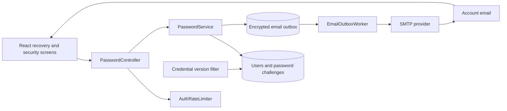

# Password reset and email-verified password change

Status: proposed design for review; no application implementation.

## Outcome and assumptions

Users can recover access when they forget a password, and signed-in users can change their password after fresh verification through their account email. Successful operations preserve their applications and preferences.

Proposed defaults: email links rather than numeric codes; 30-minute recovery links; 15-minute change links; current password required when requesting a signed-in change; all sessions revoked after either operation. Existing signup verification alone does not authorize a later password change. Mailbox access is required; recovery without mailbox access and changing email addresses are outside this feature.

## Existing implementation

- `AuthGate.tsx` handles login, registration, and verification screens; `src/data/api.ts` provides the shared CSRF/session transport.
- `SecurityConfig` uses server sessions, session-backed CSRF, and BCrypt cost 12. `CampusPrincipal` is a snapshot of the account and currently has no credential version.
- `EmailVerificationService` already generates random tokens, stores SHA-256 hashes, locks account rows, and uses transactional mail enqueueing.
- `EmailOutbox` encrypts delivery payloads. Its schema, worker eligibility checks, and sender are specifically coupled to signup verification; they cannot deliver password emails unchanged.
- `AuthRateLimiter` persists counters. Its process-local synchronization does not by itself resolve concurrent first-bucket inserts across multiple instances.
- `PasswordPolicy` requires 12 characters, uppercase/lowercase/number/symbol, and a maximum of 72 UTF-8 bytes. It is package-private.

## Approach

| Option | Benefits | Tradeoffs |
| --- | --- | --- |
| Opaque email links backed by database challenges (recommended) | Fits existing verification and outbox patterns; simple expiry, revocation, and single-use enforcement | Requires opening a link and temporarily holding its secret in browser memory |
| Email numeric codes | Convenient when reading email on another device | Lower entropy; needs strict challenge attempt limits and a separate verification/grant lifecycle |
| Managed identity provider | Moves recovery and credential lifecycle to an external service | Requires broader migration of authentication, sessions, and account mapping |

Keep the existing Spring Boot application and database. Add a focused password service; reuse mail delivery infrastructure with explicit message types. No new microservice or queue broker is needed.

`PasswordController` validates DTOs and obtains identity from the authenticated principal. `PasswordService`, in the existing auth package, owns issuance and transactional confirmation, using the existing password policy/encoder. A challenge repository owns queries and locks. Mail templates and delivery stay in the mail package. A credential-version filter enforces session revocation.

## Recovery flow

1. Login exposes **Forgot password?** User submits an email.
2. Normalize email exactly as login does. Apply IP, recipient, and global limits. Return the same HTTP 202 message for known, unknown, and recipient-throttled addresses: “If an account exists for this email, a reset link will arrive shortly.” Do not perform synchronous SMTP or expose account eligibility through response timing.
3. For an eligible account, atomically create a `RESET` challenge and encrypted outbox entry. Proposed eligibility is verified accounts and migrated verification-exempt accounts. Unverified signup accounts continue through signup verification; no reset operation silently verifies them.
4. Email links to the configured public application origin with a fragment such as `/#password-reset=<token>`.
5. The browser captures and removes the fragment immediately, keeps the token only in memory, and shows new-password and confirmation fields. Opening a link performs no mutation. Refresh requires reopening the email.
6. Explicit submission sends the token and new password. The server atomically validates and consumes the challenge, changes the password hash, revokes other password challenges, increments the credential version, and enqueues a password-changed notification.
7. Clear local account state and return to normal login. Do not automatically authenticate the reset-token holder.

The recovery token authorizes only resetting its account's password. An unrelated signed-in browser session must never determine which account is reset; the reset page should explain that the emailed account is the target without exposing its full address.

## Signed-in password change

1. Account settings exposes **Change password**. User submits their current password to request an email.
2. Resolve account ID and email exclusively from the principal and current database row. Verify the current password against the database hash; apply attempt limits before expensive hashing. Create a `CHANGE` challenge bound to the account, current credential version, and a random initiation binding stored in the session. A new change request replaces the previous initiation binding and invalidates earlier change requests.
3. Email a 15-minute link to the existing account email. The form does not collect or store a new password until the email link is opened.
4. Link completion requires both the matching authenticated account and the original session binding. Another browser or an expired session displays instructions to restart from account settings. Recovery links remain usable across browsers.
5. User enters and confirms the new password. The final POST validates the token, purpose, email snapshot, credential version, and initiation binding. It then uses the same atomic password replacement operation as recovery.
6. End the current session and invalidate all other sessions. Show “Password changed. Sign in with your new password.” If the current password is forgotten, direct the user to recovery.

## Proposed API contract

Every POST requires the existing CSRF header and cookie, including anonymous recovery. Obtain a CSRF token through `/api/auth/csrf`; never automatically replay failed writes.

| Method and path | Authentication | JSON body | Success |
| --- | --- | --- | --- |
| POST `/api/auth/password-reset/request` | Public | `email` | 202 `PASSWORD_RESET_REQUEST_ACCEPTED` |
| POST `/api/auth/password-reset/confirm` | Public | `token`, `newPassword` | 200 `PASSWORD_RESET_COMPLETED` |
| POST `/api/auth/password-change/request` | Session | `currentPassword` | 202 `PASSWORD_CHANGE_REQUEST_ACCEPTED` |
| POST `/api/auth/password-change/confirm` | Matching initiating session | `token`, `newPassword` | 200 `PASSWORD_CHANGE_COMPLETED` |

Responses use `{ "status": "...", "message": "..." }`; errors use `{ "code": "...", "message": "..." }`. Invalid, expired, consumed, revoked, wrong-purpose, or mismatched challenges share HTTP 400 `PASSWORD_CHALLENGE_INVALID`. Password policy errors use 400 `PASSWORD_POLICY_FAILED`; wrong current password uses 400 `CURRENT_PASSWORD_INVALID`. Missing/expired authentication uses 401, invalid CSRF uses 403, and public IP/global throttling uses 429 with Retry-After. Recipient suppression keeps the generic 202. Reject unknown fields, malformed tokens, oversized bodies, and client-provided owner IDs.

Only the two reset POST routes are added to the public security allowlist. Password-change routes remain authenticated. Sensitive responses use `Cache-Control: no-store`.

## Persistence and migration

Add a new Flyway migration (V4 if still available at implementation time); do not edit V3.

`campus_users` gains:

- `credential_version BIGINT NOT NULL DEFAULT 0`.
- `password_changed_at TIMESTAMP(6) WITH TIME ZONE`, nullable for existing accounts.

Add `password_challenges`:

| Column | Purpose |
| --- | --- |
| `id`, `user_id` | UUID primary key and account foreign key |
| `purpose` | Constrained to RESET or CHANGE |
| `email` | Normalized destination snapshot |
| `token_hash` | Unique SHA-256 digest; never the raw bearer token |
| `credential_version` | Account credential version at issuance |
| `initiator_binding_hash` | Required for CHANGE, null for RESET |
| `created_at`, `expires_at` | UTC instants |
| `consumed_at`, `revoked_at` | Terminal state markers |

Index by account/purpose/expiry and expiry for cleanup. Generate 32 cryptographically random bytes encoded as base64url. An unused challenge is usable only while unexpired, unrevoked, and bound to the current email and credential version.

Do not revoke earlier RESET links merely because an anonymous request arrived: that would let an attacker continually invalidate the victim's email. Recipient limits bound outstanding reset links; a successful password replacement invalidates them all. CHANGE replacement requires the authenticated, current-password-verified request.

## Atomicity and session revocation

Issuance and completion both lock the account row. Completion first resolves a token hash to an account, then locks the account, then the challenge; revalidate all conditions under those locks. Maintain this order in every password operation.

Within one transaction: validate password policy, store the encoded new password, consume the winning challenge, revoke all remaining password challenges, increment credential version, record the change time, cancel pending challenge mail, and enqueue notification. Roll back the entire operation on persistence failure. Invalid policy submissions do not consume the token. Concurrent valid submissions have one winner; the others fail after revalidation.

Copy credential version into `CampusPrincipal` at login. After security-context loading and before authorization, compare every authenticated API request's principal version with the database. On mismatch, invalidate the session, clear the security context/cookie, and return 401. Do not use a stale version cache. A login racing with a reset may receive an old-version session, but that session fails its next protected request.

This revokes authorization across instances without an in-memory session registry. It costs one small database lookup per authenticated API request; a database failure must fail closed. It does not cancel a request already authorized before the password transaction committed. Invalidate the current matching session after successful completion; the database version remains authoritative if that local cleanup fails.

## Email infrastructure changes

Extend `email_outbox` with a message type, nullable `password_challenge_id` foreign key, and nullable notification `user_id`. Make the existing `verification_token_id` nullable and add constraints requiring exactly the correct reference for each type: SIGNUP_VERIFICATION, PASSWORD_RESET, PASSWORD_CHANGE, PASSWORD_CHANGED. Backfill existing jobs as SIGNUP_VERIFICATION.

Extend sender/template contracts and encrypted payload serialization to support these types while retaining decryption of queued signup payloads. Worker eligibility and cleanup must branch by message type: signup retains its current rules; password challenges check purpose, version, email, expiry, and terminal state; notifications do not depend on an unused challenge.

Keep transactional enqueueing, encryption, leases, retry backoff, terminal failure handling, and payload erasure. Do not retry a challenge email beyond token expiry. SMTP may accept the same message twice if a worker crashes before recording success; duplicated links remain subject to the same single-use check. A message already being delivered may arrive after revocation, but its token must fail.

Build links only from trusted configured public origin, never request Host headers. No passwords or tokens in logs, analytics, tracing, or notifications. Reset pages use a no-referrer policy and exclude third-party resources. Retain terminal metadata for seven days as the existing worker does, then remove dependent outbox rows before expired challenges. Monitor delivery delay/failure and rate-limit activity without recording email addresses or secrets.

## Abuse controls and operational defaults

Reuse the database limiter with explicit scopes for reset requests, change requests, and completion; retain a shared global mail budget. Starting defaults: requests 5/minute and 30/hour per IP; recipient mail 1/minute, 5/hour, 10/day; confirmation 10/minute per IP and 10/15 minutes per token. Limits are configurable and enforced server-side. Use HMAC-protected identifiers and durable counters whose increments survive invalid-confirmation transaction rollback. Do not lock login accounts in response to anonymous reset traffic.

Fix concurrent bucket creation with a database-safe insert/conflict strategy and verify on both supported databases before advertising multi-instance support. Honor forwarding headers only from configured trusted proxies. Temporary delivery failure leaves the password unchanged and yields generic request acceptance; infrastructure failures that prevent committing the job use a generic service-unavailable response. Notification failure does not reverse a successfully committed password update.

## Frontend integration

Add focused recovery-request, password-completion, and account-security components. Extend `AuthGate` and the existing link parser with explicit purpose-aware states; extend typed adapters in `src/data/api.ts`. Avoid putting auth mutations in application-record hooks.

Show accessible loading, success, expired-link, resend, and validation states. Use current-password/new-password autocomplete correctly, allow paste and password managers, and check confirmation locally. The server remains authoritative for password policy. Clear password/token values after completion or leaving the flow. Preserve account-switch stale-response protection and theme binding; clear application data when the session ends. A lost success response must lead to sign-in/recovery guidance, never an automatic mutation retry.

## Verification and acceptance

- Unit tests with an injected clock: expiry boundary, randomness/format, hashed storage, purpose/version/binding checks, policy parity, and recipient limits.
- Transaction/integration tests: rollback, replay, concurrent completion, issuance versus completion, session revocation across two browsers, old-password rejection/new-password success, and unchanged application ownership/data.
- Security cases: unknown-email response parity, CSRF on public endpoints, cross-account change attempts, wrong current password, malformed payloads, and secret-free logs/DTO string representations.
- Mail cases: encrypted storage, signup compatibility, purpose-correct links, duplicate delivery, crash/lease recovery, cancelled jobs, expired jobs, and notification independence.
- Frontend cases: fragment removal, explicit confirmation, no mutation on link preview, expired session, account switch during requests, error announcements, and network uncertainty.
- From the repository root run `npm test` and `npm run build`; from `backend/` run `.\mvnw.cmd test` on Windows or `./mvnw test` on macOS/Linux. Extend `tests/http_smoke.py` for recovery/restart coverage and run it after bundling the rebuilt frontend. Exercise migrations and concurrency on PostgreSQL as well as H2.

Acceptance: the old password works until successful confirmation; afterward only the new password works, old sessions fail their next protected request, consumed links cannot be reused, and account data remains intact.

## Reference

The token lifecycle, generic request responses, rate limiting, normal sign-in after reset, and session invalidation align with [OWASP Forgot Password Cheat Sheet](https://cheatsheetseries.owasp.org/cheatsheets/Forgot_Password_Cheat_Sheet.html). TTLs, initiation binding, account eligibility, and credential-version enforcement are application-specific design choices.
