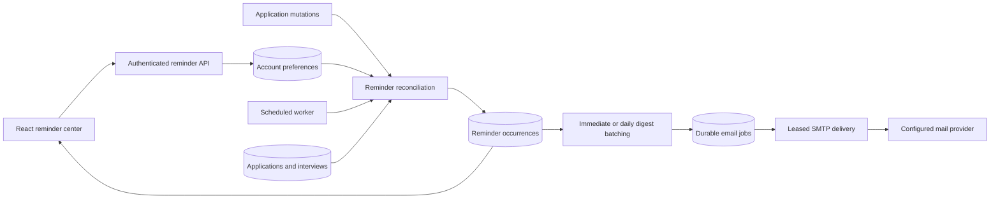

# Automated reminders system design

## Purpose and scope

Help a signed-in student act on scheduled interviews, saved application deadlines, and active follow-ups. Reminders are configurable, persistent across restarts, and support snooze and daily digests. Implement this feature on `Autonamted-Reminders-Feature`, based on the checkout supplied by the user. Existing interview dates have no time component; this feature uses the account's chosen local reminder time rather than inventing an interview start time.

## Architecture

Use the existing Spring Boot application and relational database. A separate broker or external scheduling service would add deployment requirements to this self-contained app. Browser-only timers cannot deliver while the browser is closed. The selected approach is a database-backed scheduler with optional SMTP and an in-app reminder center.

## Preferences and time semantics

Reminders default to disabled; enabling them creates occurrences for existing eligible applications. Category defaults: interviews enabled, one day before; deadlines enabled, three days before; follow-ups enabled, on the date. Each lead time accepts 0–30 days. The default timezone is UTC and local reminder time is 09:00; the UI suggests the browser timezone before first enablement. Accept valid Java timezone IDs and HH:mm times. Persist UTC instants calculated using the timezone's rules, including daylight saving transitions.

Delivery defaults to immediate in-app reminders. Daily digest mode releases newly due items at the chosen local digest time (default 09:00), once per local calendar day. Late-arriving items after that day's digest wait for the next day's digest. Empty digests are never sent. Changing timezone or delivery mode clears the digest day marker and recalculates undelivered reminders. Email is an additional opt-in channel and can only be enabled if the host has configured reminder SMTP support. In-app delivery works without mail configuration.

## Source eligibility and occurrence identity

An interview is eligible when its stage is scheduled and dated, the application is active, and its date is today or later. A deadline is eligible for a saved application with a deadline today or later. A follow-up is eligible for an applied or interviewing application with a follow-up date; overdue follow-ups remain eligible. Offers, rejected, withdrawn, deleted, and sample applications do not generate reminders. Samples are illustrative and should not produce real mail.

Each occurrence has a unique `(owner, kind, source ID, event date)` key. Rescheduling creates a new occurrence and cancels the previous one. Reconciliation also refreshes display text, cancels missing/ineligible sources, and recalculates pending times after preference edits. Application writes reconcile within their transaction after JPA flush. Cancelled occurrences may be reactivated after undo; already dismissed occurrences stay dismissed. Ready occurrences stay visible until dismissed, snoozed, or made ineligible.

## Snooze and lifecycle

States are PENDING, READY, DISMISSED, and CANCELLED. Due reminders become READY immediately or at the next digest release. Snooze accepts 15 minutes to seven days, calculates a new UTC due instant from the server clock, returns the item to PENDING, and clears its email assignment. A snooze overrides the category lead time. At its next delivery, it can send another notification. Dismissal clears email assignment and prevents reappearance for that occurrence. Only the authenticated owner can list, snooze, or dismiss reminders.

## Durable email delivery

Store jobs and reminder-to-job assignments transactionally. Immediate jobs contain one occurrence; digest jobs group at most 100 newly due occurrences, using multiple jobs for larger digests. The job stores no duplicated email body or recipient; SMTP content is built from currently eligible assigned rows and the owner's current email. Claim jobs with a conditional update and a two-minute lease, reconcile that job's owner, perform SMTP outside transactions, then record success using the lease token and owner lock. Retry transient failures with bounded delays, up to six attempts. Exhausted jobs expose FAILED in the reminder center. Cancel stale assignments after snooze, dismissal, preference opt-out, application changes, or deletion. Timing/channel changes cancel unsent jobs so new delivery rules apply; compatible category/lead-time edits preserve eligible pending retries.

SMTP is at-least-once: a process crash after provider acceptance but before database acknowledgement can produce a duplicate. SMTP cannot guarantee exactly-once acceptance. In-app occurrence creation and ordinary successful email delivery are deduplicated in the database. No external mail is provisioned or sent as part of implementation or tests; tests use synthetic recipients and a fake sender.

## API and UI

`GET /api/reminders` returns preferences, host email availability, up to 200 active occurrences ordered by due time, and a count of all READY occurrences. `PUT /api/reminders/preferences` validates and saves the complete preference object. `POST /api/reminders/{id}/snooze` accepts `{minutes}`. `POST /api/reminders/{id}/dismiss` dismisses an owned occurrence. Preference writes and reminder actions require the current version in `If-Match`, preserving the existing stale-edit convention. All routes use existing session authentication and CSRF protections.

Add a Reminders button to the workspace and a responsive modal reminder center. Show pending versus ready items, company, role, category, event date, eligibility time in the selected timezone, and email status. Provide 15-minute, one-hour, one-day and one-week snooze options, dismissal, and a link opening the related application. Settings include global/category toggles, lead times, timezone, reminder time, delivery mode, digest time and optional email. Poll while the reminder center is open; surface load and mutation errors and avoid overwriting unsaved settings during polling.

## Verification and limits

Integration tests cover migrations, security/CSRF, ownership, validation, optimistic conflicts, source eligibility, lifecycle changes, deduplication, snooze, digest boundaries, timezone/DST behavior, SMTP retry and lease recovery. Client tests cover API payloads, version and CSRF headers, and error propagation. Run the complete Java and client suites and a production frontend build. Verify the UI against a temporary test backend if browser tooling is available.

The existing application is a small single-instance deployment; preferences are processed in bounded owner pages and SMTP jobs in batches. It retains cancelled/dismissed reminders and completed email jobs for now. Larger deployments need a retention policy, shared sessions, operational metrics, and load testing. A request authorized before a preference edit may already be in SMTP and cannot be recalled.
