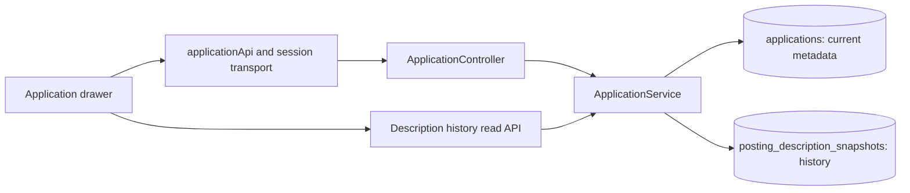

# Job posting and contact details system design

Date: 2026-10-03
Status: Proposed architecture; product implementation has not started.

## Purpose and scope

Students need to retain the posting URL, a description snapshot, recruiter contact, referral source, and compensation range after a job posting disappears. The tracker must display saved information from its own database without accessing the original website.

The first version supports manual entry and pasted descriptions, one primary recruiter and one referral source per application, and description version history. Multiple contacts, automatic scraping, attachments, and compensation currency conversion are later extensions. These are design assumptions, not requirements supplied by the user.

## Existing project and design choice

The repository uses Java 17, Spring Boot, Spring Data JPA, Spring Security sessions, React with TypeScript, and Flyway. Local persistence is file-backed H2; the production profile uses PostgreSQL. Application writes already use an owner-scoped service, an application version with `If-Match`, one transactional save, and soft deletion with undo.

Relevant integration points:

- `backend/src/main/java/com/campus/tracker/application/InternshipApplication.java`: application aggregate and version.
- `ApplicationDtos.java`, `ApplicationService.java`, and `ApplicationController.java` in that package: validation, owner checks, transactional save, and API responses.
- `src/domain/application.ts` and `src/data/applicationApi.ts`: draft types and explicit payload mapping.
- `src/hooks/useApplications.ts`: serialized mutations and refresh after conflicts.
- `src/components/ApplicationDrawer.tsx`: existing view/edit flow.
- `src/App.tsx`: client-side CSV export.

Three approaches were considered:

| Approach | Trade-off |
| --- | --- |
| Extend the application aggregate and add a snapshot history table | Recommended: fits the current single-save workflow and preserves version checks while separating large archived descriptions. |
| Separate posting, contact, referral, and compensation entities with independent APIs | Useful for shared postings and many contacts, but adds relationships and save coordination beyond the current requirement. |
| Store everything in application notes | Small change, but loses structured validation, compensation units, and description history. |

## Components and data flow

Keep this feature within the existing `application` package. Add focused posting DTOs, a validation helper, a snapshot entity/repository, and a controller for description reads. `ApplicationService` coordinates writes so parent data and snapshot changes commit or roll back together. There is no new worker or external service.

1. The user opens or creates an application and enters posting information.
2. The client submits the existing application save request with an optional `postingDetails` object.
3. The service resolves the application for the authenticated owner, checks its version on updates, validates input, and applies current metadata.
4. If a supplied description differs from the current snapshot, the service appends a revision and advances the parent's description revision.
5. The service flushes the parent and returns its new version and current metadata. Existing reminder reconciliation remains part of the application save path.
6. The drawer reads the current description separately when needed. Posting availability has no effect on these database reads.

## Persistence model

Store current scalar metadata on `applications`, grouped in a JPA embeddable or equivalent focused value object. Preserve the existing parent ownership and version rather than duplicating them on metadata.

| Fields | Storage and limits |
| --- | --- |
| `posting_url` | Optional text; maximum 2048 characters |
| `recruiter_name`, `recruiter_role` | Optional text; maximum 120 characters each |
| `recruiter_email` | Optional text; maximum 254 characters |
| `recruiter_phone` | Optional text; maximum 50 characters; retain international formatting |
| `recruiter_profile_url` | Optional text; maximum 2048 characters |
| `referral_channel` | `UNKNOWN`, `JOB_BOARD`, `COMPANY_WEBSITE`, `CAREER_FAIR`, `EMPLOYEE`, `PROFESSOR`, or `OTHER` |
| `referral_source` | Optional source name, such as a board or event; maximum 200 characters |
| `referrer_name`, `referrer_contact` | Optional text; maximum 120 and 254 characters respectively |
| `compensation_min`, `compensation_max` | Nullable `NUMERIC(14,2)` mapped to Java `BigDecimal` |
| `compensation_currency` | Optional uppercase three-letter currency code |
| `compensation_period` | Nullable `HOUR`, `MONTH`, `YEAR`, or `TOTAL_INTERNSHIP` |
| `compensation_status` | `UNKNOWN`, `PAID`, or `UNPAID` |
| `compensation_original_text` | Optional original wording, including bonus/stipend qualifications; maximum 1000 characters |
| `posting_description_revision` | Integer starting at zero; zero means no description has been captured |

Optional text defaults to an empty string, matching existing frontend conventions. Enum defaults are `UNKNOWN`; amounts and period default to null. Existing rows therefore require no invented posting data.

Add `posting_description_snapshots` with:

| Field | Meaning |
| --- | --- |
| `id` | Server-generated UUID primary key |
| `application_id` | Required foreign key to `applications`; cascade only on physical parent deletion |
| `revision` | Positive integer; unique together with `application_id` |
| `description_text` | Plain text, up to 100,000 UTF-16 code units under request validation; database text type |
| `source_url` | Posting URL at capture time; empty when unavailable |
| `captured_at` | Server timestamp with microsecond precision |
| `capture_method` | `MANUAL` in the initial version |

The parent revision identifies the current snapshot. Index `(application_id, revision)` through its unique constraint. History rows are immutable under normal application updates. Changing only a URL, contact, or compensation does not create a description revision. History archives descriptions and their source URLs; it does not claim to archive every past contact or compensation value.

An empty description before the first capture leaves the revision at zero. After a capture, an explicitly submitted empty description creates an empty revision only if it changes the current description. This clears the current display while retaining older versions. The UI must explain that distinction. There is no snapshot purge endpoint in this version; retention follows the existing application retention policy.

## API and compatibility

Extend existing `POST /api/applications` and `PUT /api/applications/{id}` with `postingDetails`. A provided object must contain all editable metadata fields; reject incomplete objects and explicit null objects. Omission preserves existing metadata on update and initializes defaults on creation. This allows existing clients and full-record status/follow-up actions to retain new data.

Use flat camelCase names corresponding to the metadata columns, such as `postingUrl`, `recruiterEmail`, and `compensationMin`. Exclude the internal `postingDescriptionRevision` from writes; responses expose it as `descriptionRevision`. Distinguish omitted objects/fields from explicit null using presence-aware deserialization rather than collapsing both into Java null.

Within `postingDetails`, `descriptionSnapshot` is an optional write-only string. Omission preserves the saved description. A supplied string, including an empty string, uses the revision behavior above; explicit null is invalid. Capture timestamps, revision numbers, owner, and snapshot IDs are server-owned and cannot be supplied.

Responses include current scalar metadata and `descriptionRevision`, but never inline description text or history in paginated application results. Serialize compensation amounts as decimal strings or null, and keep them as strings in TypeScript until formatting, avoiding binary floating-point rounding.

Add authenticated reads:

| Endpoint | Response |
| --- | --- |
| `GET /api/applications/{id}/posting-description` | Envelope with parent `applicationVersion` and `snapshot`; `snapshot` is null before the first capture |
| `GET /api/applications/{id}/posting-descriptions?page=0&size=20` | Paginated snapshot metadata ordered by revision descending; size limited to 50 |
| `GET /api/applications/{id}/posting-descriptions/{snapshotId}` | One saved description and its capture metadata |

Each read first resolves the non-deleted parent for the authenticated owner, then resolves snapshots within that parent. Missing, other-owner, deleted-parent, and wrong-parent snapshot lookups return 404. Missing sessions follow existing 401 behavior. Set `Cache-Control: no-store` on description reads. Reads do not increment application versions.

All writes continue to require CSRF protection and, for existing applications, `If-Match`. Every changed snapshot also changes the parent revision, ensuring the existing JPA version covers description-only edits. Concurrent writes return 409 and roll back metadata, revisions, and snapshot inserts together. Missing or malformed version headers retain current 428/400 behavior.

## Validation and error handling

- Posting/profile URLs must be absolute HTTP/HTTPS URLs with a host, no embedded credentials, and no control characters. Blank is allowed. The backend never fetches these URLs.
- Validate nonblank recruiter email addresses. Treat phone and free-form referrer contact as bounded text rather than requiring an email or a country-specific phone format.
- Compensation bounds must be nonnegative, fit the numeric precision, have no more than two decimal places, and satisfy minimum <= maximum when both are present. Either endpoint may be unknown.
- Any supplied amount requires `PAID`, a currency code accepted by Java's currency validation, and a period. `UNPAID` and `UNKNOWN` must have null amounts. Validate any nonblank currency even when amounts are absent. No missing value is silently converted to zero, and no annual/hourly conversion is inferred.
- Preserve description whitespace and line breaks. Reject overlength inputs with 400. An unchanged description does not create another revision.
- Render descriptions and contacts as text. Open validated external links with `noopener noreferrer`; descriptions are never rendered as imported HTML.
- Save failures leave the draft open. A conflict refreshes shared application data without discarding the user's draft; the UI offers reload before another save. Read failures expose retry and must not be mistaken for an empty saved description.

## Frontend behavior and export

Add focused Posting, Recruiter, Referral, and Compensation sections in `ApplicationDrawer`; extract a posting field component to contain the added form size. The detail view shows the saved description with capture time, a history control, and an optional link to the original posting.

Load description text on drawer open and before initializing a description edit. If loading fails, metadata can still be edited with `descriptionSnapshot` omitted; description editing stays unavailable until retry succeeds. Capture the editor's application version at edit start. If a description response reports a different parent version, refresh and reload before initializing that draft. Abort or ignore old reads when switching applications or closing the drawer.

Separate response metadata, local draft values, and the write-only description field in TypeScript. The existing payload whitelist must explicitly map posting metadata. Follow-up completion and similar full-record saves must preserve metadata and omit untouched descriptions. Never send `descriptionRevision` back as editable input.

Extend CSV export with current posting, recruiter, referral, and compensation columns using the existing CSV escaping helper. Keep large descriptions and history out of the bulk CSV. Provide a per-application JSON archive download containing the saved application metadata and all description revisions, generated from owner-scoped paginated reads; do not produce a partial file when a read fails. Check the parent version before and after gathering revisions and retry on change to avoid mixing versions. Clearly label CSV as a summary and JSON as the description archive.

Soft deletion hides posting data and descriptions with the application. Undo restores access to the same snapshots. Keep the existing policy of retaining soft-deleted data; disappearance of an external posting never triggers deletion or replacement.

## Migration and verification

The inspected repository currently ends at `V3__automated_reminders.sql`. Use `V4__job_posting_details.sql` if available when implementation starts; otherwise use the next unused version. Do not modify existing migrations. Add metadata columns with defaults, the history table, foreign key, uniqueness, and compensation checks. Map description text consistently across H2 and PostgreSQL; verify schema validation and actual round-trips in both.

Implementation acceptance checks:

1. Migrate an existing database without losing accounts, applications, dates, stages, reminders, or undo data.
2. Save and reload all new fields; restart the backend and confirm descriptions and contacts remain available without the original URL.
3. Preserve metadata and descriptions through older request shapes, follow-up actions, stage edits, status changes, deletion, and undo.
4. Verify first capture, changed capture, unchanged save, explicit clearing, URL-only changes, revision ordering, and full transaction rollback.
5. Exercise CSRF, missing sessions, ownership isolation, wrong-parent snapshot IDs, deleted records, and simultaneous stale writes.
6. Check limits, invalid URL schemes, email syntax, compensation precision/order/status/unit rules, Unicode, line breaks, and text containing HTML.
7. Confirm list responses contain no description bodies; history pagination is bounded; descriptions are loaded only for the opened drawer.
8. Check draft retention on errors, version changes during reads, CSV escaping, and complete JSON archive output.
9. Run `npm test`, `npm run build`, and `backend/mvnw.cmd test`; perform an H2/PostgreSQL migration check and a browser review of save, refresh, history, restart, and undo. Record results in `VALIDATION.md`.

These are future implementation checks. This document was reviewed against the current source; no product code was changed and no implementation tests were run.
