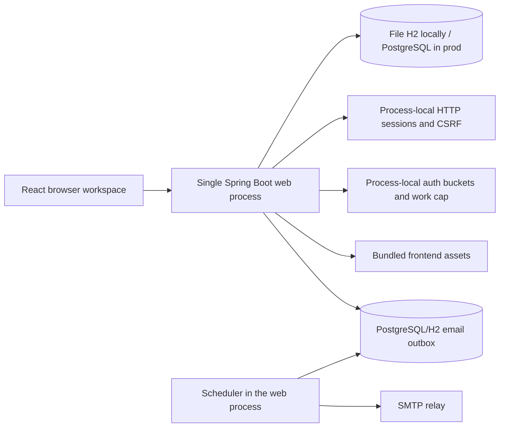
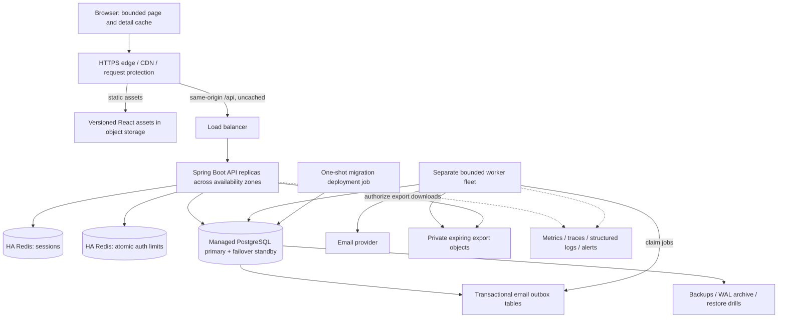

# Scalability architecture and gap assessment

Date: October 4, 2026. Implementation status updated October 8, 2026: repository foundations, bounded workspace reads, shared Redis state, dedicated mail/export workers and portable deployment tooling are implemented. Local recovery/load qualification and final review are tracked in `VALIDATION.md`; hosted deployment and large-SaaS capacity remain pending.

## Purpose and scope

Design the existing internship tracker to serve hundreds of thousands of accounts, as requested by the user. Preserve per-account applications, interviews, follow-ups, appearance preferences, email verification, session authentication, CSRF, optimistic concurrency, soft deletion, and undo.

The recommendation is a horizontally replicated Spring Boot application with explicit module boundaries, shared session storage, managed PostgreSQL, CDN delivery of React assets, and independently scaled background workers. Account count alone does not justify splitting transactional application workflows into microservices. Actual replica counts and database sizes must come from measurements.

This document distinguishes the original source baseline from design targets. Baseline `45728d1` includes verification-counter concurrency fixes, concurrent-registration recovery, verification-route password-work limits, and stale-session protection. The baseline gap analysis below is historical; the implemented changes and current qualification evidence are recorded in `VALIDATION.md`. Production capacity remains unqualified. Budget, cloud provider, regions, traffic, availability, and retention have not been specified. The assumptions below make the design testable without presenting them as approved business commitments.

## Planning workload and service targets

| Dimension | Proposed planning assumption | Implication |
| --- | --- | --- |
| Registered accounts | 300,000, with headroom toward 500,000 | Separate total accounts from active sessions and requests |
| Daily active accounts | 60,000 | Validate the real activation and retention distribution |
| Foreground API requests | 50 per daily active account: 3 million/day, about 35 requests/second average; excludes background polling and authentication | A 20-times busy-period factor produces about 700 foreground requests/second |
| Visible browser tabs | Up to 20,000 | Current one-minute preference polling alone adds about 333 requests/second |
| Auth qualification load | Up to 100 password operations/second during the stress scenario; provisionally allow four associated HTTP requests per operation, or 400 requests/second | Includes CSRF/login/confirmation requests; measure actual flow amplification, benchmark BCrypt, and test legitimate campus NAT traffic separately from abuse |
| API qualification load | 1,500 total HTTP requests/second sustained; 2,000 requests/second short bursts | About 700 foreground + 333 polling + 400 auth HTTP requests = 1,433; increase the target if measured flow amplification is higher. These are qualification targets, not established capacity |
| Application history | 200 applications/account on average: 60 million applications | Test skew: many small accounts and some accounts with 10,000+ records |
| Interview history | 3 stages/application on average: 180 million stage rows | Notes, index sizes, stage fan-out, bloat, and backups affect storage more than account count alone |

Proposed initial SLOs: 99.9% monthly availability for authenticated core operations; core API p95 below 300 ms and p99 below 1 second; password-operation p95 below 2 seconds; first useful workspace render below 2 seconds on a defined representative device/network. Mail acceptance is asynchronous and has a separate target: 95% of eligible verification messages accepted by the provider within 60 seconds under normal provider operation. Inbox arrival is outside the application's guarantee.

Proposed disaster-recovery targets: RPO at most 5 minutes and RTO at most 60 minutes. Routine database instance/zone failover should preserve acknowledged writes; disaster restore has a separate potential data-loss window. Both require demonstrated recovery, appropriate managed-service configurations, and an operational budget. Measure regional failover requirements before adopting a second active region.

## Current architecture: verified baseline

Useful foundations already present:

- Controllers pass authenticated identity into owner-scoped services; repositories enforce record ownership. Transactional services and typed DTOs provide a suitable application boundary.
- `@Version`, `If-Match`, HTTP 409, soft deletion, and returned server state protect concurrent edits and undo. Frontend mutations are serialized and older responses are discarded.
- PostgreSQL support, Flyway, owner-leading indexes, bounded REST page sizes, and `@BatchSize(size = 50)` on stage collections already exist. Do not describe the system as having no pagination, indexes, or collection batching.
- Email verification uses transactional token/outbox creation, encrypted payloads, atomic conditional leases, retries, terminal states, payload erasure, and cleanup. SMTP is outside the claiming transaction. A durable messaging foundation already exists.
- Docker builds an unprivileged runtime image. Compose already has a separate migration job and database health check. Production runtime, migration, and administrator database roles are separated.
- `VALIDATION.md` records frontend, H2, HTTP/restart, and PostgreSQL privilege/workflow checks. Its October 4 main-review record reports 40 frontend tests, 65 backend tests, two PostgreSQL scenarios, build, and smoke checks. Concurrency fixes are already implemented and locally validated; Docker execution, hosted deployment, external SMTP, and production capacity remain unverified. These recorded results were not rerun for this documentation review.

## Alternatives and decision

| Approach | Benefits | Costs / limitations | Decision |
| --- | --- | --- | --- |
| Replicated modular Spring application plus worker fleet | Reuses ownership and transaction boundaries; scales HTTP and mail independently; manageable operational surface | Requires shared sessions/limits, bounded reads, database tuning, and deployment discipline | Recommended starting architecture |
| Larger single instance plus managed database | Fastest initial hosting path, low coordination overhead | Web process remains a failure domain; deployment interrupts sessions; limited resource headroom | Useful staging/intermediate step |
| Separate auth, applications, interview, preferences, and notification services | Independent team ownership and scaling when justified | Adds distributed consistency, service identity, network failures, deployment coordination, and more operating cost | Reconsider only when measurements or team boundaries require it |

Use existing packages as module boundaries. Auth owns account lifecycle and verification; applications owns applications and stages; preferences owns appearance; delivery owns outbox processing. Applications and stages remain one transaction boundary. Separate deployment of delivery workers does not require a separate database or a new business service.

## Target architecture

Redis sessions and auth limits are shown separately to distinguish their policies. Start with separate namespaces and budgets; use separate deployments where rate-limit traffic could compromise session availability. Do not mix authenticated sessions with an evictable general-purpose cache.

For session and limiter stores, use explicit memory limits, bounded TTL/key cardinality, alerts, and a `noeviction` policy rather than allowing pressure to remove active sessions or restrictions. Redis [noeviction](https://redis.io/docs/latest/develop/reference/eviction/) rejects new writes when memory is exhausted, so handle that as a dependency-capacity failure and test it. Estimate memory from active sessions times measured serialized size plus indexes, keys, and operational headroom, rather than from registered accounts alone.

Run an API baseline across at least two availability zones, with sufficient remaining capacity after a zone or instance failure. Three API replicas are an initial topology to test, not a throughput guarantee. Use a managed container platform with rolling deployment, instance health checks, draining, and autoscaling; choose Kubernetes only if existing operational experience or platform needs justify it.

### Edge and browser

Serve the UI and `/api` through one public HTTPS origin. The edge routes `/api/*` to Java and static paths to the asset origin. Forward cookies, CSRF and `If-Match` headers, query parameters, and error/status responses. Bypass shared caching for all API responses and all session-setting responses. Use immutable caching for hashed assets and revalidation for HTML and the theme bootstrap script.

Block direct public access to API instances. The trusted ingress must strip supplied forwarding headers and set validated client-address and scheme information. Configure the container's trusted proxy handling accordingly. The current `forward-headers-strategy: NONE` and `getRemoteAddr()` otherwise put legitimate clients behind one proxy into the same IP bucket. Raising that bucket is not a substitute for a correct trust boundary. Also test shared campus NATs, where many legitimate users really do share an address.

Replace the all-history cache deliberately, since the repository guide requires preserving it unless redesigned. Cache bounded pages, summary results, activities, and opened details by account and query. Debounce search, cancel superseded reads, and retain account-generation guards. Keep mutations serialized through `useApplications`, apply only confirmed responses, then invalidate the affected page/summary/activity queries. Do not replay failed writes automatically.

Separate endpoints can observe different concurrent database commits. Return a read timestamp with summaries, compute related counts in one statement or a short consistent transaction, and refresh affected reads after a confirmed mutation. Do not imply that a list and summary fetched separately form one atomic snapshot. Initially read from the primary and avoid shared result caching; add caches only with explicit staleness and invalidation rules.

### API and data loading

Introduce additive versioned read contracts, for example:

| Proposed endpoint | Purpose / contract |
| --- | --- |
| `GET /api/v2/applications` | Lightweight list, bounded size, opaque cursor, sort/filter identity, `hasNext`; company/role/location/status/dates/version and necessary stage counts, rather than full notes and every stage |
| `GET /api/applications/{id}` | Existing full owned detail and version for editing; retain current mutations |
| `GET /api/v2/applications/summary` | Total and per-status counts plus active/interview/offer/due counts, calculated across the account's full history |
| `GET /api/v2/activities` | Bounded interviews, follow-ups, and saved-application deadlines, with application identity and date ordering |
| `POST /api/v2/exports`, `GET /api/v2/exports/{id}` | Owner-scoped background export creation and status; CSRF on creation; authorized, expiring downloads |

These routes are proposals, not existing endpoints. Keep the current list API available through the transition and remove it only after client migration and an explicit compatibility policy.

Preserve existing behavior precisely:

- Search includes company, role, location, notes, **and interview-stage names**. Current REST `q` omits stage names, so simply forwarding the current UI search would regress behavior. Use an owner-scoped `EXISTS` stage search to avoid multiplying parent rows.
- Tabs, status, due-only, sorting, counts, and activities operate over all matching records, not only the current page. Workspace counts currently cover the whole account; label any added filtered counts separately.
- The Closed tab includes Offer, Rejected, and Withdrawn. The current activity helper excludes only Rejected and Withdrawn; Offer applications can still have activities. Keep that distinction.
- Date-only fields stay local calendar dates. Until account timezone preferences exist, pass the browser's validated local `today` date to due queries, without treating it as security authority. Validate it as a date and parameterize queries. Do not use the server's UTC day to change due semantics.
- CSV includes the full account's records, notes, and stage descriptions, independent of the visible page. Preserve UTF-8 BOM and formula-leading-character protection.

Use keyset pagination with deterministic tie-breakers. For updated order, a candidate is `(updated_at DESC, id DESC)` with a matching index and cursor; existing REST ties currently use ascending ID, so the v2 ordering change must be explicit. Define company collation, case handling, and null-date ordering. Every cursor is versioned, bound to filter/sort, and validated; ownership always comes from the authenticated session. Avoid total-count queries on every list request.

Cursor pagination is a live view, not a historical snapshot: edits can move rows across pages. Refresh resets the cursor. Export guarantees must be separate. Initially define large background exports as a live traversal with stable creation-time/ID ordering and a job-start creation cutoff; deduplicate IDs and document that values and deletion state can change during generation. If the product requires an exact point-in-time export, implement a measured snapshot/materialization strategy and account for long snapshot effects on database maintenance. Do not promise snapshot consistency merely by adding a cursor.

### Shared sessions and authentication controls

Adopt Spring Session backed by managed HA Redis so session identity and CSRF survive API-instance routing and rolling restarts. Preserve session fixation protection, the post-login CSRF refresh, HttpOnly/Secure/SameSite cookie policy, two-hour expiry semantics, and logout invalidation. Explicitly retain `JSESSIONID` or update cookie deletion and all tests together; a cookie-name mismatch must not leave stale cookies after logout.

Make the persisted security context compatible across rolling application versions. Test the current `CampusPrincipal` and CSRF attributes with the chosen serializer, minimize retained credential data after authentication, and namespace incompatible session formats. Expect a controlled sign-in transition when replacing existing process-local sessions. Use dependency versions managed by the repository's Spring Boot line; the matching [Spring Session 3.5 Redis guidance](https://docs.spring.io/spring-session/reference/3.5/configuration/redis.html) covers shared storage and serializer configuration.

Move process-local IP/email/session-creation token buckets to atomic shared operations with bounded key lifetime and cardinality. Preserve token-bucket refill semantics where they currently exist; the verification limiter uses fixed windows and should keep its own documented semantics. The per-instance CPU work cap already covers login, registration, verification confirmation, and resend. Benchmark its default of two active operations against intended instance resources; a distributed request budget does not by itself bound concurrent BCrypt work.

Retain the implemented verification-counter fix: caller transactions are suspended, counter statements commit independently, and duplicate INSERTs retry a conditional increment against the winning row. Existing H2 tests cover separate limiter instances and creation races; PostgreSQL scenarios cover concurrent quota enforcement with runtime privileges. Extend qualification to multiple deployed API processes, high-volume hot buckets, and database failure. This is deployment/performance qualification, not a missing concurrency implementation; an upsert rewrite is unnecessary without measured benefit.

Make the hard-coded global 1,000-mail-per-day budget configurable and align it with legitimate registration peaks and provider quotas. It is a deliberate abuse budget, not a bug to remove. Keep per-recipient controls and alerts. The global counter is also a shared hot row in the current database implementation; benchmark contention before retaining it at high volume.

### PostgreSQL and correctness

Use a managed PostgreSQL primary with failover standby, private networking, explicit runtime credentials, encrypted transport/storage, backups, and monitored disk/IOPS. H2 remains a local development option; multiple production replicas require shared PostgreSQL. A failover standby is not automatically a query replica. Choose and test synchronous replication/failover guarantees for acknowledged writes; asynchronous replication can lose recent commits during promotion, as described in PostgreSQL's [standby documentation](https://www.postgresql.org/docs/17/warm-standby.html). Initially keep reads on the primary to preserve server-confirmed writes, undo, login verification, and appearance changes.

Set connection-pool, thread, acquisition, statement, and lock budgets deliberately. Verification counters use `NOT_SUPPORTED` and independent statements while an outer account/token transaction can retain a connection; account for that additional demand. Enforce this connection ceiling across autoscaling and rolling deployment:

`(maximum API replicas + rollout overlap) * API pool size + maximum workers * worker pool size + maintenance reserve <= database connection budget`

For example, 12 API replicas plus three overlap instances, each with a pool of 12, four workers with pools of five, and 20 maintenance connections require a budget of at least 220. This illustrates the calculation, not recommended production sizing. Benchmark queue waits and nested transaction demand before choosing values. Add a connection proxy only if measurements and deployment topology warrant it.

Measure representative queries using PostgreSQL [EXPLAIN](https://www.postgresql.org/docs/17/using-explain.html). Existing owner-leading indexes are useful; do not create indexes merely because rows are numerous. Candidate additions include an active-row owner/updated/ID index matching v2 ordering, measured owner/company and owner/applied-date sort indexes, and indexes supporting activity queries. Global date-first scans are a different workload from the existing owner-first follow-up index and would need separate analysis if automated reminders are later built.

Current substring search uses `lower(column) LIKE '%term%'`, including notes. Measure selective owner-scoped plans first. PostgreSQL [pg_trgm](https://www.postgresql.org/docs/17/pgtrgm.html) can accelerate substring search if matching expression indexes justify their write/storage cost; short terms can still scan extensively. Full-text search changes matching semantics and needs an explicit product decision. An external search cluster remains a later option if PostgreSQL cannot meet the measured requirement.

Use list projections and bounded stage queries. Existing collection batching reduces unbounded one-query-per-parent behavior, but full DTO conversion still fetches notes and stages for every listed record. Do not collection-fetch-join a paginated parent query in a way that forces in-memory pagination or duplicates rows.

Retain owner checks, application `@Version`, and existing 409 behavior across replicas. For uncertain create results, keep the current no-replay behavior; if safe resubmission becomes a product requirement, add explicit owner-scoped idempotency keys with a unique constraint, request digest, committed result, and expiry. They do not replace `If-Match`.

### Background delivery and exports

Run mail delivery separately from the web fleet using the existing `MAIL_WORKER_ENABLED=false` on API instances. Build an explicit worker launch mode with no public web listener; the current code only offers an embedded scheduler toggle. Give workers a bounded pool and separate resource/connection limits. Use a restricted worker database role for needed delivery and export operations.

The current worker fetches up to 25 candidates, then claims each with a conditional UPDATE. This already prevents ordinary simultaneous claims, but several replicas can select the same candidates and compete. PostgreSQL [FOR UPDATE SKIP LOCKED](https://www.postgresql.org/docs/17/sql-select.html) can claim distinct queue rows in a short transaction; store lease ownership before commit, then perform provider calls outside that transaction. Match leases to bounded call/retry deadlines and preserve eligibility checks, fenced completion, retry limits, and encrypted payload erasure.

SMTP delivery is at least once: a process can crash after provider acceptance and before recording SENT. The existing stable Message-ID does not guarantee provider deduplication. Keep confirmation single-use, tolerate duplicate messages, and use provider idempotency only where supported. Do not promise exactly-once email.

Move broad cleanup scans off every delivery poll into scheduled, indexed, bounded maintenance batches. Monitor oldest eligible job age, backlog, delivery latency, retry/terminal categories, and provider quota utilization. Failed jobs need an operational review path; do not blindly replay an expired verification token.

The current crypto object accepts only the active `keyId`; rotating that configuration makes older queued payloads undecryptable. Add a controlled decrypt key ring and active encrypt key, retain old keys until relevant jobs expire/drain, and test overlapping old/new workers during rotation. Store keys in managed secrets, never in the image or source.

Use private object storage for large exports, with owner checks at creation/status/download, expiry, quotas, cancellation, and cleanup. Prevent cross-account access even if a job ID is guessed. An API download proxy preserves same-origin authorization; signed links require short lifetimes and an explicit sharing policy. Add a managed broker only when queue depth/latency or additional job types justify it; preserve a transactional outbox so database commit and publication cannot diverge.

Export jobs need their own durable owner-scoped metadata: state, creation cutoff, lease, attempts, output reference, expiry, and failure category. Commit a job before returning HTTP 202; workers publish a complete private object before marking it ready. Bound active jobs and output size per account, fence worker completion, and clean up abandoned objects. Give export workers a separate pool/budget from verification mail so a large CSV cannot delay signup delivery. Add schema and worker-role grants through new migrations; the verification-token-specific email outbox is not an export job queue.

### Operations, availability, and recovery

Add Actuator/Micrometer and structured request-correlated logs, with traces for database and delivery paths. Track request latency/errors by route template, DB pool wait, query latency, JVM/GC, auth work saturation, limiter rejection reasons, Redis latency/evictions, and queue age. Exclude emails, tokens, passwords, and raw notes from logs and metric labels. Account IDs must not become high-cardinality metric labels.

Keep `/api/health` as the launcher/smoke marker; it currently always returns UP and cannot establish dependency readiness. Add distinct process liveness and dependency-aware readiness on the serving port. Liveness must not fail merely because PostgreSQL or Redis is unavailable. Readiness should report inability to serve core authenticated operations, with an explicit shared-outage policy; SMTP degradation should leave tracking available. Configure probe timeouts and graceful draining. [Spring Boot 3.5 Actuator](https://docs.spring.io/spring-boot/3.5/reference/actuator/endpoints.html) supports these health groups and requires explicit security when a custom security chain exists; the current `anyRequest().permitAll()` must not accidentally expose administrative endpoints.

On session Redis loss, reject protected operations safely with a service-unavailable response; do not fall back to per-instance sessions or unauthenticated access. If a separately deployed limiter store fails, deny affected authentication/session-creating requests with 503 rather than disabling admission checks; ordinary CRUD can continue when its session store and database remain available. Test Redis failover and logout persistence as well as process restarts. On PostgreSQL loss, do not acknowledge writes and do not retry them automatically. On SMTP loss, retain/retry eligible jobs and alert on queue age. On a terminated API replica, drain requests and route subsequent requests to another replica using shared sessions. On a terminated worker, expired leases allow later takeover.

Apply bounded request concurrency, body sizes, export quotas, database acquisition waits, and provider deadlines. Set downstream deadlines below the request/drain timeout and reject overload promptly instead of accumulating an unbounded queue. Distinguish policy denial (429 with Retry-After) from unavailable dependencies (503); exclude neither unexpected server errors nor legitimate overload rejections from capacity reporting.

Autoscale API replicas using CPU plus request latency/in-flight pressure, with a tested minimum and a maximum constrained by DB connections. Scale workers using backlog age and provider quotas. Test burst scaling, zone loss, and rollout overlap. More replicas must not silently multiply abuse budgets or mail quotas.

Create a reproducible CI/CD pipeline: frontend tests/build, backend unit/integration tests, real PostgreSQL tests, HTTP smoke checks, image build, disposable Compose startup/failure checks, and staged rollout. No tracked GitHub Actions workflow was found in this snapshot. Qualify alternative CI infrastructure if it exists outside the repo. Pin deployable image artifacts by digest and automate secret injection and infrastructure configuration.

Retain the existing one-shot migrator and least-privilege grants. Serialize schema deployment, use additive expand/backfill/switch/contract migrations, and test old/new binaries together before rolling deployment. Never edit applied V1-V3 scripts. Long index/backfill operations need a tested online-migration strategy and explicit privilege changes. Runtime application credentials do not have DELETE on applications/users; any future retention purge needs a separately authorized maintenance role and a user-visible undo/retention contract.

Backups require monitored execution and verified restore, not just a persistent Docker volume. Use PostgreSQL [WAL-based point-in-time recovery](https://www.postgresql.org/docs/17/continuous-archiving.html), separate protected backup storage, and scheduled restores into an isolated environment. Verify records, role grants, schema, and verification behavior. Recovery must also restore/access outbox decryption keys; decide whether restored sessions are invalidated and how already-delivered mail is handled.

## Prioritized gaps and code evidence

P0 blocks safe public multi-instance deployment or legitimate signup growth. P1 is required to qualify the proposed large workload and availability targets. P2 is conditional on measurement or later product scope.

| Priority | Current evidence | Consequence | Required change |
| --- | --- | --- | --- |
| P0 | [SecurityConfig](../../../backend/src/main/java/com/campus/tracker/config/SecurityConfig.java), [pom.xml](../../../backend/pom.xml): session CSRF, no shared session dependency | Routing and restart lose session continuity | Shared Spring Session store, cookie/serializer/rollout tests |
| P0 | [Auth abuse limiter](../../../backend/src/main/java/com/campus/tracker/auth/abuse/AuthRateLimiter.java): synchronized process-local HashMap | Replicas and restarts change effective abuse budgets | Atomic shared buckets; retain local CPU work cap |
| P1, qualification | [Verification limiter](../../../backend/src/main/java/com/campus/tracker/auth/verification/AuthRateLimiter.java): committed duplicate-insert recovery and independent commits; local concurrent regression results recorded | High-volume and deployed multi-process behavior remain unqualified | Extend existing checks to multiple API processes, hot-bucket contention, and dependency failures |
| P0 | [application.yml](../../../backend/src/main/resources/application.yml), auth filters/controllers: forwarded headers disabled; peer IP used | Trusted load-balancer address can become every user's rate-limit identity | Trusted ingress/header policy, blocked direct access, NAT tests |
| P0 | Verification limiter: hard-coded daily global mail budget of 1,000 | Eligible signup mail can be suppressed during legitimate growth | Configurable measured budgets, provider quota alignment, alerts |
| P1 | [applicationApi.ts](../../../src/data/applicationApi.ts): sequentially fetches every 100-row page; [App.tsx](../../../src/App.tsx): local summaries, activities, CSV, eight-row pagination | Workspace cost grows with account history; conflict refresh downloads it again | Bounded reads, summaries/activities, details, background full exports |
| P1 | [selectors.ts](../../../src/domain/selectors.ts) vs [ApplicationService](../../../backend/src/main/java/com/campus/tracker/application/ApplicationService.java) | Server filtering alone loses stage search and other UI semantics | Contract parity tests before replacing the all-history client |
| P1 | ApplicationService uses PageRequest/counts; [ApplicationDtos](../../../backend/src/main/java/com/campus/tracker/application/ApplicationDtos.java) maps full stages/notes | Deep offsets, repeated counts, and payload amplification | Cursor/slice reads, projections, measured PostgreSQL query/index plans |
| P1 | [HealthController](../../../backend/src/main/java/com/campus/tracker/common/HealthController.java): constant UP; no Actuator dependency | Rollout cannot tell ready from dependency-failed | Secured probes, metrics, tracing, dashboards, alerts |
| P1 | [EmailOutboxWorker](../../../backend/src/main/java/com/campus/tracker/mail/EmailOutboxWorker.java), [MailConfiguration](../../../backend/src/main/java/com/campus/tracker/mail/MailConfiguration.java): embedded serial polling and per-poll cleanup | Web scaling changes worker topology; provider latency and cleanup limit delivery | Dedicated bounded workers, scalable claims, maintenance batches |
| P1 | [OutboxCrypto](../../../backend/src/main/java/com/campus/tracker/mail/OutboxCrypto.java): one accepted key ID | Rotation can strand old queued mail | Decrypt key ring and tested overlapping rotation |
| P1 | [compose.yaml](../../../compose.yaml), [Dockerfile](../../../Dockerfile): local deployment and migration foundation only | HA, autoscaling, hosted rollout, backups, and recovery are unspecified | Managed deployment, IaC/CI, failover and restore qualification |
| P1 | [VALIDATION.md](../../../VALIDATION.md): functional checks but no production load/capacity qualification | No evidence of the 1,500 requests/second, availability, or recovery targets | Workload, saturation, soak, concurrency, and failure tests |
| P2 | [ThemeProvider.tsx](../../../src/theme/ThemeProvider.tsx): one-minute visible-tab preference reads | Background traffic can dominate quiet workspaces | Measure first; jitter/backoff, longer interval, conditional/private caching if contracts are updated |
| P2 | Soft-deleted application rows have no purge lifecycle; replication/sharding/search service absent | Future retention and size pressure | Define retention with maintenance privileges; add replicas/search/shards only after measured need |

Password recovery and account disable/session revocation are also public-service lifecycle gaps, as the README notes. They need separately designed permissions and workflows; they are not prerequisites for improving application-query throughput. Calendar integration, automated reminder mail, attachments, and admin features are outside this design's implementation scope.

## Staged delivery and exit criteria

| Stage | Deliverables | Evidence required to exit |
| --- | --- | --- |
| 1. Establish a measurable staging baseline | Managed PostgreSQL staging, metrics/probes, representative seeded workload, baseline load report, preserved migration grants | Trace database/request/queue bottlenecks; prove staging restore and migration failure gating |
| 2. Make replicas correct | Redis sessions and shared limits, deployed qualification of existing verification counters, trusted ingress, cookie handling, configurable mail quotas | One session/CSRF lifecycle across at least two replicas without sticky routing; correct concurrent limits; graceful replica loss |
| 3. Bound read and export work | Add v2 list/summary/activity APIs, detail loading, account-keyed query cache, cursor semantics, full exports | UI behavior parity; 10,000-record accounts load a bounded first page; full counts/search/export correctness |
| 4. Isolate background delivery | Worker launch mode/role, bounded concurrency, queue claims, cleanup batches, key rotation | Worker termination and provider outage tests; bounded queue age under signup load; old/new key overlap |
| 5. Qualify large SaaS deployment | Query/index tuning, pool budgets, HA topology, autoscaling limits, reproducible pipeline, rollback/restore runbooks | Target mixed-load and soak results; zone/DB/Redis failure exercises; approved SLO/RPO/RTO and cost report |
| 6. Optimize from evidence | Optional short-lived account summary cache, read replica for lag-tolerant reads, broker, external search, owner-based partition/shard strategy | Documented bottleneck and measured gain that exceeds operational/consistency cost |

Stages are design-level increments, not an implementation task plan or an approval to deploy. Measurement and failure-handling work starts early rather than being left until the end.

## Qualification plan

- Continue frontend tests/build, backend tests, the real PostgreSQL profile, bundled HTTP smoke tests, and explicit Docker/Compose checks. Verify the migration job's failure prevents app startup in a disposable deployment.
- Cross-replica tests: anonymous CSRF on A, login on B, refreshed CSRF on A, CRUD on B, conflicting edits across instances, logout on either, and restart during an active session. Test old/new session formats and authenticated account switches.
- PostgreSQL concurrency tests: extend existing quota/registration regressions to independent deployed API processes, simultaneous first creation of each rate-limit bucket, exact admission budgets, token confirmation, outbox lease takeover, and competing application updates. Preserve implemented post-rollback duplicate-signup acceptance and unique constraints.
- UI contract tests: stage-name search, every tab/status/due filter, null sort dates, local dates around midnight/DST, global summaries, Offer activity behavior, interview completion/undo, deleted-record restore, stale replies after account switch, and CSV escaping/full-history export.
- Load tests: progressive realistic datasets up to the planning row scale; low/high/skewed history sizes, hot accounts, long notes, up to 30 stages, frequent mutations, short search terms, login bursts, shared NATs, polling, exports, and delayed provider responses. Use open-loop arrivals so saturation is not hidden by clients waiting for each response.
- Measure achieved request rate, latency percentiles, legitimate rejection rate, error rate, SQL plans, pool waits, heap/GC, Redis memory, disk/IOPS, and queue age. Account for autoscale/rolling overlap; find the saturation boundary rather than reporting only a successful low-load run.
- Run sustained and burst loads, a multi-hour soak, instance/zone loss, DB failover, Redis unavailability/memory exhaustion, logout during Redis failover, worker termination after provider acceptance, export/mail resource contention, incompatible schema rollback, and backup recovery into an isolated environment. Document acknowledged writes, duplicate mail, and session behavior.

Success requires both preserved user behavior and measured resource/failure performance. A passing H2 suite, a local volume, a larger instance, or an account-count estimate cannot establish that result.

## Review outcome and remaining decisions

Source inspection covered frontend adapters/hooks/selectors/workspace/theme behavior, backend controllers/services/entities/auth limiters/outbox/crypto/security, schema/configuration, Docker/Compose/migration/grants, API docs, and the current validation record. Framework recommendations were checked against the primary references linked near the relevant decisions.

No application suites, load tests, hosted failure tests, or infrastructure changes were run for this documentation-only review. Prior test results are attributed to the validation record; no new production capacity is claimed. This task changes only this design document.

Review improvements on October 4: updated the committed baseline and completed-fix status; separated foreground, polling, and authentication traffic; aligned Spring Session references with the repository's framework line; added summary consistency and database connection budgeting; specified Redis memory/overload handling, failover durability, and separate durable export jobs.

Before implementation planning, confirm the traffic/storage distribution, budget and hosting constraints, SLO/recovery targets, expected signup peaks, export consistency needs, retention/undo policy, and regional requirements. The architectural recommendation and priority order can be reviewed independently of those final numerical choices.
