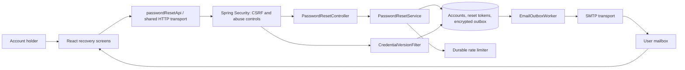
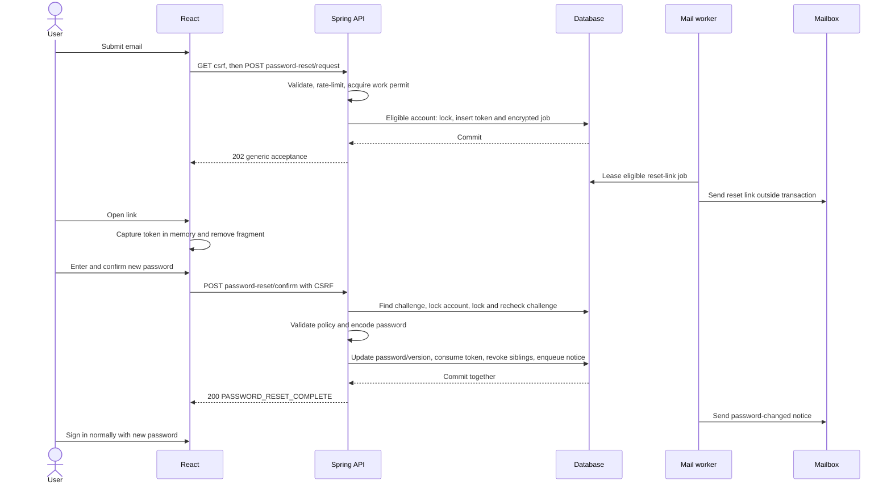

# Password Reset system design

Date: October 10, 2026

Branch: `Password-Reset`

Status: Proposed architecture for review; application behavior is not implemented.

## 1. Purpose and scope

Let an existing account holder who forgot their password recover access through an emailed reset link, choose a new password, and sign in normally. The user selected an emailed link rather than an email code. The feature belongs in the existing React / Spring Boot application and uses its database, session security, and SMTP infrastructure.

Proposed defaults are a 30-minute link lifetime, automatic invalidation of earlier login sessions after completion, and a password-changed notification. These are design decisions rather than existing behavior.

Success means that a reset preserves the account ID, applications, interview stages, and preferences; only the password and credential version change. Requesting or opening a link must not change credentials or terminate sessions. An unknown address must not be distinguishable through the response body or status. Successful confirmation is atomic and cannot be repeated.

Recovery is available to accounts for which `CampusUser.canAuthenticate()` is true: verified accounts and accounts exempt through the legacy migration. Pending signup accounts get the same generic request response but no reset email. Their verification and original signup password remain unchanged. Recovery before first verification is a separate product extension because the current verification flow requires the original signup password. This eligibility boundary requires product review before implementation.

Excluded: changing a known password from settings, recovery without mailbox access, changing the recovery address, SMS, security questions, MFA recovery, and introducing an identity provider. Password reset does not recover a compromised mailbox.

## 2. Verified repository context

| Existing boundary | Verified behavior | Design implication |
| --- | --- | --- |
| `backend/pom.xml` | Java 17; Spring Boot 3.5.16; JPA, JDBC, Flyway, Spring Security and mail | Extend the monolith; no additional service is needed |
| `SecurityConfig` | BCrypt cost 12, server-side sessions, session-backed CSRF; public auth routes are explicitly listed | Add two public POST routes while retaining CSRF |
| `CampusPrincipal` | Session contains a snapshot of credentials; no credential version | Updating the password alone cannot revoke existing sessions |
| `PasswordPolicy` / `src/domain/password.ts` | At least 12 Unicode code points with uppercase, lowercase, number and symbol; at most 72 UTF-8 bytes | Reuse the existing policy and encoder |
| `UserRepository.findByIdForUpdate` | Pessimistic account lock already used by verification | Use one account-first lock order for reset issuance and completion |
| `EmailOutbox` / `EmailOutboxWorker` | Encrypted transactional enqueue, atomic leases, retries, payload erasure; verification-specific foreign key and eligibility query | Generalize message purpose and token references explicitly |
| Two `AuthRateLimiter` classes | Process-local abuse limits plus durable HMAC-keyed verification counters | Reuse both layers without creating ambiguous bean names |
| `AuthWorkLimiter` | Shared bound on concurrent expensive authentication work | Reset requests and password encoding must acquire a permit |
| `src/data/api.ts` | Same-origin cookies, memory-only CSRF, no automatic write replay, session-generation guards | Add a typed reset adapter using the shared transport |
| `src/domain/verificationLink.ts` | Captures and scrubs the verification fragment at module initialization; tracks changes outside React rendering | Use the same pattern for reset links and preserve existing verification links |
| `deploy/postgres/runtime-grants.sql` | Runtime can update only `theme_preference` and `email_verified_at` on accounts | Explicit column grants are necessary for password updates |
| Flyway migrations | V1, V2 and V3 already exist | Add V4; never rewrite an applied migration |

The actual V2 filename is `V2__user_theme_preference.sql`; `docs/CODE_GUIDE.md` calls it `V2__user_preferences.sql`. The guide also attributes token capture directly to `src/main.tsx`; capture actually occurs through the verification-store import used by `AuthGate`. This design follows the source and does not change application code to match those descriptions.

## 3. Approach selection

| Approach | Benefits | Costs | Decision |
| --- | --- | --- | --- |
| Opaque random link backed by a database row | Simple ownership proof; expiry, revocation and atomic single use fit existing transactions | Token table and mail-purpose changes | Selected |
| Email code plus a restricted recovery session | Can be typed on another device | More screens, code-guessing controls and recovery-session state | Unnecessary for the selected link flow |
| Signed stateless reset token | Can validate the signature without a token lookup | Still needs server state for single use and revocation; adds signing-key lifecycle | No benefit over the existing database |

## 4. Components and responsibilities



| Component | Responsibility and interface |
| --- | --- |
| `ForgotPassword.tsx` | Email entry, generic acceptance, explicit resend, throttling and connection errors |
| `ResetPassword.tsx` | New password and confirmation fields, policy feedback, explicit submit, invalid-link and success views |
| `src/domain/passwordResetLink.ts` | Capture `#reset-password=<token>`, scrub the fragment immediately, expose a memory-only external store |
| `src/data/passwordResetApi.ts` | Typed `requestReset(email)` and `confirmReset(token, newPassword)` calls through `request` and `jsonBody` |
| `auth.reset.PasswordResetController` | Validate whitelisted DTOs; enforce IP limits and shared work admission; delegate without choosing an account from JSON |
| `auth.reset.PasswordResetService` | Normalize email, check eligibility, issue challenges, validate tokens, atomically replace credentials and enqueue mail |
| `auth.reset.PasswordResetTokenRepository` | Focused JDBC challenge lookup, locking and lifecycle updates; parameterized SQL |
| `PasswordPolicy` | Existing authoritative policy; expose its validation entry point to the reset subpackage without duplicating rules |
| Durable auth limiter | Purpose-specific reset counters, independent committed reservations, HMAC subject protection and retry durations |
| Mail infrastructure | Typed verification, reset-link and password-changed messages; shared encryption, leasing and transport |
| `CredentialVersionFilter` | Check the authenticated principal's credential version against the database before API dispatch |

Constructor injection remains the backend convention. Existing application hooks and mutations remain outside this subsystem.

## 5. Request and completion flows



### Request issuance

1. Validate a single email address of at most 254 characters. Normalize with trim and `Locale.ROOT` lowercase, matching login. Do not create an account.
2. Apply request IP/global intake limits and acquire the shared authentication work permit before hashing or entering an account transaction. Recipient limits are applied to every normalized address, including unknown ones.
3. Run the same bounded dummy BCrypt operation for every admitted request, including recipient-throttled and unknown addresses. Use asynchronous SMTP for every real message; do not return early solely because an address is absent. This reduces timing differences but does not establish constant-time database behavior; compare response-time distributions during verification.
4. For an eligible address within recipient and mail budgets, lock the account and recheck eligibility. Generate 32 bytes using `SecureRandom`, encode as unpadded base64url, and store only the SHA-256 digest in the challenge row. The URL token is exactly 43 characters.
5. Record the current credential version and email snapshot. Insert the challenge and AES-GCM encrypted reset email in the same transaction. A rollback leaves neither record committed. Do not call SMTP here.
6. Return the same 202 status and body for unknown, pending, recipient-throttled and accepted eligible addresses. A database outage returns a generic service error; never claim a committed enqueue that failed.

Issuing another link does not revoke earlier unexpired links. This prevents an unauthenticated caller from continually invalidating a user's delivered link. Recipient quotas bound concurrent links. Completing any one link revokes all remaining links for that account.

### Completion transaction

1. Validate token shape and new-password policy; apply IP and HMAC-token attempt budgets and acquire the work permit. The old password is not required because the link is the recovery proof.
2. Read the digest-matched challenge to identify the account. Lock the account using `findByIdForUpdate`, then lock and reload the challenge. Recheck account eligibility, email snapshot, credential version, expiry, consumption and revocation.
3. Encode the new password with the existing BCrypt encoder under the permit. Recheck expiry against the injected `Clock` after encoding and before the final mutation. Require `expires_at > now`; exact expiry is invalid.
4. Update only the account password hash and credential version, incrementing the version once. Mark this challenge consumed, revoke other active reset challenges, and cancel their pending/sending reset-link jobs with encrypted-payload erasure.
5. Insert one encrypted password-changed notification job tied to the consumed challenge. Commit all changes together. A failed enqueue or credential update rolls back the whole completion; a later SMTP failure cannot undo it.
6. Return success without authenticating the caller. If the caller was signed in to the reset account, invalidate that local session after commit and expire its cookie. A session belonging to a different account is not changed by the backend reset.

All account/challenge mutation paths use account-first locks. Concurrent confirmations of the same or different links for one account serialize; exactly one succeeds. A request issued after successful reset can create a link against the new credential version.

## 6. API contracts

Both routes are public only in the authentication sense. They still require the existing anonymous session cookie and `X-CSRF-TOKEN`, obtained from `GET /api/auth/csrf`. Responses use `Cache-Control: no-store`. No endpoint returns the raw token, password hash, owner ID or account eligibility.

| Method and route | JSON request | Success |
| --- | --- | --- |
| `POST /api/auth/password-reset/request` | `{ "email": "student@example.test" }` | 202 with the generic body below |
| `POST /api/auth/password-reset/confirm` | `{ "token": "<43-character token>", "newPassword": "<new password>" }` | 200 with completion body below |

```json
{
  "status": "PASSWORD_RESET_REQUEST_ACCEPTED",
  "message": "If this address is eligible for password recovery, a reset link will arrive shortly."
}
```

```json
{
  "status": "PASSWORD_RESET_COMPLETE",
  "message": "Your password has been reset. Sign in with your new password."
}
```

| Status | Meaning and handling |
| --- | --- |
| 400 | Invalid email or password fields; unknown JSON properties rejected |
| 400 / `PASSWORD_RESET_INVALID` | One generic message for malformed, unknown, expired, consumed, revoked or mismatched tokens; malformed-token DTO errors must use this same code/message |
| 403 | Missing or invalid CSRF; refresh CSRF only for the next explicit submission |
| 429 | IP/global intake, confirmation budget or shared-work saturation; positive integer `Retry-After`; recipient issuance suppression still returns 202 |
| 503 | Known temporary infrastructure failure, with a generic message and no internal details |

Use the existing `{ "message": "...", "code": "..." }` error shape where a code applies. DTO string representations redact email, token and password. Password confirmation is client-side only; the API receives one new password. Do not introduce token-validation GET requests, auto-confirmation, or automatic write retries. If completion commits but its response is lost, the UI must explain that the password may already have changed and offer normal sign-in or a new reset request.

## 7. Database and migration design

Add `V4__password_reset.sql` after verifying V4 remains unused at implementation time. Use UUIDs and microsecond UTC instants as in V3; verify syntax and locking on both H2 and PostgreSQL.

### Account credential version

Add `campus_users.credential_version BIGINT NOT NULL DEFAULT 0`, constrained to nonnegative values. Existing and new accounts start at zero. Add the field to the entity and principal; keep it out of public user DTOs. Use a focused account credential mutation so an older entity snapshot cannot overwrite theme or verification state.

### Reset challenges

| `password_reset_tokens` column | Constraint / purpose |
| --- | --- |
| `id` | UUID primary key |
| `user_id` | Non-null foreign key to `campus_users(id)` |
| `email` | Non-null VARCHAR(254); issuance snapshot |
| `token_hash` | Non-null unique VARCHAR(64); SHA-256 hex digest |
| `credential_version` | Non-null BIGINT; issuance snapshot |
| `created_at`, `expires_at` | Non-null UTC timestamps; expiry after creation |
| `consumed_at`, `revoked_at` | Nullable lifecycle timestamps; never both set for the same challenge |

Index `(user_id, expires_at)` for sibling revocation and expiry cleanup. Index `expires_at` for cleanup if query plans justify it. The digest uniqueness index serves confirmation lookup.

### Generalized encrypted outbox

Keep `email_outbox` and its current lease/status/retry columns. Add non-null `message_type`, constrained to the three purposes below and defaulting existing rows to `EMAIL_VERIFICATION`, and nullable `password_reset_token_id` referencing the new table. Make `verification_token_id` nullable. Enforce these reference combinations with a CHECK constraint:

- `EMAIL_VERIFICATION`: verification reference present, reset reference absent.
- `PASSWORD_RESET_LINK`: reset reference present, verification reference absent.
- `PASSWORD_CHANGED`: reset reference present, verification reference absent. The service and worker enforce consumption of the referenced challenge; a row CHECK cannot validate another table's lifecycle state.

Add uniqueness on `(message_type, password_reset_token_id)` so each challenge has at most one link job and one completion notice. Existing verification rows remain valid because their reset reference is null. Change verification-specific cancellation and cleanup queries to target only verification jobs; add analogous reset cleanup.

New encrypted payloads include a payload version and message type along with recipient and optional token. On decryption, require the authenticated payload type to match the row type before rendering. Preserve the current job-ID/key-ID AES-GCM binding. Decode old recipient/token payloads only for `EMAIL_VERIFICATION` rows, allowing queued legacy mail to survive upgrade. A notice contains no reset token or password.

Delete terminal outbox rows after seven days, then expired reset challenges older than seven days with no remaining outbox reference. Erase encrypted payload, key ID and nonce immediately when a job becomes SENT, CANCELLED or FAILED. Retain no plaintext reset secrets in audit records.

### PostgreSQL privilege changes

Extend `deploy/postgres/runtime-grants.sql` with column-level UPDATE permission on `password_hash` and `credential_version`, plus SELECT/INSERT/UPDATE/DELETE on `password_reset_tokens`. Retain the existing column grants and all denials on identity, exemption state, DDL, account deletion and Flyway history. This deliberately expands the runtime credential-write boundary; it does not grant table-wide account UPDATE.

`PostgresPrivilegesIT` currently expects password-hash UPDATE to fail. Replace that expectation with an allowed credential-update assertion and keep forbidden-column assertions. Provisioning and upgrade verification must apply the new grants as well as V4. Production uses the existing schema-owner migration path rather than enabling Flyway under runtime credentials.

## 8. Session invalidation and concurrency

Incrementing a database credential version makes session revocation independent of a process-local session registry. Every login loads password hash and version from the same account snapshot. An authenticated API request must compare its principal version to the current account version with an uncached database read. An absent account or mismatch clears the security context, invalidates the local session, expires the cookie and returns generic 401 for protected API routes.

Place `CredentialVersionFilter` after the security context is loaded and before CSRF/authentication/authorization handling for API requests. This allows a stale session to be discarded before a public CSRF or reset request: public authentication endpoints continue anonymously, while protected routes receive 401. Preserve the existing anonymous session-creation budget after that invalidation. Verify actual filter order against Spring Security 6 as resolved by Boot 3.5.16; do not register the filter twice through servlet component scanning.

A request checked after reset commit cannot use an older credential version. An already admitted in-flight request may finish; the feature does not promise cancellation of transactions already running. A login racing reset may create an old-version principal, but its next API request is rejected. A post-authentication version check in the login success handler should also reject an already stale snapshot before returning the profile. No positive version cache is allowed in the initial design because it would delay revocation.

Database lookup failure must fail closed for authenticated requests with a generic 503. Account version lookup is indexed by the primary key. Multi-instance deployment still needs session affinity or shared session storage for existing login behavior; this design does not introduce distributed session storage.

## 9. Email delivery, abuse controls and operations

Extend `EmailSender` to accept a typed message including job ID, purpose, recipient and optional token. Keep SMTP connection settings and encryption secrets in the existing mail configuration. Use a stable job-based Message-ID for retries, including token-free notices. Preserve verification templates and their `#verify-email=` links.

Reset links are `${campus.mail.public-origin}/#reset-password=<token>` using the configured trusted origin, never a request Host header. Production requires HTTPS. The worker checks expiry, current email, eligibility, credential version and token state both when claiming and immediately before delivering a link. Notices require a consumed challenge and matching account email but remain deliverable after the challenge's original expiry, for up to 24 hours after notice enqueue.

Reuse the worker's short leases, batch size, bounded attempts and retry policy. Cancel a link job when its token expires instead of extending its lifetime to accommodate mail delays. SMTP runs outside database transactions. Delivery is at least once: a crash after SMTP acceptance can produce a duplicate message with the same job/token. A send racing revocation can deliver an unusable link; confirmation checks remain authoritative.

Initial configurable limits:

| Scope | Proposed budget | Response |
| --- | --- | --- |
| Reset request per IP | 5/minute and 30/hour | 429 with Retry-After |
| Global reset intake | 100/minute, counting all addresses | 429 with Retry-After |
| Reset issuance per normalized address | 1/minute, 5/hour, 10/day, including unknown-address reservations | Generic 202 when suppressed |
| Reset confirmation per IP | 10/minute | 429 with Retry-After |
| Reset confirmation per HMAC-protected token | 10/15 minutes | 429 with Retry-After |
| Link-mail issuance | Share the existing 1,000/day verification mail ceiling | Generic 202 when suppressed |
| Password-changed notices | Separate bounded SMTP budget of 1,000/day | Defer delivery; never roll back an already committed reset |
| Expensive authentication work | Existing shared `AuthWorkLimiter` maximum-active policy | 429; release permit on every path |

Use distinct `reset-*` counter scopes in the existing `auth_rate_limits` table and the configured HMAC secret. Reuse the existing independently committed counter algorithm; do not hold counter locks across an account transaction or SMTP call. Add remaining-window information for durable reset 429 responses because the current verification limiter does not supply Retry-After. Recipient/mail suppression must not produce address-specific error bodies.

Queue notices transactionally even if their delivery budget is exhausted. The worker defers them to the next allowed window or marks them FAILED when the 24-hour delivery deadline is reached. Notice failure is operationally visible and never restores the previous password.

Log purpose, job ID, aggregate outcome, latency and sanitized failure category. Do not log emails, password values, raw tokens, token hashes, request bodies or complete reset URLs. Monitor mail queue age, reset completion counts, invalid attempts, work saturation and terminal mail failures. The 30-minute TTL and stated limits are initial application choices, not externally mandated values.

## 10. Frontend behavior

Add “Forgot password?” to the sign-in screen. After an accepted request, show the generic response, advice to check the mailbox, an explicit resend action and a return-to-sign-in action. Include a neutral verification-help link for users whose signup is still pending without revealing whether the submitted account is pending.

Capture recognized reset fragments before rendering, clear them with `history.replaceState`, and store tokens only in module memory. Preserve verification-link handling. Validate exact token shape locally; malformed links show a recovery action without a request. Opening the link never consumes it. A reload loses the token and asks the user to reopen the email. Support `hashchange` and React StrictMode without consuming a fragment twice.

The reset screen has new-password and confirm-password fields with `autocomplete="new-password"`, visible policy feedback, labelled controls, accessible error/success announcements and a disabled submit while pending. Enforce password matching locally and reuse `passwordError`; the server remains authoritative. Use existing theme tokens.

If a user is already signed in, require explicit sign-out before submitting recovery. Do not compare the link to the signed-in account or infer its owner. Guard logout and reset responses so delayed results cannot clear a newer login or theme session. Success clears password/token memory, discards the anonymous CSRF cache and offers normal sign-in; login refreshes CSRF through the existing path. A different account's session must never be cleared by a stale recovery response.

Apply `Referrer-Policy: no-referrer` on recovery rendering and avoid third-party scripts/assets there. Treat the token as a credential even though URL fragments are not sent in normal HTTP requests. Memory storage and fragment removal reduce accidental exposure; they do not protect against malicious script execution.

## 11. Validation and acceptance criteria

This document proposes tests; it does not report those tests as executed.

| Layer | Required evidence before feature completion |
| --- | --- |
| Domain/frontend tests | Policy parity including Unicode/byte boundary; matching confirmation; fragment capture/scrubbing; StrictMode, reload and hashchange; existing verification flow preserved |
| API adapter tests | Correct JSON/CSRF/cookies; generic acceptance; Retry-After; no automatic writes; lost-response guidance; stale response cannot affect a newer session |
| Backend integration | Known, unknown, pending and legacy accounts; identical accepted bodies; unknown-field rejection; missing CSRF; token expiry boundary, malformed/unknown/reused/revoked tokens; no account IDs trusted from JSON |
| Transaction/concurrency | Simultaneous confirmations of same and sibling tokens; issue versus confirm; rollback on notification enqueue failure; exactly one credential-version increment; theme and verification updates preserved |
| Sessions | Two pre-reset sessions rejected on next protected request; other account unaffected; old password denied and new password accepted; login/reset race; public CSRF usable after stale-session clearing; database failures fail closed |
| Outbox | Legacy queued payloads survive migration; verification/reset/notice eligibility remains distinct; tampered payload/type rejected; duplicate SMTP behavior, leases, expiry cancellation, notice deadline and payload erasure |
| Rate limits | Counters survive restart; exact concurrent quota reservation; Retry-After positive; unknown-address recipient reservations; shared work permit recovery; cross-instance limits |
| Migrations/PostgreSQL | Fresh and V3-upgrade databases under restricted runtime role; allowed credential updates; other column/DDL denials; constraints and lock behavior verified on real PostgreSQL |
| HTTP/browser smoke | Capture SMTP locally, reset through real HTTP, sign in, retain records/preferences, restart H2; mail preview GET cannot consume link; browser accessibility/console and theme checks |

Relevant implementation commands, from the documented directories:

```powershell
# Repository root
npm test
npm run build

# backend/
.\mvnw.cmd test
.\mvnw.cmd -Ppostgres-it verify
.\mvnw.cmd -Pwith-ui clean package

# Repository root, after bundled packaging
npm run test:smoke
```

The `postgres-it` profile requires Docker/Testcontainers or the existing configured local PostgreSQL binary mode; passing H2 tests alone does not establish PostgreSQL compatibility. The validation record documents a Windows wrapper failure and cached Maven workaround; verify launcher availability when implementing. Tests use disposable databases and synthetic accounts, never delete or migrate a user's local H2 database.

Before rollout, apply V4 and updated runtime grants through the existing migration procedure, validate mail/public-origin settings, deploy the matching backend/frontend together, and exercise the flow using a controlled mailbox. Rolling back to code without credential-version checks weakens session revocation, so an operational rollback must invalidate existing server sessions. Do not roll back the schema by deleting recovery records or editing applied migration history.

## 12. Review decisions and references

User-selected: emailed reset link. Proposed for review: 30-minute expiry, eligible verified/legacy accounts, multiple outstanding links until completion, automatic credential-version revocation and password-changed notification. Architecture/documentation is the current deliverable; implementation requires a subsequent request and review of this spec.

Repository references: [API contracts](../../API.md), [code guide](../../CODE_GUIDE.md), [authentication security](../../AUTHENTICATION-SECURITY.md), [database security](../../DATABASE-SECURITY.md), and [validation record](../../../VALIDATION.md).

External guidance checked October 10, 2026: [OWASP Forgot Password Cheat Sheet](https://cheatsheetseries.owasp.org/cheatsheets/Forgot_Password_Cheat_Sheet.html) supports private recovery responses, expiring single-use tokens, normal login after recovery, and session invalidation. Exact TTLs, counters, schema, mail types and credential-version enforcement above are application design choices. [Spring Security servlet architecture](https://docs.spring.io/spring-security/reference/servlet/architecture.html) describes security filter placement; final ordering must be checked against the installed dependency version.
