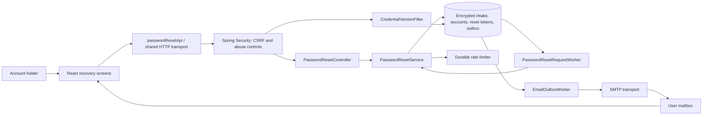
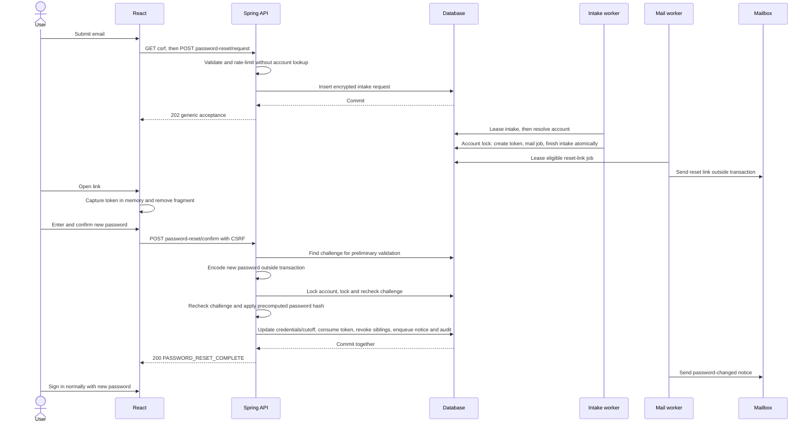

# Password Reset system design

Date: October 10, 2026

Branch: `Password-Reset`

Status: Reviewed production architecture specification, revised October 11, 2026. Implementation is authorized; deployment release evidence remains required.

## 1. Purpose and scope

Let an existing account holder who forgot their password recover access through an emailed reset link, choose a new password, and sign in normally. The user selected an emailed link rather than an email code. The feature belongs in the existing React / Spring Boot application and uses its database, session security, and SMTP infrastructure.

The production defaults are a 30-minute link lifetime, durable asynchronous request intake, automatic invalidation of earlier login sessions after completion, and a password-changed notification. These are architecture requirements rather than existing behavior. Production readiness requires the release evidence in sections 11–14; a design document alone does not establish it.

Success means that a reset preserves the account ID, applications, interview stages and preferences; only credentials and recovery-security metadata change. Requesting or opening a link must not change credentials or terminate sessions. An unknown address must not be distinguishable through the response body or status. Successful confirmation is atomic and cannot be repeated.

Recovery covers verified, legacy-exempt and pending-signup accounts. A pending account can replace its forgotten password, but reset never changes `email_verified_at` or `email_verification_exempt`. It must still complete the existing verification flow using its new password and a verification link before login. Existing valid verification links remain usable with the new password; the user can explicitly resend verification if needed. Unknown addresses never create accounts. The repository does not currently model disabled accounts; if that state is introduced, recovery must not remove an administrative disable or login restriction.

Excluded: changing a known password from settings, recovery without mailbox access, changing the recovery address, SMS, security questions, MFA recovery, and introducing an identity provider. Password reset does not recover a compromised mailbox.

## 2. Verified repository context

| Existing boundary | Verified behavior | Design implication |
| --- | --- | --- |
| `backend/pom.xml` | Java 17; Spring Boot 3.5.16; JPA, JDBC, Flyway, Spring Security and mail | Extend the monolith; no additional service is needed |
| `SecurityConfig` | BCrypt cost 12, server-side sessions, session-backed CSRF; public auth routes are explicitly listed | Add two public POST routes while retaining CSRF |
| `CampusPrincipal` | Session contains a snapshot of credentials; no credential version | Updating the password alone cannot revoke existing sessions |
| `PasswordPolicy` / `src/domain/password.ts` | At least 12 Unicode code points with uppercase, lowercase, number and symbol; at most 72 UTF-8 bytes | Update signup and reset together to 15 Unicode code points, no composition rules, and a common/compromised-password blocklist. Keep BCrypt cost 12 and reject more than 72 UTF-8 bytes without truncation; existing login passwords remain valid |
| `UserRepository.findByIdForUpdate` | Pessimistic account lock already used by verification | Use one account-first lock order for reset issuance and completion |
| `EmailOutbox` / `EmailOutboxWorker` | Encrypted transactional enqueue, atomic leases, retries, payload erasure; verification-specific foreign key and eligibility query | Generalize message purpose and token references explicitly |
| `OutboxCrypto` | Decrypts only with its one configured key ID | A deployment-safe decrypt key ring is required before key rotation |
| Two `AuthRateLimiter` classes | Process-local abuse limits plus durable HMAC-keyed verification counters | Reuse both layers without creating ambiguous bean names |
| `AuthWorkLimiter` | Shared bound on concurrent expensive authentication work | Confirmation encoding uses this permit; account-independent intake has its own bounded ingress admission |
| `src/data/api.ts` | Same-origin cookies, memory-only CSRF, no automatic write replay, session-generation guards | Add a typed reset adapter using the shared transport |
| `src/domain/verificationLink.ts` | Captures and scrubs the verification fragment at module initialization; tracks changes outside React rendering | Use the same pattern for reset links and preserve existing verification links |
| `deploy/postgres/runtime-grants.sql` | Runtime can update only `theme_preference` and `email_verified_at` on accounts | Explicit column grants are necessary for password updates |
| Flyway migrations | V1, V2 and V3 already exist | Add V5; never rewrite an applied migration |

The cached Boot 3.5.16 dependency-management POM specifies Spring Security 6.5.11. The production build must confirm the resolved tree and test filter ordering against that version. The existing scheduler polls email every five seconds and runs delivery serially; the throughput/availability targets below require explicit bounded worker configuration and measurement, rather than assuming those defaults scale.

The actual V2 filename is `V2__user_theme_preference.sql`; `docs/CODE_GUIDE.md` calls it `V2__user_preferences.sql`. The guide also attributes token capture directly to `src/main.tsx`; capture actually occurs through the verification-store import used by `AuthGate`. This design follows the source and does not change application code to match those descriptions.

## 3. Approach selection

| Approach | Benefits | Costs | Decision |
| --- | --- | --- | --- |
| Opaque random link backed by a database row | Simple ownership proof; expiry, revocation and atomic single use fit existing transactions | Token table and mail-purpose changes | Selected |
| Email code plus a restricted recovery session | Can be typed on another device | More screens, code-guessing controls and recovery-session state | Unnecessary for the selected link flow |
| Signed stateless reset token | Can validate the signature without a token lookup | Still needs server state for single use and revocation; adds signing-key lifecycle | No benefit over the existing database |

## 4. Components and responsibilities



| Component | Responsibility and interface |
| --- | --- |
| `ForgotPassword.tsx` | Email entry, generic acceptance, explicit resend, throttling and connection errors |
| `ResetPassword.tsx` | New password and confirmation fields, policy feedback, explicit submit, invalid-link and success views |
| `src/domain/passwordResetLink.ts` | Capture `#reset-password=<token>`, scrub the fragment immediately, expose a memory-only external store |
| `src/data/passwordResetApi.ts` | Typed `requestReset(email)` and `confirmReset(token, newPassword)` calls through `request` and `jsonBody` |
| `auth.reset.PasswordResetController` | Validate whitelisted DTOs; enforce intake or confirmation admission; never look up an account while returning request acceptance |
| `auth.reset.PasswordResetService` | Accept encrypted requests; issue challenges in worker transactions; validate tokens; atomically replace credentials and enqueue mail |
| `auth.reset.PasswordResetRequestWorker` | Lease encrypted intake jobs, resolve accounts after acceptance, issue at most one challenge per intake and erase resolved payloads |
| `auth.reset.PasswordResetTokenRepository` | Focused JDBC challenge lookup, locking and lifecycle updates; parameterized SQL |
| `PasswordPolicy` | Existing authoritative policy; expose its validation entry point to the reset subpackage without duplicating rules |
| Durable auth limiter | Purpose-specific reset counters, independent committed reservations, HMAC subject protection and retry durations |
| Mail infrastructure | Typed verification, reset-link and password-changed messages; shared encryption, leasing and transport |
| `CredentialVersionFilter` | Check the authenticated principal's credential version against the database before API dispatch |

Use explicit TransactionTemplate blocks or separate collaborators; never rely on same-bean transactional self-invocation. Encoding and independently committed quotas remain outside account transactions. Constructor injection remains the backend convention. Existing application hooks and mutations remain outside this subsystem.

## 5. Request and completion flows



### Durable request intake

1. Validate a single email address of at most 254 characters. Normalize with trim and `Locale.ROOT` lowercase, matching login. Require JSON, reject unknown/duplicate fields and enforce a 4 KiB decoded body limit before binding. Never create an account.
2. Apply shared IP/global intake and recipient budgets to every normalized address. Recipient suppression returns generic 202 for both existing and unknown addresses and does not enqueue. A bounded process-local ingress permit limits concurrent database/encryption work; it is separate from the BCrypt work permit.
3. For every admitted address, encrypt the normalized email and insert a `password_reset_requests` row in a short transaction. Allocate a database sequence `request_order` without reading `campus_users`. Return 202 only after this transaction commits. The route does no account lookup, dummy BCrypt, SMTP, token issuance or password mutation.
4. All accepted requests share the same response shape and account-independent processing path. Timing tests still cover quotas, input lengths and infrastructure errors, but address existence cannot select a faster synchronous branch. There is no public polling/status endpoint that could reveal the worker outcome.
5. Database/encryption failure produces a generic 503. When durable intake is unavailable, do not return acceptance or fall back to synchronous account lookup. A network failure after commit has an ambiguous outcome; an explicit subsequent request remains bounded by address quotas.

### Worker issuance

1. Poll intake every second with a bounded batch. Lease jobs with an atomic owner/expiry update in a short transaction. Decrypt outside the account transaction, using a permitted key ID and authenticated payload type. Expire requests that have not finished within ten minutes of intake.
2. Resolve the candidate account only here, outside the account transaction. Unknown addresses are finalized without mail. For a candidate, reserve the shared link-mail issuance budget through an independently committed limiter call before entering the account transaction. Budget exhaustion terminates intake generically rather than retrying it into a future mail window; delivery retries belong to an already issued token. Across verification and reset producers, reserve recipient admission before charging the shared global issuance bucket. Separate attempts from issuance; production global ceilings cannot be disabled by verification flags. Reservations consumed before a later rollback/supersession are intentionally not refunded.
3. Start the issuance transaction and lock the candidate account first; then lock/recheck the intake row, lease owner, deadline and `request_order > campus_users.reset_request_cutoff`. Recheck the email against the locked account. A stale request must never issue another usable link after a successful reset.
4. Generate 32 bytes with `SecureRandom`, encoded as a canonical unpadded 43-character base64url token. Store only its SHA-256 digest in the challenge row. Store the current email and credential version, and start the 30-minute TTL at issuance rather than intake or SMTP acceptance.
5. Insert the challenge and encrypted mail job and mark intake DONE with payload erasure in the same transaction. Finalization must conditionally match the live lease owner and deadline and affect exactly one row, or roll back issuance. A unique challenge reference to the intake ID prevents duplicate issuance after crashes or lease takeover. A rollback changes none of these records.
6. For unknown, expired, superseded or mail-suppressed requests, finalize intake and erase the payload without an account-specific HTTP response. Transient database failures retry a still-live intake with bounded backoff; invalid ciphertext is terminal and raises an operational alert.

Order is allocated from `auth_security_event_order`, a non-cycling database sequence with CACHE 1, also used during completion. Per-connection blocks of cached sequence values must not be used because they can break chronological ordering across connections. Gaps are harmless and rollback does not require sequence reuse. After acquiring the account lock, completion advances that account's cutoff to a newly allocated order. Issuance against an older request is rejected even if it is still queued. The ordering describes sequence allocation, not transaction commit order; a request allocated while completion is in flight may safely be suppressed. This does not depend on clocks across application replicas.

Issuing another link does not revoke earlier unexpired links. This prevents an unauthenticated caller from continually invalidating a user's delivered link. Recipient quotas bound concurrent links. Completing any one link revokes all remaining links for that account.

### Completion transaction

1. Enforce the body limit, strict JSON contract, global/IP and HMAC-token budgets, and password policy before expensive work. Acquire the shared BCrypt permit. The old password is not required because the link is the recovery proof.
2. Read the digest-matched challenge and reject inactive or expired challenges before encoding. Compute the new BCrypt hash outside a database transaction while holding the permit. Avoid holding an account row lock or pooled connection during BCrypt.
3. Start a short READ COMMITTED transaction. Lock the account using `findByIdForUpdate`, then lock and reload the challenge. Recheck email snapshot, credential version, lifecycle and expiry against authoritative database UTC time. Require `expires_at > now`; exact expiry is invalid. Use PostgreSQL `clock_timestamp()` at final conditional consumption, not transaction-start `CURRENT_TIMESTAMP`, which can become stale while waiting for a lock. Supply the H2 equivalent through a tested database-time abstraction; an injected time source supports deterministic unit tests. Do not trust independent application-replica clocks for production expiry.
4. Update only password hash, credential version and the newly allocated reset-request cutoff. Increment the version once. Conditionally consume this still-active, unexpired challenge and require exactly one affected row; otherwise roll back the credential update. Revoke other active reset challenges and cancel their pending/sending reset-link jobs with encrypted-payload erasure. Pending intake with an earlier order is subsequently suppressed by the worker.
5. Insert one encrypted password-changed notification job and one completion audit event tied to the consumed challenge. Commit all changes together. Audit insertion, enqueue or credential-update failure rolls back the whole completion; a later SMTP/export failure cannot undo it.
6. Return success without authenticating the caller. If the request principal belongs to the reset account, clear only that request's security context after commit. The committed credential epoch revokes old sessions logically. Do not invalidate a shared HTTP session or send a cookie-deletion header: a concurrent login may already have reused the session for a newer account.

All account/challenge mutation paths use account-first locks; intake lease transactions end before acquiring an account lock. Lock mail jobs in stable ID order when touching multiple rows. Workers must never hold a mail/intake lease-row lock while requesting an account lock. Concurrent confirmations of the same or different links for one account serialize; exactly one succeeds. A new intake allocated after successful reset can create a link against the new credential version.

Use bounded database lock/statement timeouts. Map timeout/deadlock failures in confirmation to a generic retryable 503 only when rollback is known; do not replay the write automatically. A lost connection during commit is ambiguous and the UI must use the lost-response guidance. Quota reservations remain consumed after rollback. Token consumption and revocation are never committed independently of the credential update.

## 6. API contracts

Both routes are public only in the authentication sense. They still require the existing session cookie and `X-CSRF-TOKEN`, obtained from `GET /api/auth/csrf`. Anonymous callers are supported. Responses, including errors, use `Cache-Control: no-store`. No endpoint returns the raw token, password hash, owner ID, intake ID or account eligibility. A 202 acknowledges receipt for asynchronous evaluation, not successful delivery or account existence.

| Method and route | JSON request | Success |
| --- | --- | --- |
| `POST /api/auth/password-reset/request` | `{ "email": "student@example.test" }` | 202 with the generic body below |
| `POST /api/auth/password-reset/confirm` | `{ "token": "<43-character token>", "newPassword": "<new password>" }` | 200 with completion body below |

```json
{
  "status": "PASSWORD_RESET_REQUEST_ACCEPTED",
  "message": "If recovery is available for this address, check your inbox for a reset link."
}
```

```json
{
  "status": "PASSWORD_RESET_COMPLETE",
  "message": "Your password has been reset. Sign in with your new password."
}
```

| Status | Meaning and handling |
| --- | --- |
| 400 | Invalid email or password fields; unknown JSON properties rejected |
| 400 / `PASSWORD_RESET_INVALID` | One generic message for malformed, unknown, expired, consumed, revoked or mismatched tokens; malformed-token DTO errors must use this same code/message |
| 403 | Missing or invalid CSRF; refresh CSRF only for the next explicit submission |
| 413 / 415 | Decoded body exceeds 4 KiB / unsupported Content-Type or content encoding; reject before JSON binding |
| 429 | IP/global intake, confirmation budget or shared-work saturation; positive integer `Retry-After`; recipient issuance suppression still returns 202 |
| 503 | Known temporary infrastructure failure, with a generic message and no internal details |

Use the existing `{ "message": "...", "code": "..." }` error shape where a code applies. DTO string representations redact email, token and password. Password confirmation is client-side only; the API receives one new password. Do not introduce token-validation GET requests, auto-confirmation, or automatic write retries. If completion commits but its response is lost, the UI must explain that the password may already have changed and offer normal sign-in or a new reset request.

## 7. Database and migration design

Add `V4__password_reset.sql` after verifying V5 remains unused at implementation time. Use UUIDs and microsecond UTC instants as in V3; verify syntax and locking on both H2 and PostgreSQL.

### Account credential version

Add `campus_users.credential_version BIGINT NOT NULL DEFAULT 0` and `reset_request_cutoff BIGINT NOT NULL DEFAULT 0`, constrained to nonnegative values. Existing and new accounts start at zero. Add credential version to the entity and principal; keep both fields out of public user DTOs. Use a focused account credential mutation so an older entity snapshot cannot overwrite theme or verification state. Reset never updates either email-verification column.

### Encrypted request intake

Create the non-cycling BIGINT sequence `auth_security_event_order`, starting at one with CACHE 1, and `password_reset_requests`:

| Column | Constraint / purpose |
| --- | --- |
| `id`, `request_order` | UUID primary key; unique non-null positive BIGINT order allocated from the sequence |
| `payload`, `key_id`, `nonce` | Encrypted normalized email and payload metadata; present in PENDING/PROCESSING states, null in terminal states |
| `status` | PENDING, PROCESSING, DONE, CANCELLED or FAILED |
| `attempts`, `next_attempt_at` | Nonnegative bounded retry count and next UTC attempt time |
| `lease_owner`, `lease_expires_at` | Both present only when PROCESSING; fencing owner for atomic transitions |
| `created_at`, `expires_at`, `completed_at` | Database UTC times; ten-minute processing deadline; completion set only for terminal states |
| `failure_category` | Sanitized enum; no raw SMTP, email or exception text |

Index `(status, next_attempt_at)` and `(status, lease_expires_at)` for due work and takeover, and terminal completion time for bounded cleanup. Encryption authenticates the intake purpose, payload version, job ID and key ID. Resolve unknown addresses into DONE without a stored account-existence reason. Lease the intake for 30 seconds; use at most five claims with 1/5/15/60-second jittered backoff, limited by its ten-minute deadline. Every finalize/retry uses a conditional update on the still-live lease owner.

### Recovery admission controls

Create `password_reset_control` with one migration-owned singleton row: `id = 1`, `enabled = false`, `operator_intake_paused = false` and `health_intake_paused = false`, all flags non-null. Only the deployment/operations identity changes enabled/operator pause; runtime can SELECT and UPDATE only health pause. Read on the primary without a positive cache at API admission and worker claims. Missing/unreadable control state fails closed.

When disabled, reject reset request/confirmation with generic 503 and stop new intake processing and reset-link dispatch. Password-changed notices for committed events may still deliver. Either intake-pause flag rejects new intake only: confirmation and processing of already accepted requests continue, allowing backlog recovery. A separate health task controls health pause based on worker heartbeat/queue age and never clears an operator pause. Deployment drains admitted work before relying on disabled mode; a flag change does not cancel a transaction already running. These controls are private operator interfaces, not public API routes.

### Reset challenges

| `password_reset_tokens` column | Constraint / purpose |
| --- | --- |
| `id` | UUID primary key |
| `request_id` | Non-null unique foreign key to `password_reset_requests(id)`; one issued challenge per intake |
| `user_id` | Non-null foreign key to `campus_users(id)` |
| `email` | Non-null VARCHAR(254); issuance snapshot |
| `token_hash` | Non-null unique VARCHAR(64); SHA-256 hex digest |
| `credential_version` | Non-null BIGINT; issuance snapshot |
| `created_at`, `expires_at` | Non-null UTC timestamps; expiry after creation |
| `consumed_at`, `revoked_at` | Nullable lifecycle timestamps; never both set for the same challenge |

Index `(user_id, expires_at)` for sibling revocation and expiry cleanup. Index `expires_at` for cleanup if query plans justify it. The digest uniqueness index serves confirmation lookup.

### Completion audit events

Create `auth_security_events` with UUID `id`, unique non-null `completion_id` (the consumed challenge UUID, without an FK that would prevent earlier challenge cleanup), `event_type` constrained to `PASSWORD_RESET_COMPLETED`, database UTC `occurred_at`, versioned HMAC `account_subject`, and a server-generated UUID correlation ID. Never copy an arbitrary caller correlation header into security logs. No account email, plaintext secret or password hash belongs in this table. Insert one event in the same transaction as consumption and notification. Index `occurred_at` for export/retention. Runtime receives SELECT/INSERT only; UPDATE/DELETE are denied. A separate operator retention job with DELETE and SELECT(id, occurred_at) permissions purges records after 30 days, without giving the web process maintenance credentials. The downstream restricted audit sink must have equivalent or stricter retention and access controls.

### Generalized encrypted outbox

Keep `email_outbox` and its current lease/status/retry columns. Add non-null `message_type`, constrained to the three purposes below and defaulting existing rows to `EMAIL_VERIFICATION`, and nullable `password_reset_token_id` referencing the new table. Make `verification_token_id` nullable. Enforce these reference combinations with a CHECK constraint:

- `EMAIL_VERIFICATION`: verification reference present, reset reference absent.
- `PASSWORD_RESET_LINK`: reset reference present, verification reference absent.
- `PASSWORD_CHANGED`: reset reference present, verification reference absent. The service and worker enforce consumption of the referenced challenge; a row CHECK cannot validate another table's lifecycle state.

Add uniqueness on `(message_type, password_reset_token_id)` so each challenge has at most one link job and one completion notice. Existing verification rows remain valid because their reset reference is null. Change verification-specific cancellation and cleanup queries to target only verification jobs; add analogous reset cleanup.

New encrypted payloads include a payload version and message type along with recipient and optional token. On decryption, require the authenticated payload type to match the row type before rendering. Preserve the current job-ID/key-ID AES-GCM binding. Decode old recipient/token payloads only for `EMAIL_VERIFICATION` rows, allowing queued legacy mail to survive upgrade. A notice contains no reset token or password. Its template identifies the service and UTC reset time, and directs unauthorized-change reports to the configured help destination; it does not promise reversal or mailbox-compromise recovery.

Erase intake ciphertext immediately on terminal transition. Delete terminal intake with no challenge reference after 24 hours. Delete terminal outbox rows after seven days, then expired reset challenges older than seven days with no remaining outbox reference, then their unreferenced intake rows. Expire active work regardless of a stopped mail worker through a separately scheduled bounded maintenance task. Cleanup uses indexed batches of at most 1,000 rows and separate short transactions for mail, challenge and intake phases; it must not hold a mail-row lock while acquiring a challenge/account lock. Test races with active completion and multiple cleanup replicas. Erase outbox payload, key ID and nonce immediately on SENT, CANCELLED or FAILED. Retain no plaintext reset secrets in audit records.

### PostgreSQL privilege changes

Extend `deploy/postgres/runtime-grants.sql` with column-level UPDATE permission on `password_hash`, `credential_version` and `reset_request_cutoff`, SELECT/INSERT/UPDATE/DELETE on the intake/challenge tables, SELECT/INSERT on audit events, SELECT plus health-pause-column UPDATE on the control row, and USAGE on `auth_security_event_order` without sequence UPDATE/ALTER rights. Grant a separate retention identity DELETE and SELECT(id, occurred_at) only on audit events; it has no web-process role membership. Retain existing column grants and all denials on identity, exemption state, DDL, account deletion and Flyway history. This deliberately expands the runtime credential-write boundary; it does not grant table-wide account UPDATE or permission to enable recovery.

Both `PostgresPrivilegesIT` and `deploy/postgres/verify-runtime.sql` currently forbid password-hash UPDATE. Update both to assert the exact allowed credential columns, new table DML and sequence USAGE; retain forbidden-column and table-wide UPDATE assertions. Provisioning and upgrade verification must apply the new grants as well as V5. Production uses the existing schema-owner migration path rather than enabling Flyway under runtime credentials.

## 8. Session invalidation and concurrency

Incrementing a database credential version makes session revocation independent of a process-local session registry. Every login loads password hash and version from the same account snapshot. An authenticated API request must compare its principal version to the current account version with an uncached READ COMMITTED read on the write primary, never a lagging replica. An absent account, missing version in a legacy session or mismatch clears only the request-local security context and returns generic 401 for protected API routes. Never invalidate the shared HTTP session or mutate its stored context from a delayed rejection: session-ID rotation can reuse the same session object for a newer login. Redact the principal's generated string representation as well as request DTOs.

Required API filter order is security-context loading, response security headers, `CredentialVersionFilter`, `AuthAbuseFilter`, `CsrfFilter`, logout/login processing, then authorization. Register the version filter before the already-registered `AuthAbuseFilter`, and assert the order in a filter-chain test. It must write its own JSON 401/503 responses because it runs before exception translation; MVC advice cannot handle those failures. Disable duplicate servlet registration if exposing it as a bean.

A stale principal is removed from the request context before a public CSRF or reset request: public authentication endpoints continue anonymously, while protected routes receive 401. Session allocation remains subject to the anonymous creation budget. Successful reset clears the submitting request's context only if its principal belongs to the reset account, after commit. Every old session is logically revoked by the committed epoch; obsolete session state expires normally or is replaced by a new login. The post-login epoch fence also clears only request-local authentication when it rejects a stale login or cannot verify the primary. Intentional logout remains an explicit session invalidation.

A request checked after reset commit cannot use an older credential version. An already admitted in-flight request may finish; the feature does not promise cancellation of transactions already running. Login authentication remains request-local until the success handler checks the primary credential epoch and explicitly saves the context, with both steps under the same session mutex. Spring's default pre-handler session persistence must be disabled for form login: a rejected older login must never overwrite a newer successful login. The bounded authentication work limit also bounds requests waiting at this mutex; BCrypt runs outside it. Reset can commit after a successful login fence, but its next API request is rejected. No positive version cache is allowed because it would delay revocation. Ensure every protected API route uses this chain, including preferences, application reads and writes and any future async dispatch.

Database lookup failure must fail closed for authenticated requests with a generic 503. Account version lookup is indexed by the primary key. The supported initial production topology is one application instance with restart-invalidated in-memory sessions and a managed PostgreSQL primary. For more than one instance, require documented session affinity with accepted session loss on node failure or shared session storage tested with principal version serialization. Durable reset quotas and leasing work across instances; existing process-local login/CSRF limits alone do not, so shared edge controls are mandatory before scaling. BCrypt admission remains bounded per instance and the total bound is part of capacity planning.

## 9. Email delivery, abuse controls and operations

Extend `EmailSender` to accept a typed message including job ID, purpose, recipient and optional token. Keep SMTP connection settings and encryption secrets in the existing mail configuration. Use a stable job-based Message-ID for retries, including token-free notices. Preserve verification templates and their `#verify-email=` links.

Reset links are `${campus.mail.public-origin}/#reset-password=<token>` using the configured trusted origin, never a request Host header. Production requires HTTPS. The worker checks expiry, current email, credential version and token state both when claiming and immediately before delivering a link; a pending-signup account is eligible. Notices require a consumed challenge and matching account email but remain deliverable after the challenge's original expiry, for up to 24 hours after notice enqueue.

Reuse the worker's atomic lease transitions and bounded retry mechanism. Configure a maximum of two concurrent SMTP sends per instance, separate from request and maintenance executors. The two-minute mail lease must exceed measured worst-case SMTP duration; configure a total send deadline of 60 seconds with cancellation that closes the transport, not just the current independent per-I/O timeouts. If the transport cannot guarantee this, use lease renewal with fencing and test it. Cancel a link job when its token expires instead of extending its lifetime for mail delays. SMTP runs outside database transactions. Delivery is at least once: crashes can produce duplicate messages with the same job/token, and Message-ID does not guarantee provider deduplication. A send racing revocation can deliver an unusable link; confirmation remains authoritative.

Initial configurable limits:

| Scope | Proposed budget | Response |
| --- | --- | --- |
| Reset request per IP | 5/minute and 30/hour | 429 with Retry-After |
| Global reset intake | 100/minute and 10,000/day, counting all addresses | 429 with Retry-After |
| Reset issuance per normalized address | 1/minute, 5/hour, 10/day, including unknown-address reservations | Generic 202 when suppressed |
| Reset confirmation per IP | 10/minute | 429 with Retry-After |
| Global reset confirmation | 60/minute, counting valid and invalid tokens | 429 with Retry-After |
| Reset confirmation per HMAC-protected token | 10/15 minutes | 429 with Retry-After |
| Link-mail issuance | Share the existing 1,000/day verification mail ceiling | Generic 202 when suppressed |
| Password-changed notices | Separate bounded SMTP budget of 1,000/day | Defer delivery; never roll back an already committed reset |
| Expensive authentication work | Existing shared `AuthWorkLimiter` maximum-active policy | 429; release permit on every path |

Use distinct `reset-*` counter scopes in `auth_rate_limits` and a configured HMAC secret. Reuse independently committed atomic reservations; do not hold counter locks across account transactions or SMTP. Use one primary-database time value per reservation set for window boundaries and Retry-After, including the shared verification/reset mail budget; application-node clock skew must not create independent global windows. Reject global saturation before allocating new recipient/token subjects, bounding adversarial cardinality. Add remaining-window information for reset 429 responses; fixed-window boundaries can admit a double burst and must be included in load tests. Recipient/mail suppression must not produce address-specific errors. Production must not permit configuration that disables durable reset limits. Failure to reserve against shared storage returns 503, never unrestricted admission.

Enforce the 4 KiB decoded body cap and header/body deadlines in both the trusted edge and backend. Reject compressed request bodies for these endpoints unless the backend also enforces decoded size. Use trusted-proxy allowlisting and overwrite forwarded headers at the edge; block direct backend ingress and test spoofed headers. Keep forwarding disabled for direct local use. Apply a shared edge connection/request budget before session allocation and JSON parsing. Tune IP limits using legitimate campus/shared-NAT traffic; address controls must not lock accounts or revoke live links.

Queue notices transactionally even if their delivery budget is exhausted. The worker defers them to the next allowed window or marks them FAILED when the 24-hour delivery deadline is reached. Notice failure is operationally visible and never restores the previous password.

Log purpose, opaque correlation/job ID, aggregate outcome, latency and sanitized failure category. Disable request-body, fragment and cookie capture in application logs, reverse-proxy logs, APM, analytics and error reporting on authentication flows. Never use emails, tokens or user IDs as metric labels. The restricted completion audit described in section 7 is transactional and exported asynchronously; it contains no credentials. Retention is an application baseline subject to the operator's applicable data policy.

## 10. Frontend behavior

Add “Forgot password?” to sign-in. After acceptance, show the generic response, mailbox advice, explicit resend and return-to-sign-in actions. Show neutral verification help after completion for all users: pending signup must still verify using its new password. Do not disclose whether the token belonged to a pending account.

Capture recognized reset fragments before rendering, clear them with `history.replaceState`, and store tokens only in module memory. Preserve verification-link handling. Validate exact token shape locally; malformed links show a recovery action without a request. Opening the link never consumes it. A reload loses the token and asks the user to reopen the email. Support `hashchange` and React StrictMode without consuming a fragment twice.

The reset screen has new-password and confirm-password fields with `autocomplete="new-password"`, visible policy feedback, labelled controls, accessible error/success announcements and a disabled submit while pending. Enforce password matching locally and reuse `passwordError`; the server remains authoritative. Use existing theme tokens.

If already signed in, the UI requires explicit sign-out before submitting recovery. An unavailable initial session check keeps recovery gated with an explicit retry; a failed background check preserves the known account until a definitive 401 or successful session transition. Do not compare the link to the signed-in account or infer its owner. Avoid cookie deletion on passive stale-session rejection: late Set-Cookie headers can delete a newer session before JavaScript guards run. Coordinate intentional auth/session-creating transitions through an origin-wide Web Lock where supported, local serialization otherwise, and test delayed headers across tabs. Guard logout, CSRF refresh and reset responses so delayed results cannot clear a newer login or theme session. Reuse one serialized auth transition boundary across login/logout/reset, and notify other tabs of session changes with a token-free event; other tabs clear only their account-scoped memory and refetch current session state. The backend supports authenticated API callers but does not mutate a different account's session. Success clears password/token memory, discards anonymous CSRF state and offers normal sign-in. Password-manager autocomplete/paste is supported.

Apply `Referrer-Policy: no-referrer` and a same-origin Content Security Policy with `frame-ancestors 'none'`, `form-action 'self'`, no unsafe script execution and no third-party scripts on the authentication shell. The HTTP policy must cover `/`, because fragments do not select a server route; a React-only change cannot set that response header. Allow only required image/style/font sources after testing the existing app. Production also requires HTTPS, HSTS, Secure/HttpOnly/SameSite session cookies and CDN bypass for `/api/**`. Memory-only token handling reduces accidental exposure; it does not defeat malicious script execution. Configure the email provider without link tracking/rewriting, and test the fragment end-to-end in supported email clients and link scanners.

## 11. Validation and acceptance criteria

This document proposes tests; it does not report those tests as executed.

| Layer | Required evidence before feature completion |
| --- | --- |
| Domain/frontend tests | Policy parity including Unicode/byte boundary; matching confirmation; fragment capture/scrubbing; StrictMode, reload and hashchange; existing verification flow preserved |
| API adapter tests | Correct JSON/CSRF/cookies; generic acceptance; Retry-After; no automatic writes; lost-response guidance; stale response cannot affect a newer session |
| Backend integration | Known, unknown, pending and legacy accounts; account-independent intake response; unknown/duplicate-field and body-size rejection; missing CSRF; expiry boundary after lock waiting; malformed/unknown/reused/revoked tokens; no account IDs trusted from JSON |
| Transaction/concurrency | Same/sibling-token confirmations; issue versus confirm; queued older intake versus confirm; lease takeover; rollback on audit/notification enqueue failure; exactly one version increment; theme/verification preserved; pending account verifies with its new password |
| Sessions | Two pre-reset sessions rejected on next protected request; other account unaffected; old password denied and new password accepted; login/reset race; public CSRF usable after stale-session clearing; database failures fail closed |
| Intake/outbox | No account lookup during acceptance; one challenge per intake under crashes; legacy payload migration; purpose eligibility; active/previous key rotation; tamper rejection; SMTP duplicate, timeout and lease takeover; expiry, notice deadline and payload erasure |
| Rate limits | Counters survive restart; exact concurrent quota reservation; Retry-After positive; unknown-address recipient reservations; work permit recovery; skewed application clocks cannot bypass shared limits |
| Migrations/PostgreSQL | Fresh and V3-upgrade databases; exact column/table/sequence grants; control enabling and audit UPDATE/DELETE denied to runtime; CACHE 1 ordering across pooled connections; updated verify-runtime; real locking/constraints; startup stops on migration/grant failure |
| HTTP/browser smoke | Capture SMTP locally; reset/sign-in/persistence; preview GET cannot consume link; supported email clients preserve fragments without tracking; accessibility, CSP, theme, multi-tab and stale-response behavior |
| Production failure/load drills | Measured section 12 targets; mail and database outage; worker stop/takeover; shared/NAT limits; key rotation; schema/guard deployment fence; durable primary failover and controlled restore |

Relevant implementation commands, from the documented directories:

```powershell
# Repository root
npm test
npm run build

# backend/
.\mvnw.cmd test
.\mvnw.cmd -Ppostgres-it verify
.\mvnw.cmd -Pwith-ui clean package

# Repository root, after bundled packaging
npm run test:smoke
```

The `postgres-it` profile requires Docker/Testcontainers or the existing configured local PostgreSQL binary mode; passing H2 tests alone does not establish PostgreSQL compatibility. The validation record documents a Windows wrapper failure and cached Maven workaround; verify launcher availability when implementing. Tests use disposable databases and synthetic accounts, never delete or migrate a user's local H2 database.

## 12. Production topology, service targets and operations

### Deployment and durability contract

Run the application behind a trusted HTTPS ingress, with managed PostgreSQL, a transactional SMTP provider and external secret storage. H2 and loopback SMTP capture are development/test facilities. Use the database as the authoritative queue and quota store; introducing Redis or a message broker is unnecessary at this traffic envelope.

Security decisions and reset writes use the primary. A successful response requires a durable database commit. Any high-availability failover must preserve acknowledged security commits through synchronous replication and selection of a synchronized standby; asynchronous failover that can lose a consumed token or credential version is unsupported. A single-primary installation can instead accept maintenance downtime. Encrypt database backups/storage, restrict access and test the chosen durability contract.

Request, intake, mail and maintenance work have separate bounded admission/executors. Initial per-instance settings are four active intake handlers, two intake-worker transactions, batches of 25 and two concurrent SMTP sends. BCrypt uses the existing maximum-active setting of two. Set a 20-connection pool and a maximum of eight concurrent recovery database operations, including quota/lease/cleanup work, leaving headroom for login, credential checks and workspace operations. Admission is immediate: reject a saturated API permit with 429 and let background tasks wait for their next poll, rather than queue unbounded work. No connection is held during encoding or SMTP. Initial timeout budgets: pool acquisition one second, ordinary statements two seconds, account lock wait one second and completion transaction five seconds. Verify actual driver/database enforcement, including commit ambiguity; tune only against recorded capacity with explicit upper bounds. Stop claiming new work on shutdown, finish or roll back bounded transactions and let expired leases handle crashes.

### Initial measured service objectives

These are release targets for this small application, not benchmark claims. The production-equivalent load test uses at least two vCPUs, same-region managed PostgreSQL, a controlled SMTP service, at least 30 minutes of 20 reset intake requests/minute with 100/minute boundary bursts, 10 confirmations/minute with 60/minute bursts, and representative concurrent workspace/login traffic. Distribute valid test traffic across legitimate address/IP budgets; separately test single-IP/NAT throttling and the daily mail ceiling. Record eligible/unknown traffic mix, limits, hardware, test duration and observed percentiles together.

| Objective | Target / measurement |
| --- | --- |
| Reset API availability | At least 99.9% non-5xx responses for valid, admitted CSRF-protected requests over 30 days; expected 400/403/429 outcomes tracked separately |
| Intake latency | p95 <= 300 ms and p99 <= 1 second, measured from edge receipt through durable enqueue |
| Completion latency | p95 <= 1.5 seconds and p99 <= 3 seconds, including BCrypt and durable commit |
| Queue-to-provider latency | p95 <= 60 seconds and p99 <= 2 minutes from eligible intake to SMTP acceptance when the provider is healthy |
| Session revocation | Zero old-version API admissions whose version check starts after reset commit; a race test proves this rather than a percentile target |
| Crash correctness | Zero duplicate challenge issuance per intake and zero duplicate successful completions per credential version |

SMTP acceptance is not proof of mailbox delivery; do not promise arrival within a fixed time. Configure provider-domain authentication (SPF, DKIM and DMARC), bounce monitoring and sender reputation checks before release. Transient outages remain bounded by intake/link/notice deadlines. Domain/provider configuration is an operator deployment requirement, not an action performed by this document.

Track latency histograms, response/outcome counters, work-permit utilization, DB-pool/lock timeouts, intake/mail age, lease takeover, terminal failure, cleanup lag and audit-export lag. Alert the on-call operator when oldest intake exceeds 30 seconds, oldest eligible reset mail exceeds two minutes, API 5xx exceeds 1% for five minutes, or any cryptographic/configuration failure occurs. Alert for pending work approaching its deadline and any failed password-changed notice. Metric dimensions are low-cardinality purpose/outcome only.

Use readiness checks for schema/grants, valid key configuration and required database connectivity; do not make general app readiness depend on SMTP health. Expose private recovery-worker health rather than expanding public `/api/health`. Set health intake pause when the intake worker is unavailable, queue age exceeds two minutes or cleanup is overdue by 24 hours; return generic 503 for every address while already accepted work continues processing. Keep confirmation available for delivered valid links when only intake is paused. Global 10,000/day intake, ten-minute processing expiry and bounded retention limit normal storage; provision for fixed-window double bursts, seven-day challenge-linked intake and cleanup outages. Export audit events at least once with event-ID deduplication and a durable sink checkpoint, retaining the database copy for 30 days independently of export; alert on export lag before retention can remove needed evidence.

### Operational responses

| Failure | Required action and user-visible contract |
| --- | --- |
| Database unavailable or quota storage fails | Intake/confirmation/version checks fail closed with 503; no in-memory fallback or automatic write replay |
| Worker process crashes | Another worker takes over an expired fenced lease; transactional issuance uniqueness and single-use completion remain authoritative |
| SMTP unavailable | Preserve durable jobs; retry within deadlines; alert queue age; expire links rather than extend TTL or change passwords back |
| Configuration/key missing | Refuse startup or pause affected worker, alert privately, keep public errors generic; do not continually retry invalid ciphertext |
| Reset/credential compromise suspected | Disable new intake if needed; operator revokes relevant live challenges, advances queued-request cutoffs and credential versions under account locks; investigate restricted audit evidence and notify affected users |
| Recovery mailbox unavailable | Explain that this flow requires mailbox access; direct users to the operator's established support channel. Staff must not send/reset passwords or override ownership based only on an email address or application details |

Document on-call, database and mail-provider contacts in the deployment runbook; ownership is assigned to the application operator. Do not invent a support address in the UI. The release requires a real configured help destination and independent ownership-proof procedure for exceptional cases.

## 13. Secrets, rollout, rollback and recovery

### Key lifecycle

Extend the current single-key mail configuration into an allowlisted decrypt key ring: one active encryption key ID and explicitly retained previous decrypt keys loaded from external secret storage. New intake and mail use the active key; existing ciphertext uses its stored permitted key ID. Keep AES-256-GCM, a fresh random 96-bit nonce per encryption and authenticated job/purpose metadata. Unknown key IDs or tag failures are terminal; never fall back to another key or plaintext. Prefer disabling core dumps and limit access to process diagnostics containing sensitive memory.

Normal rotation is staged: distribute the new decrypt key to all compatible workers, switch the active encrypt key, verify new-key round trips and old-job delivery, then remove the previous key only after no live ciphertext needs it and the approved rollback/backup procedure accounts for it. A compromised key is revoked immediately, with affected queued ciphertext cancelled and corresponding challenges revoked; preserving delivery takes lower priority than preserving recovery ownership. Test rotation using the existing legacy verification payload as well as reset intake/link/notice payloads.

Do not rotate the HMAC quota key by simply resetting counters. Support an overlap in which reservations must pass both old-key and new-key buckets for at least the longest live quota window plus cleanup grace. All relevant nodes must support overlap before activation. Audit pseudonyms carry their own key version; audit HMAC key rotation is separate from quotas and encryption. Keep plaintext secrets out of Git, build output, exceptions and health responses.

### Deployment fence

The current verification-only worker can cancel reset jobs and cannot decode their payloads. A mixed-version rollout is therefore unsafe even with additive schema changes. For the supported single-instance release, use a short planned maintenance deployment:

1. Take and verify a recoverable backup. Disable reset ingress at the edge and cluster-wide feature flag; drain API requests and stop all old mail workers/application processes.
2. Run V5 and updated runtime/retention grants using the existing migration identity. Execute the updated `verify-runtime.sql`. A failure leaves the application stopped; do not widen grants to work around it.
3. Start the matching bundled frontend/backend with reset still disabled. Require schema, dependency, key-ring and filter-chain readiness. Confirm no old process can serve API traffic or lease jobs. Discard pre-deployment sessions, including shared-store sessions if used.
4. Keep general recovery traffic blocked at ingress, enable the feature for a controlled operator smoke test and prove mailbox reset, new-password login, old-session rejection, notice and record preservation. Failure disables the feature and keeps recovery closed. After success, admit general traffic and monitor the stated thresholds.

If zero-downtime deployment becomes necessary, first ship a compatibility release that reads the expanded schema/payloads, fences worker purposes and checks credential versions while emitting no reset jobs. Only after every API/worker node runs that release may a subsequent release enable resets. Schema readiness alone is not an activation signal. A shared feature flag cannot compensate for an old node that ignores it.

### Rollback and restore

The ordinary application rollback target must still understand the new schema, payload/key versions and credential-version checks. Disable new intake, retain safe confirmation for already issued links if supported, and roll back binaries without reversing V5. Never restore the previous password on mail failure or alter applied Flyway migrations. A rollback to a pre-version-check binary requires a fully drained maintenance operation with all sessions removed and recovery endpoints/workers disabled; it cannot share traffic with a version-aware node.

After a database restore, keep API traffic and workers stopped until security state is reconciled. Revoke all restored active recovery/verification challenges, cancel restored intake and token-bearing mail with payload erasure, advance cutoffs/versions as necessary, remove all sessions and reset the event-order sequence above every restored stored order. A backup can restore older password hashes: revoking sessions alone does not fix that. Reconcile acknowledged credential changes from protected current records, or keep password login blocked for affected accounts until independent mailbox recovery is required through an operator-controlled procedure. Never claim an old backup preserves later resets. Exercise this procedure in an isolated environment before release; no automatic production restore is authorized by this spec.

## 14. Security review and release gate

| Threat / invariant | Architecture control | Required proof |
| --- | --- | --- |
| Account enumeration | Account-independent encrypted intake, generic acceptance/suppression, no worker-status endpoint | Instrument intake to assert no account query; compare known/unknown response paths and timing |
| Brute force / memory exhaustion | 256-bit random canonical token, bounded bodies, shared global admission before subject allocation, durable quotas | Random-key/body/CSRF flood tests remain bounded; zero admission on shared-store failure |
| Reuse / concurrent confirmation | Account-first locks, conditional consumption, unique audit/notice, atomic credential update | Same/sibling token races produce one completion and no partial credentials |
| Delayed queued mail revives recovery | Sequence-ordered intake cutoff and current credential version | An intake with request_order <= completion cutoff cannot issue afterward; allocation after cutoff but before completion commit is permitted and tested |
| Session survives reset or replica lag | Primary-only uncached version check, filter-order fence, no mixed old servers | Old sessions rejected across supported topology and durable failover |
| Mail preview / token disclosure | Explicit POST, fragment scrubbing, no tracking, CSP/referrer policy, encrypted payloads, redacted diagnostics | Supported clients/scanners cannot consume links; logs/APM contain no reset credentials |
| Key rotation breaks or weakens recovery | Allowlisted key ring, staged overlap, revoked-key cancellation, HMAC quota overlap | Live old/new/legacy jobs tested; no quota reset bypass |
| Reset bypasses verification | Pending-account password replacement leaves verification columns unchanged | Login remains verification-gated; existing verification can use new password |
| Restore resurrects spent credentials | Offline restore, challenge/cutoff/session invalidation and password-history reconciliation | Isolated restore drill cannot replay a restored link or use a reverted password after reopening |

The design cannot protect against compromise of the mailbox, application runtime or database write administrator; these can defeat ownership proof or credential integrity. Restricted audit, incident handling and secret isolation reduce exposure, but are not substitutes for those trust boundaries. TLS/CSP controls must be tested on the actual deployment, not assumed from local development.

Release requires all of the following evidence: frontend/backend/real PostgreSQL checks pass; restricted grants and expiry/locking behavior pass; supported email-client and browser flows pass; load/SLO results are recorded; crash/rotation/restore drills pass; the deployed filter/worker fence is verified; monitoring and configured support/on-call paths exist; and an engineering reviewer plus the operator review the implementation and runbook. No critical correctness or ownership finding may remain open. Pending verification, infrastructure errors and ambiguous commit responses must all have usable UI behavior. A code review or this document does not replace those checks.

The shared password policy loads a packaged baseline blocklist and optional maintained supplemental UTF-8 file at startup. The retained BCrypt byte cap limits long Unicode passwords; no full NIST compliance claim is made. A future hash migration must preserve existing credentials.

## 15. Decisions and references

User-selected: emailed reset link. Production design decisions: asynchronous durable intake, 30-minute issued tokens, recovery for pending accounts without verification bypass, multiple outstanding links until completion, queued-request suppression, automatic credential-version revocation, transactional notice/audit and fenced deployment. Implementation is authorized on this branch; release requires the evidence described above.

Repository references: [API contracts](../../API.md), [code guide](../../CODE_GUIDE.md), [authentication security](../../AUTHENTICATION-SECURITY.md), [database security](../../DATABASE-SECURITY.md), and [validation record](../../../VALIDATION.md).

External guidance checked October 10, 2026: [OWASP Forgot Password Cheat Sheet](https://cheatsheetseries.owasp.org/cheatsheets/Forgot_Password_Cheat_Sheet.html) supports private recovery responses, expiring single-use tokens, normal login and session invalidation. [OWASP Session Management](https://cheatsheetseries.owasp.org/cheatsheets/Session_Management_Cheat_Sheet.html) addresses session lifecycle and sensitive-data protection; [OWASP Secrets Management](https://cheatsheetseries.owasp.org/cheatsheets/Secrets_Management_Cheat_Sheet.html) covers rotation, access and recovery. [Spring Security 6.5 servlet architecture](https://docs.spring.io/spring-security/reference/6.5/servlet/architecture.html) explains filter placement. PostgreSQL 17 documents [transaction isolation](https://www.postgresql.org/docs/17/transaction-iso.html), [transaction versus wall-clock timestamps](https://www.postgresql.org/docs/17/functions-datetime.html), [sequence behavior](https://www.postgresql.org/docs/17/functions-sequence.html) and [standby durability](https://www.postgresql.org/docs/17/warm-standby.html). The precise schemas, sequence cutoff, TTLs, limits and service targets here are application architecture choices, not standards-compliance claims.
