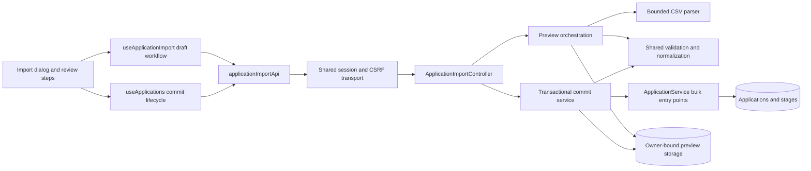

# CSV import architecture

Date: 2026-10-15. Status: revised after three independent reviews; all findings rechecked and resolved at the architecture level; user review pending. No application implementation is included. See the [categorized review report](../reviews/2026-10-15-csv-import-design-review.md).

## 1. Intent, scope, and decisions

Enable an authenticated account to add applications or deliberately update existing ones from CSV, with correction, exclusion, before/after review, and explicit acknowledgement of updates. Success means no hidden data loss, no cross-account access, an atomic batch, and a recoverable result after a lost response or server restart.

The supplied feature brief is the requirements baseline. This document supplies concrete contracts, ownership boundaries, failure behavior, storage, and verification. It is a design deliverable, not permission to start implementation. Existing ordinary CRUD, soft deletion, undo, pagination, session cookies, CSRF, and appearance behavior remain part of the compatibility contract.

Considered approaches:

| Approach | Trade-off | Decision |
| --- | --- | --- |
| Server parses and persists an immutable preview; synchronous atomic commit | Adds metadata storage and a short bounded transaction; enables server-captured versions and durable idempotency | Recommended for the bounded 500-row batch |
| Browser parses and issues ordinary saves per row | Simpler UI prototype; cannot guarantee atomicity, shared parsing, or reliable retry outcomes | Reject |
| Asynchronous import worker and job queue | Useful for much larger imports; needs scheduling, leases, cancellation and more status states | Defer; limits make it unnecessary initially |

### Verified repository constraints

- `src/App.tsx`: export is inline, has nine columns, no application ID, and ambiguous `name | state | date; ...` stages; `csvCell` already prefixes some formula-like cells.
- `src/hooks/useApplications.ts`: synchronous ref lock serializes writes by rejecting overlap; epoch protects reads, but mutation result/finally paths currently lack equivalent lifetime/session checks. This design must add those checks where import joins this lifecycle.
- `src/data/applicationApi.ts`: list loads all pages of 100 and deduplicates; editable payloads are whitelisted. `src/data/api.ts` supplies same-origin cookies, CSRF, a session guard, and no write replay; its error envelope currently discards row-specific details.
- `ApplicationController.java` invokes Bean Validation; `ApplicationService.java` implements additional rules privately in `apply`, trims company/role/location/stage names, flushes each ordinary write, and scopes lookups by owner/deleted state.
- `InternshipApplication.java` has parent `@Version` and orphan-removing stages. Imported stage replacement must use the same application mutation path so stage changes advance the parent version.
- Flyway currently ends at V3. PostgreSQL production disables app-start Flyway and uses `MigrationMain` plus an explicit grants script. Add V4 if still next at implementation time; never modify applied migrations.
- `VALIDATION.md` contains historical verification from other snapshots. Its claims do not substitute for inspecting the current code or new import checks.

## 2. Components and dependencies

Proposed frontend files:

| File | Responsibility |
| --- | --- |
| `src/domain/applicationImport.ts` | Discriminated import request/response types, field intents, actions, issues, receipt; pure review-state helpers; no transport or CSV parsing |
| `src/data/applicationImportApi.ts` | Typed preview multipart, commit JSON, status GET; use shared transport and session guard |
| `src/hooks/useApplicationImport.ts` | File/options in memory, draft revision, pending/ready/unknown states, preview invalidation and stale-response protection |
| `src/components/import/ApplicationImportDialog.tsx` and focused step components | Select, map, correct/review, confirm, results; semantic forms, focus, keyboard interaction |
| `src/domain/applicationCsv.ts` | Shared export/report CSV quoting and spreadsheet-risk reduction, export projection including structured stages; no formula unescaping on import |
| Existing `src/hooks/useApplications.ts` | Add `commitImport` and guarded post-success full-history reload to serialized mutation lifecycle |
| Existing `src/data/api.ts` | Bounded typed error details and multipart support via `FormData`; do not set multipart Content-Type manually; pre-dispatch and response session checks |
| Existing `src/App.tsx`, `src/styles.css`, `src/theme/tokens.css` | Import entry beside Export; compose dialog and existing semantic tokens |

Proposed backend package `com.campus.tracker.application.importing`: `ApplicationImportController`, `ImportDtos`, `ImportMultipartReader`, `CsvImportParser`, `ImportPreviewService`, `ImportCommitService`, `ImportCanonicalizer`, `ImportPreviewRepository`, import metadata entities, `ImportAdmissionService`, `ImportCleanupWorker`, `ImportProperties`. Add import-specific header/admission filters in configuration. Keep transport/multipart decoding, CSV parsing, and persistence separate. Only orchestration resolves authenticated targets. Only application services mutate applications.

In `com.campus.tracker.application`, extract `ApplicationRules` for explicit `Validator.validate(ApplicationRequest)` (including nested constraints) and existing date/stage business checks, plus one normalization function shared by ordinary and bulk saves. Expose owner-scoped bulk read/write methods on `ApplicationService`; importing code must not access package-private entity fields or duplicate `apply`. Bulk methods join the caller transaction with REQUIRED propagation, never REQUIRES_NEW. Exceptions escape to roll back the batch; do not catch and continue. Ordinary CRUD retains its current response and If-Match contract.

## 3. Source format, mapping, and field intents

Use Apache Commons CSV, pinning a released Java-17-compatible version at implementation (1.14.1 is the current release shown by the upstream repository when this design was researched). Configure comma delimiter, double-quote escaping, no comments, no surrounding-space trimming, no ignored empty lines, no lenient end-of-file, and UTF-8 decoding with malformed/unmappable input reported. Remove exactly one leading UTF-8 BOM. Support embedded newlines, escaped quotes, CRLF/LF, and quoted commas. Do not implement CSV splitting in JavaScript or hand-parse delimiters.

Apache sources: [repository and released dependency](https://github.com/apache/commons-csv), [CSV format configuration](https://commons.apache.org/proper/commons-csv/apidocs/org/apache/commons/csv/CSVFormat.html), [BOM handling](https://commons.apache.org/proper/commons-csv/apidocs/index.html). Documentation can show snapshots; do not select a SNAPSHOT dependency.

- First logical record is the header; require nonempty, unique headers after case/whitespace normalization used only for header matching. Values remain literal. Identify source columns by zero-based position, and data rows by one-based logical record number; physical line ranges are supplementary because cells can span lines.
- Reject structurally malformed CSV globally (including ragged records, blank records, missing headers, NUL, invalid UTF-8); no partially parsed committable preview. Exceeding any source limit rejects the whole file, including excess data in ignored columns. A final newline is allowed and is not an extra data row.
- Read iteratively, but do not use a parser row-limit option that returns only the first 500 records. Read the 501st record to reject overflow; consume through EOF on valid files. File-byte cap bounds parser allocation even before record-level column/field checks.
- Initial file-only preview returns headers and rows with suggested mappings, advisory matches, and mapping-required issues; it is not committable. User mappings are explicit and many-to-one destination mapping is rejected. Every source column must map to a supported field, the Application ID lookup control, legacy stage disclosure, or explicit Ignore.
- Allow editable company, role, location, status, appliedDate, deadline, followUpDate, notes, and structured stages. Reject reserved metadata headers/mappings (`ownerId`, version, timestamps, sample/deleted flags and aliases), even if marked Ignore; reject stage IDs inside stage JSON. Unknown ordinary columns may be explicitly ignored. No reflective entity binding.
- Dates default to strict `uuuu-MM-dd`; selectable alternatives are strict `MM/dd/uuuu` or `dd/MM/uuuu`, one explicit date policy per file. Show ISO normalized output. No locale guessing or timestamps; stage JSON always uses ISO dates and nullable dates. Empty optional API dates become `null`; never use UTC conversion for calendar dates.
- Preserve formula-like text and leading apostrophes exactly. Do not evaluate formulas or reverse spreadsheet-export safety prefixes. Ordinary save normalization still trims company/role/location/stage names; show this normalization in the before/after review so it is not hidden. Notes retain literal whitespace/newlines.

Each row carries an action and explicit field intents: `KEEP`, `SET(value)`, or `CLEAR`. Blank means exactly zero-length, not whitespace. Unmapped and blank update cells default to KEEP. A correction can explicitly SET an empty string only for string fields that permit it; CLEAR maps optional strings to `""` and optional dates to `null`. Required company/role/status cannot be cleared. Whitespace-only required text fails validation after the shared normalization. Never use a sentinel string such as `NULL` to clear.

For Add: blank/unmapped company and role are errors; status defaults to Saved; location/notes default to empty strings, dates to null, stages to empty. Explicit nonempty values use normal parsing and complete-record validation. For Update: overlay intents on the server-loaded snapshot; preserve every unmapped field and blank cell by default, then validate the entire merged record. Optional clearing is chosen per row/field in the correction UI. Included invalid rows prevent commit; Skip is an explicit user exclusion, with a retained reason and no application write. Invalid value cells can be excluded; file-level syntax, security and resource-limit failures cannot be bypassed by skipping a row.

### Targets and actions

- Nonblank Application ID is an owner-scoped active-record lookup control, never a field update. Invalid UUID, missing, deleted, or foreign IDs produce the same unavailable-target issue; never fall back to Add. Changing or removing this control is a deliberate correction requiring a new preview.
- With no ID: normalize company/role only for advisory matching, rank active owner-scoped candidates deterministically, and display at most five plus a `moreCandidates` flag. Suggestions do not choose Update. Default Add is shown explicitly with a possible-duplicate warning; Update requires explicit target selection. No globally unique company/role rule is introduced.
- Application ID controls the target if present; a manually selected conflicting target is an error. A row cannot choose Add while retaining a nonblank Application ID.
- Check all non-Skip selected targets for duplicates, including rows that would be Unchanged. Two rows targeting one record must be corrected or explicitly excluded; order is never used to resolve them.
- Add, Update, Skip, Unchanged are server-derived final actions. Unchanged means equality of normalized editable values, including ordered stage content and preserved identities; it writes nothing and does not advance updatedAt/version. It still captures and rechecks its target version at commit. Final Update count excludes Unchanged.

### Stages and export compatibility

`Interview stages JSON` is a strict array of objects with only `{name,date,state}`; maximum 30; names/states obey normal constraints. IDs are never accepted from CSV. For new records valid JSON can supply stages. For existing records the default mode is KEEP even when JSON is present; user must explicitly select REPLACE per row. REPLACE with `[]` explicitly clears all stages; blank JSON never clears. Replacements allocate server-generated IDs. A content-identical replacement is Unchanged and retains existing IDs. Diff includes ordered stages and warns when identities will be replaced. Preserving stages uses server-captured IDs internally, never uploaded IDs.

Legacy `Interview stages` text is not parsed into stages. Nonempty legacy data produces a blocking disclosure until the user acknowledges excluding it or supplies structured replacements; for an existing record the result is preserved stages unless replacement is explicitly chosen. An Add that excludes legacy data visibly has zero stages. When both columns exist, structured JSON is authoritative only under the above action/mode rules; the legacy column still gets an explicit disclosure. Do not claim lossless old-export import.

Update future exports to include Application ID and Interview stages JSON without stage IDs, retaining legacy text for readability if desired. Extract common quoting/protection for exports and downloaded row reports. Prefix dangerous formula-leading cells after inspecting leading whitespace/control characters; quote every cell and double quotes. Explain this reduces risk, is not universal spreadsheet safety, and may add a literal apostrophe on reimport. Do not promise lossless round trips even for formula-like text in new exports. Never insert uploaded HTML; use React text rendering.

## 4. HTTP contracts and immutable preview lifecycle

All routes authenticate through existing `/api/**` rules, use session cookies, require existing CSRF headers on POST, and return `Cache-Control: no-store`, including errors. Import URLs contain random UUIDs and are not authorization tokens. Responses contain bounded source values and row details only for the owner. Set no-store explicitly for import responses and early filter/limit failures.

### POST /api/application-imports/preview

`multipart/form-data`: one `file` CSV part and one optional `options` JSON part. Options contain protocol/schema version, mapping by column position, explicit date format, row overrides (action choice, target selection, corrected field values, clears, stage mode and legacy acknowledgements), and optional `supersedesPreviewId`. The latter is lifecycle control, never application data. Reject unexpected parts/properties, duplicate JSON keys, duplicate row overrides, out-of-range positions and IDs, and conflicting intents. Decode the JSON part using strict DTO binding; a Multipart String must not bypass unknown-property rejection.

Every submission includes the original file and the complete current options and creates a fresh immutable preview UUID. The browser retains the bounded File object in memory; there is no server raw-file upload session or mutable preview PATCH. UI revisions instantly invalidate confirmation; only the newest matching revision response can become reviewable. For a correction to an existing preview, supply `supersedesPreviewId`. Admission locks global quota, owner quota, then the owner-bound predecessor row; require PREVIEW state and matching original-file digest, credit its payload/reservation, create the successor, and mark the predecessor SUPERSEDED with its successor ID and erased payload in one transaction. Review contents are never edited. Failed successor creation leaves the predecessor intact. Independently opened imports still consume separate quota slots.

Supersession racing commit is decided by the predecessor row lock: if commit wins, return 409 `IMPORT_ALREADY_COMPLETED` and reconcile its receipt without creating a replacement; if supersession wins, commit of the old ID returns 410 `IMPORT_PREVIEW_SUPERSEDED` and performs no application writes. A busy predecessor returns a retryable `IMPORT_PREVIEW_BUSY`, not forced retirement. Never supersede a preview with an unresolved commit. Lost successor responses are reconciled by GET of the predecessor, which reports the successor ID; the UI can GET it without another POST. For an initial preview with no predecessor, a lost response has not modified applications and the user can explicitly create another preview after the request ends.

Return 201 and Location for a persisted preview, even if it has row-level validation issues. Response:

`{id, schemaVersion, policyVersion, createdAt, expiresAt, reviewDigest, committable, headers, rows, counts, issues}`.

Each row includes stable source row number, bounded original cells, final action, target summary, candidate summaries/truncation disclosure, intents, full normalized resulting editable record, before/after diffs, issues `{code,field,message}`, and warnings requiring acknowledgement. Target versions are server-captured canonical data; clients cannot supply them. Persist all review-affecting inputs, acknowledgements, actions, selected targets/versions, normalized before/after values, parser/schema/policy identifiers, counts and digest. Client-provided preview hashes or result objects are never authoritative. Canonicalization is deterministic with fixed property order and UTF-8 byte measurement; hash for integrity/reference, not authentication. A global/structure error returns an error envelope without a committable partial preview.

### POST /api/application-imports/{id}/commit

JSON only: `{reviewDigest, acknowledgement:{existingApplicationsToUpdate:N}}`. The path ID references the persisted preview; digest binds the displayed review. Require the count even when zero and compare it to the persisted exact Update count. Do not accept rows, mapping, versions, owners, or replacement payloads. Unknown properties fail. The UI labels the confirmation `Import X new applications and update N existing applications` and requires a separate checkbox `I understand that N existing applications will be updated` for N > 0. Any warning acknowledgements have already been frozen in the preview.

Return 200 with a durable receipt after the transaction completes. Repeated commits for a completed preview return the original receipt without writes, even after preview expiry or policy change, while receipt retention lasts. Owner lookup and request schema validation still apply; for completed previews the stored receipt takes precedence over changed acknowledgement values because no new work is performed.

### GET /api/application-imports/{id}

Return 200 `{status:"PREVIEW",preview:...}`, `{status:"COMPLETED",receipt:...}`, or `{status:"SUPERSEDED",successorId}`; GET never executes a commit. A completion receipt remains readable after payload expiry until its own 30-day retention ends. For terminal expiry determination, acquire the same owner-bound metadata write lock as commit and reread state: return a receipt if completed, otherwise 410 `IMPORT_PREVIEW_EXPIRED` only if the locked PREVIEW is expired. If that lock cannot be acquired within two seconds, return 202 `{status:"UNRESOLVED",code:"IMPORT_STATUS_UNRESOLVED"}` with Retry-After; this is a read outcome, not a persisted COMMITTING state. A normal nonterminal PREVIEW read can be unlocked but cannot establish that a previous commit has stopped. Superseded status exposes only an owner-scoped successor reference, never a replacement commit. Unknown/purged or foreign IDs return the same 404 `IMPORT_NOT_FOUND`; cleanup must obtain the row lock before deleting, so a missing row cannot hide a commit holding it.

Commit errors: 409 `IMPORT_TARGET_CHANGED` or `IMPORT_POLICY_CHANGED`, 410 expired, 422 `IMPORT_NOT_READY` / `IMPORT_ACK_REQUIRED` / `IMPORT_VALIDATION_FAILED`, 429 quota/rate saturation with Retry-After, 413 size limit, 400 malformed content/options, 401/403 session/CSRF. Commit row errors are owner-only, bounded, and report that zero applications were committed. Retryable database/connection failure is an uncertain outcome until GET reconciles it. Error messages do not echo CSV values. Shared `ApiError` gains optional typed bounded `details`; preserve existing callers' status/message/code handling.

## 5. Transaction, concurrency, and idempotency

Preview construction parses outside the application-write transaction. In a bounded read transaction load each selected active application by authenticated owner, materialize its stages, snapshot full values/version and derive final results. Validate every included complete record with the shared validator. Persist immutable canonical bytes in an admission-controlled metadata transaction. Snapshot consistency across different targets is not required: each target is independently versioned and all are rechecked at commit. No application writes occur during preview.

Commit executes in one Spring-proxied database transaction:

1. Lock the import metadata row by `(id,owner_id)` with PESSIMISTIC_WRITE. Concurrent commits for the same ID serialize. If completed, return stored receipt immediately. If superseded, return its terminal rejection without writes. Unknown IDs fail; never insert metadata from a commit path.
2. Check expiry using an injected UTC Clock, supported schema/policy versions, canonical integrity, committable flag, exact digest and acknowledgement count. Rolling deployments must reject unsupported preview policy/schema rather than silently reinterpret them; deploy compatible code together or drain previews first.
3. Load non-Skip target records with owner/deleted checks in deterministic UUID order and lock them for write. Compare server-captured parent versions including Unchanged targets; duplicate target check is repeated. Normal CRUD relies on `@Version`, so a competing edit committed before these locks is detected; an ordinary edit waiting behind import fails its own stale version check/flush after import. Do not use unscoped ID lookups.
4. Revalidate all full resulting records with the same rules/Bean Validator and commit-time Clock before any application writes. Verify stage preservation against the locked original/version; no guessing missing stage identities. Expiry is an admission condition checked after obtaining locks and before writes; transaction completion may occur after that instant.
5. Apply Add/Update through bulk application-service entry points; Skip/Unchanged write no application rows. Flush the whole batch so parent-version and constraint failures happen before building the receipt. There are no per-row transactions or partial success responses.
6. Persist receipt and transition metadata to COMPLETED in this same transaction, recording row outcome and generated application IDs/versions. All application changes, generated IDs and receipt commit together. Only serialize the success response after the transaction commits. Any exception rolls back everything, including intermediate flushes and receipt.

Receipt shape: `{importId,receiptId,completedAt,retainUntil,counts:{added,updated,skipped,unchanged},rows:[{rowNumber,action,applicationId?,resultVersion?}]}`. Do not include source cells, company names, stage content, before/after values or notes. This immutable receipt is the original completion result, not a snapshot of the current applications. It has no automatic batch undo; existing record-level undo is separate and versioned.

The guarantee is at most one successful batch per immutable preview ID within its lifecycle. After purge the ID is not found and can never initiate work. A different preview ID can create duplicates; advisory company/role matching is not deduplication or commit idempotency. File hashes do not prevent intentional reimports. Two different previews updating the same target cannot both commit from the same target version.

Lock ordering: commit locks its import row, then target UUID order. Admission/cleanup lock the global quota row, then owner quota row, then affected import rows. Commit never takes quota-row locks. Cleanup uses bounded batches and nonblocking/short-timeout import-row locking, skipping locked commits; no process-local lock supplies correctness. Map lock timeout/deadlock to an error requiring status reconciliation, never silent internal write retry.

## 6. Storage, retention, resource admission and deployment

Add a new migration (provisionally `V4__application_imports.sql`) with portable H2/PostgreSQL storage; UUIDs are generated by Java and no sequence grants are required. Use bounded canonical UTF-8 text, mapped as SQL TEXT/Java String with verified Hibernate validation on both databases, not Java serialization or vendor-dependent `@Lob` OIDs.

Tables:

- `application_imports`: UUID PK, owner UUID FK, state (PREVIEW/COMPLETED/SUPERSEDED), created/expires/completed/receipt-retain timestamps, schema/policy versions, original-file digest, review digest, nullable canonical payload and byte count, nullable minimal receipt text, receipt byte count, nullable successor UUID. CHECK state consistency: PREVIEW has payload and reservation, COMPLETED has receipt and no payload/reservation, SUPERSEDED has successor reference and neither payload nor receipt/reservation. Owner+created, state+expires, state+retain indexes. Immutable review fields never change; only lifecycle/retention fields do. Successor ID is an informational reference without a blocking FK so cleanup order cannot prevent purge.
- `application_import_quota_locks`: one migration-seeded GLOBAL row plus on-demand owner lock rows with unique scope key. Used to serialize storage admission across app instances; limits are calculated against persisted rows, not fallible in-memory counters. Owner-row creation uses insert-if-absent collision handling outside failed transactions. Cleanup retires unused owner lock rows only with the global lock, so two lock rows for one owner cannot race.

Payload TTL: 30 minutes from preview creation, never extended by reading. Refresh creates a new independently expiring ID and supersedes its predecessor. Cleanup every minute uses row locks before deleting expired PREVIEW or SUPERSEDED rows; it skips locked rows rather than treating an in-flight commit as expired. A PREVIEW reservation remains charged even after wall-clock expiry until locked deletion or terminal transition releases it. Superseded tombstones have no payload/reservation and are kept until their original expiry so lost successor responses can be recovered. After deletion their IDs return 404. Purge completed receipt rows 30 days after completion, not after preview creation. Erase completed preview payload immediately at successful commit; only the minimal receipt remains. Authentication and status never depend on retaining raw CSV.

Initial configurable defaults (server-side; browser prechecks are advisory):

| Limit | Default and enforcement |
| --- | --- |
| File | 2 MiB actual streamed bytes, not only Content-Length |
| Data records / source columns | 500 / 32, including ignored cells and excluded rows |
| Options / canonical preview | 256 KiB JSON part / 8 MiB deterministic UTF-8 serialized preview; abort before persistence if exceeded |
| Cell / header / JSON nesting | 64 KiB UTF-8 per source/corrected scalar, 256 bytes per header, maximum structured-stage/options depth 8; stricter ordinary field rules still apply |
| Multipart request / parts | 3 MiB aggregate including overhead, exactly file and optional options; per-part limits still apply |
| Upload and preview work | At most 1 per owner and 4 per process; 30-second end-to-end deadline starting at admission, 10-second CPU/parse budget within it, maximum 5-second blocking body/DB read; release capacity within 35 seconds even for stalled/dripping uploads |
| Request rates | Per owner preview 10/minute and commit 10/minute, status 60/minute; global preview/commit 60/minute each and status 600/minute; fail closed on limiter unavailable, 429 with Retry-After |
| Active preview storage | 5 previews and 40 MiB per owner; 100 previews and 800 MiB globally, count still-stored payloads even if expired until erased |
| Receipt storage | 2,000 completed receipts / 64 MiB per owner, 100,000 / 2 GiB globally; each receipt at most 128 KiB; reject admission rather than evict retained receipts |

Reserve a receipt slot and its 128 KiB maximum for each admitted preview when computing completion storage limits; an admitted preview cannot fail merely because other imports filled receipt space. A compact 500-row receipt is about 53 KiB with Add/version-zero rows and under 67 KiB with the longest action name and 19-digit versions; cap timestamp text at 32 ASCII characters and do not add unbounded messages to receipt rows. Verify these bounds against the final serializer. Keep the 128 KiB bound in configuration and admission accounting together. Canonical payload and receipt caps are measured during bounded serialization, not after allocating an unbounded output buffer.

Enforce admission under quota locks using one SQL aggregate statement with a single consistent database snapshot for owner and global totals. Every persisted PREVIEW contributes one full receipt reservation regardless of expiry; every COMPLETED contributes one receipt and actual receipt bytes; SUPERSEDED contributes only bounded tombstone metadata. Never sum independent READ COMMITTED queries that can miss a concurrent PREVIEW-to-COMPLETED transition. Supersession credits the locked predecessor in the same admission calculation. Commit converts its reservation to actual receipt without taking quota locks, and can only reduce reserved bytes. Only a row-locked deletion/transition releases a reservation. Bound uncommitted metadata (PREVIEW plus SUPERSEDED tombstones) to 300 rows per owner and 10,000 globally; completed metadata has the separate receipt count/byte caps above. Cleanup may prune expired rows before admission but must not evict retained receipts. Share durable request-rate accounting across instances using dedicated scoped keys, rather than repurposing auth policies. Process parse permits are an additional protection, not the global storage guarantee.

Servlet multipart processing can precede admission, including CSRF parameter fallback. Define this exact order: security context/session resolution; existing abuse protection; import header-only CSRF guard before CsrfFilter; CsrfFilter; authorization; import rate/owner/process admission; bounded multipart reader; controller/service. For import POSTs, the header-only guard rejects absent CSRF headers without invoking getParameter, getParts, or reading the body. Invalid present headers are rejected by CsrfFilter with existing token/masking semantics. Preserve other routes' behavior. Do not install an eager MultipartFilter. Exclude the preview route from Spring's standard servlet multipart resolver and do not call servlet getParts there.

Use an import-specific maintained streaming multipart decoder (Apache Commons FileUpload 2 core, released 2.0.0-M5 or later compatible release, pinned during implementation) over the admitted request InputStream, then pass bounded parts to orchestration. This avoids container-internal multipart reads bypassing the byte/deadline wrapper. Limit total parts to two, part headers to 8 KiB each, Content-Type/boundary lengths, aggregate body to 3 MiB, file to 2 MiB and options to 256 KiB, including ignored/unexpected data. For this initial preview route, support fixed-length HTTP/1.1 bodies at the application connector: before acquiring permits require a valid Content-Length (411 if absent, 413 if over limit), reject any Transfer-Encoding or non-identity Content-Encoding (400), and reject unsupported connector transport. This prevents chunk extensions/trailers or transfer decompression from keeping one servlet read busy while underlying socket activity continues. Browser FormData built from the bounded File and JSON Blob must work without attempting to set forbidden browser headers; verify the actual browser/Vite/bundled paths. An HTTP/2-facing proxy must buffer with bounded bytes and an absolute upload deadline and forward fixed-length HTTP/1.1, or this route is unsupported through it. Direct HTTP/2 upload support requires a separately verified absolute cancellation design.

The reader checks a monotonic 30-second deadline before and after each fixed-length underlying read and between parsing/validation/persistence operations; apply query/lock timeouts within that deadline. Configure the supported Tomcat connector for at most five seconds per blocking upload read (`disableUploadTimeout=false`, bounded `connectionUploadTimeout`); the resulting maximum release bound is 35 seconds, not an assertion that a Java timer can interrupt any blocking read. On deadline/timeout, stop reads, close request resources, prevent continued body swallowing, return a bounded error if possible, delete temporary parts, and release permits in finally. Do not merely cancel a Future while a read continues. Test stalled and continuously dripping fixed-length bodies on the actual embedded server, and prove chunked bodies (including dripping chunk headers/extensions/trailers), unsupported encodings, and absent-length bodies are rejected before admission without draining them.

Spool file content only under the admitted reader to private OS-generated temporary paths, outside the web root, with restrictive access, random names, disk quota and startup cleanup of abandoned parts. Never use uploaded filenames as paths, parse compressed archives, accept URLs, or log request bodies/row DTOs. Options/header buffers are separately bounded. Reverse-proxy limits are defense in depth, not the sole bound. Upstream details: [FileUpload streaming API](https://commons.apache.org/proper/commons-fileupload/streaming.html), [release notes](https://commons.apache.org/proper/commons-fileupload/changes.html), [Tomcat upload timeouts](https://tomcat.apache.org/tomcat-10.1-doc/config/http.html). Reject deployment configurations that cannot pass the embedded-server elapsed-bound and no-pre-admission-body-read tests.

No-store, content-type checks and import-specific multipart/JSON/limit exception translation must cover failures outside controllers. Logs contain operation ID, safe owner reference, counts, duration and error code only; no cells, filenames, target field values, option JSON, or canonical payload. Disable generated sensitive `toString` output for DTOs/entities and avoid request/response body logging. Database backups need the same access restrictions as application data; expiry is logical removal, not a promise of immediate backup erasure.

Grant the runtime only SELECT/INSERT/UPDATE/DELETE on the new import and quota tables needed for admission, transition and cleanup. Update `deploy/postgres/runtime-grants.sql`, `verify-runtime.sql`, `PostgresPrivilegesIT`, and database security documentation; preserve prohibitions on application/user deletion, schema changes, role switching and Flyway history access. Migration job runs before app startup. Verify fresh and existing V3 upgrades, repeat migration/grants, TEXT mapping and actual HTTP preview/commit/status/cleanup under campus_runtime. Do not infer PostgreSQL compatibility from H2.

## 7. Frontend states, reconciliation, and accessibility

Wizard states: select -> mapping -> review/correct -> confirm -> submitting -> completed; orthogonal preview-pending, validation-failed, commit-unknown and committed-refresh-failed states. Mapping/review use source row numbers and a per-row form with an explicit Exclude action; do not place 500 editable rows in an inaccessible custom grid. Paginate review with total/error counts and next-error navigation; included rows across all pages remain visible in final totals. Show source values, normalized after values, preserved values, warnings and stage replacement explicitly. No silent truncation: long text can use expandable controls; candidate list limits have visible disclosure.

Every draft edit increments a revision, clears confirmability and acknowledgement, and disables commit until a new preview is returned for that exact revision. Capture both sessionGuard and hook lifetime/revision for preview and status operations. In `useApplications`, capture session/lifetime before commit and check before network dispatch (including after awaited CSRF), before state writes, refresh and finally state changes. Throw a distinguishable stale-session result rather than dispatching an old account's request with a newer account cookie. Guard every page request and stop pagination immediately when the guard becomes false. Account switch clears file, rows, previews, candidate data, receipts and pending UI. Aborting a request only cancels waiting; it cannot promise a server commit was cancelled.

`commitImport` shares the same synchronous mutation ref lock as save/delete/restore and requires a current ready workspace. While submitting, disable editing/duplicate submit and hold an unresolved-import lock if the outcome is unknown. Preview requests do not mutate applications but cannot supersede the preview currently being committed. Do not let ordinary conflict-refresh logic hide import-specific conflicts or reset the review automatically.

After confirmed commit, store/display receipt independently, then call the existing full paginated list loader under the same current-session guard. Successful commit plus failed refresh is `Import completed; refresh your workspace` with a read-only Retry refresh action. Never change it to import failed or resubmit. Keep server-confirmed application state; no optimistic per-row merge. No automatic import undo or receipt-to-application reconstruction.

Any failure after commit dispatch without an authoritative import rejection or a runtime-validated receipt enters `commit-unknown`: network/5xx/timeout, failed/truncated body reads, JSON decode errors, wrong content type or invalid success shape all qualify. Track whether dispatch occurred so local pre-dispatch validation failures remain ordinary errors. Retain the preview ID and perform only status GET reconciliation (bounded backoff within the current session). Validate status/receipt envelopes at runtime rather than trusting TypeScript casts; malformed GET responses leave the outcome unresolved. COMPLETED resolves to the original receipt. PREVIEW and 202 UNRESOLVED mean `completion not yet confirmed`; neither is a reason to replay POST or start a replacement import. Offer explicit Check status. After the outstanding request has ended, an explicit user `Retry this reviewed import` may send commit for the same ID, digest and acknowledgement; the server lock/receipt makes this safe even if the first transaction is still finishing. A fresh preview is only offered once a definite validation/conflict rejection is known, or the user explicitly acknowledges the duplicate risk after receipt retention has expired. 401/403 requires authentication/CSRF recovery and status lookup before another write. A superseded response follows its owner-bound successor for review/status, never automatic commit.

For restart recovery retain only `{ownerId,previewId}` in per-tab sessionStorage when commit begins, with an expiry hint; no source data or receipt content. On authenticated remount for the same owner, restore the unresolved-write lock before enabling mutations and reconcile by status GET. The pointer is untrusted and never grants access. Clear it on confirmed completion, explicit logout, account switch, or terminal 404/410 from a validated owner-scoped response whose expiry decision used the metadata lock. Never clear it from local time, 202 UNRESOLVED, an unlocked PREVIEW read or an unvalidated error body. Logout does not cancel server work. A user who logs out while outcome is uncertain sees a warning with a copyable import reference before choosing logout; the original reference remains usable by its owner while retained. Do not persist application data as a localStorage fallback.

Accessibility: labelled file/mapping controls and row action radios; semantic table for read-only diffs with captions/headers; error summary links focus the affected control using `aria-describedby`/`aria-invalid`; focus first invalid field or summary after preview; modal focus containment, Escape/close when safe, return focus to Import button. Explicit close during submit explains work may continue and preserves the recovery pointer. `aria-live="polite"`/role=status announces parsing, validation counts, submitting, reconciliation and refresh outcomes, with no false percent progress. Confirmation checkbox includes the exact update count. All actions work with Tab/Shift+Tab/Enter/Space, no drag-only or color-only meaning. Reuse semantic theme tokens and verify light/dark/contrast and narrow screens.

## 8. Verification and implementation handoff

Required test design before implementation:

| Area | Evidence required |
| --- | --- |
| Parser | Quoted commas/quotes/newlines, CRLF/LF/BOM, malformed UTF-8/quotes, blank/ragged/header-only files, exact and overflow byte/row/column/cell limits including ignored columns, duplicate headers, literal formula/apostrophe text |
| Semantics | Defaults, unmapped/blank preservation, explicit clears, normalized complete-record validation, unavailable IDs, explicit candidates, duplicate targets including Unchanged, Skip, equality and ordered stages, legacy acknowledgement, strict stage JSON and forbidden fields |
| Transaction | One invalid/concurrent/deleted target rolls back every row; unchanged versions rechecked; competing ordinary stage edit; duplicate same-ID and different-ID commits; parent versions; rollback after flush; durable original receipt; policy/schema incompatibility |
| Security/resource | Cross-account preview/commit/status and nondisclosing target errors; CSRF including multipart; real-container proof that missing/invalid headers never read/spool body; slow/stalled/dripping upload capacity recovery within 35 seconds; unknown properties; temp cleanup; per-user/global admission and tombstone limits; safe logs/no-store |
| Recovery | Lost/truncated/invalid success responses with GET, duplicate in-flight commit, restart before/after commit, status during commit crossing expiry, reservation held across expiry, consistent quota aggregate during completion, maximum 500-row receipts, 30-day purge, 404 never starts work |
| Frontend | More than five correction cycles with supersession, lost successor response, supersession/commit race, revision and acknowledgement invalidation, stale responses and account switch during CSRF/commit/pagination, unresolved lock restored on remount, no automatic POST, completed versus refresh-failed, all-pages refresh |
| Accessibility | Actual keyboard flow, focus/error links, screen-reader progress/counts, exclusion/correction across pages, large text expansion, light/dark and narrow layout |
| PostgreSQL | Fresh/V3 upgrade and idempotent grants, real restricted-role import/cleanup, concurrent commits/admission, TEXT mapping, denied extra privileges; H2 parity |

Pure frontend functions/adapters fit current Node test imports with explicit `.ts` extensions. Existing tests have no React DOM/browser runner; add focused browser/component infrastructure during implementation or document and execute manual browser/a11y checks instead of claiming Node tests cover focus. Backend tests use isolated in-memory H2; extend real PostgreSQL integration profile separately. Extend the HTTP smoke runner with multipart import, CSRF, duplicate commit, restart and recovery using synthetic accounts and temporary databases only.

After implementation run from root `npm test`, `npm run build`; from backend `.\mvnw.cmd test`, `.\mvnw.cmd -Pwith-ui clean package` after frontend build, and `.\mvnw.cmd -Ppostgres-it verify` (Docker or the documented isolated PostgreSQL binary mode). From root run `python tests/http_smoke.py` and/or the maintained Node smoke runner after packaging. Verify all updated commands against current scripts. Documentation-only design work does not require application suites and must not report these proposed tests as passed.

Implementation order: shared application rules and typed import contract; migration/grants and admission; bounded parser/preview; atomic commit/status/cleanup; adapter and guarded hook integration; accessible wizard and safe exports; full verification. This is sequencing guidance, not a detailed implementation plan. User review of the design is the next handoff before implementation planning.

## 9. Implementation adjustments and verification boundaries

The user approved this architecture and same-session implementation on October 15, 2026. Repository inspection justified these small implementation adjustments; the earlier requirements remain applicable:

- Multipart parts are bounded in memory rather than spooled to private temporary files. At most four admitted previews hold a 2 MiB file and 256 KiB options each. No upload files or second unbounded copy need cleanup; the permit is released in `finally`. Parser/canonicalization allocations retain their independent limits.
- Target snapshots use bounded owner-scoped ID queries, and advisory candidates use exact trimmed case-insensitive company/role equality with at most six results per distinct pair (five shown plus a disclosure). The backend does not load an account's full history to construct candidates. The frontend still reloads all history pages after completion.
- Input/work configuration can only tighten protocol hard ceilings. Storage/rate quotas remain configurable positive values. Commit work has a 30-second outer transaction bound, 5-second import JDBC statement bounds and 2-second application target-lock query bounds.
- The actual retained receipt ceiling and reservation are 128 KiB, including 500-row batches, as resolved by the design review. Terminal expiry and cleanup retain row-lock coordination with active commits; elapsed wall-clock TTL alone releases nothing.
- Verification uses disposable PostgreSQL 18.6 clusters because those binaries are available. The current Flyway version warns that its tested support ends at PostgreSQL 17; successful PostgreSQL 18 checks do not establish PostgreSQL 17 coverage. No user database is migrated.
- React/JSDOM checks exercise component state, error focus and session lifecycle. Actual browser visual layout, native modal Tab containment and screen-reader checks are blocked because neither an in-app nor Chrome browser is available in this session. Native Node FormData and real HTTP/container checks are recorded separately; they are not browser evidence. See `VALIDATION.md` for executed commands and final results.
